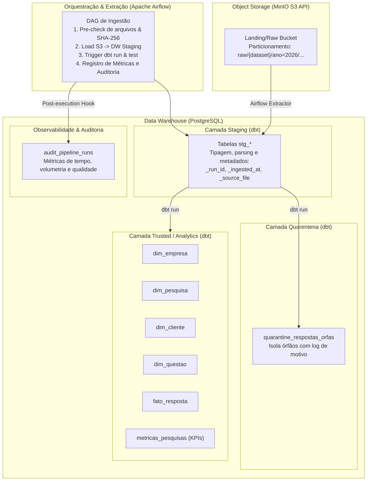

# Briefing Executivo e Técnico — Ponderada de Ingestão de Dados Raw (Airflow + dbt)

> **Objetivo deste documento:** Servir como especificação completa, clara e objetiva para que um agente de IA projete, execute de ponta a ponta e documente a Ponderada de Ingestão de Dados Raw com excelência máxima (nota 10/10), utilizando **Apache Airflow**, **dbt**, **MinIO (Object Storage S3)** e **PostgreSQL (Data Warehouse)** 100% reproduzível via Docker.

---

## 1. O Enunciado Oficial e Comunicações do Professor

### 1.1 Anúncio no Slack — Prof. Afonso Brandão

> *"Bom dia!! Atenção para a ponderada da semana.*  
> *Cada aluno deverá pensar no módulo de ingestão de forma individual, mas para o projeto, e criar um MR no repositório do seu projeto. A ideia aqui é ver formas diferentes de tratar, organizar e criar uma arquitetura de ingestão de dados raw. Conversem entre si no grupo, uma arquitetura de ingestão raw não pode ser igual à do colega do mesmo grupo. O envio deverá ser do link do MR (que não precisa ser aceito) e depois da correção vocês poderão decidir a melhor estratégia para o artefato.*  
> *Leia com atenção, a entrega é individual, em uma branch criada por você, mas dentro do projeto!!*  
> *Vocês têm até sexta 23h59 para finalizar a entrega e arrastar o cartão.*  
> *Pensem em formas diferentes de lidar com sistemas de arquitetura distribuída."*

### 1.2 O Desafio da Ponderada

> *Neste projeto, o aluno deverá projetar, implementar e documentar um pipeline robusto de ingestão de dados que transfira dados brutos armazenados em um object storage (ex: AWS S3, Azure Blob, GCS) para tabelas estruturadas em um data warehouse (ex: Snowflake, BigQuery, Redshift, Databricks). O pipeline deve ser eficiente, escalável e confiável, garantindo a integridade e a qualidade dos dados durante o processo.*

---

## 2. Critérios de Avaliação Oficiais

1. **Compreensão dos Dados e do Fluxo de Ingestão:**  
   Demonstrar domínio sobre a estrutura dos dados no object storage, os formatos utilizados (CSV com `;`, UTF-8-BOM), e como esses dados serão transformados e carregados no data warehouse. Justificar as escolhas de modelagem das tabelas de destino (staging, quarentena, dimensional: fatos/dimensões).

2. **Seleção de Métricas e Controles de Qualidade:**  
   Definir e implementar métricas e controles relevantes para monitorar a saúde do pipeline: volume de dados ingeridos, tempo de execução por etapa, taxa de sucesso/falha, duplicidades, nulos e consistência de schemas. Integrar esses controles ao pipeline ou documentar sua telemetria.

3. **Eficiência na Integração e Transformação de Dados:**  
   Implementar as etapas de extração, transformação e carga (ELT) de forma otimizada, considerando particionamento, idempotência (execuções consecutivas não duplicam registros), tratamento de erros, reprocessamento e escalabilidade. Justificar as ferramentas adotadas (Airflow, dbt, MinIO, PostgreSQL).

4. **Design e Documentação do Pipeline:**  
   Apresentar um design claro e organizado do pipeline, incluindo diagrama de fluxo da arquitetura (Mermaid), especificação de componentes, dependências e triggers. Documentação intuitiva que permita a qualquer avaliador subir e testar a solução com um único comando.

5. **Análise e Interpretação dos Resultados da Ingestão:**  
   Analisar o desempenho do pipeline pós-execução, destacando volumetria processada, gargalos, padrões de dados inconsistentes/órfãos tratados e impacto das otimizações aplicadas. Extrair insights de qualidade sobre os dados do parceiro.

---

## 3. Contexto do Projeto e Dados do Parceiro (Sindusfarma)

O projeto pertence ao **Grupo 2 — Central de Pesquisas do Sindusfarma**.  
O repositório já possui inventário analítico em `docs/inventario_das_bases.md` e contratos formais em `contracts/`.

### As 6 Fontes de Dados Brutas:
1. `empresas.csv` (779 registros): Cadastro mestre das indústrias farmacêuticas (`ID`, `Nome Fantasia`, `% de mercado`, `Nacionalidade`, `Associado`, etc.).
2. `clientes.csv` (5.430 registros): Contatos das empresas (`id_cliente`, `id_empresa`, `cargo`, `departamento`, `e-mail`).
3. `pesquisas.csv` (366 registros): Metadados das pesquisas setoriais (`id`, `titulo`, `status`, datas de solicitação, aprovação, divulgação e entrega).
4. `questoes.csv` (231 registros): Perguntas que compõem cada pesquisa (`id_pergunta`, `pesquisa_id`, `enunciado`, `tipo`, `alternativas`).
5. `respondentes.csv` (18.735 registros): Registros de participação (`id_pesq`, `id_empresa`, `id_cliente`, timestamps de início e término).
6. `respostas.csv` (20.607 registros): Transações analíticas das respostas dadas (`id_resposta`, `pesquisa_id`, `id_pergunta`, `id_empresa`, `valor`, `alternativa`).

### Particularidades Críticas já Documentadas no Projeto:
* **Integridade Referencial e Órfãos Reais:**
  * Há 4 `pesquisa_id` (`424`, `1116`, `1139`, `1147`) presentes em `questoes.csv` (43 linhas) e `respostas.csv` (3.592 linhas) que não existem em `pesquisas.csv`.
  * Há 1 `id_pesq` (`304`) em `respondentes.csv` (55 linhas) sem correspondência em `pesquisas.csv`.
  * `clientes.id_cliente` possui o valor sentinela `'s/i'` que precisa ser preservado sem quebrar conversões numéricas.
* **Política de Governança Definida:**
  * **Não dar Hard Fail** por conta de pesquisas legadas ausentes. Os dados íntegros devem avançar para a camada `trusted` e os registros órfãos devem ser isolados em uma tabela de **Quarentena** com metadados de rejeição (`rejection_reason`), mantendo a rastreabilidade.

---

## 4. Arquitetura Definida para a Solução

A solução adotada será uma **Stack ELT Moderna 100% Reproduzível via Docker**:

* **Object Storage:** **MinIO** local configurado com bucket S3 e credenciais padrão, simulando AWS S3 sem custos de nuvem.
* **Data Warehouse:** **PostgreSQL** com schemas separados (`raw_staging`, `quarantine`, `trusted_dw`, `audit`).
* **Orquestrador:** **Apache Airflow** gerenciando dependências, pre-checks de integridade, injeção de `run_id` e execução do dbt.
* **Transformação & Qualidade:** **dbt-core** com testes de esquema (`unique`, `not_null`, `relationships`), modelos incrementais/idempotentes e geração de documentação de linhagem.
* **Infraestrutura:** `docker-compose.yml` contendo os serviços coordenados para subir com `docker compose up -d`.

---

## 5. Escopo e Entregáveis Esperados do Modelo Executor

O modelo executor deve entregar uma solução profissional, robusta e pronta para produção:

1. **Estrutura de Código Modular:**
   * Diretório dedicado na branch (ex: `pipeline_ingestao_andre/` ou integrado na raiz).
   * `docker-compose.yml` funcional subindo MinIO, PostgreSQL e Airflow com dbt instalado.
   * Script de seed/carga inicial dos 6 arquivos CSV de exemplo para o MinIO.
   * DAGs do Airflow estruturadas com boas práticas (sensores/tasks atômicas, tratamento de falhas, retries, logs informativos).
   * Projeto dbt configurado (`dbt_project.yml`, `profiles.yml`, `sources.yml`, modelos staging, quarentena e trusted/analytics).
   * Testes dbt implementados para validar os contratos de dados.

2. **Idempotência e Tolerância a Falhas:**
   * Garantir que reexecuções da DAG não dupliquem registros no Data Warehouse.
   * Roteamento automático de inconsistências para quarentena sem travar o pipeline analítico.

3. **Métricas e Observabilidade:**
   * Coleta e gravação de métricas a cada execução:
     * Duração total e por task.
     * Linhas lidas do Object Storage vs. linhas gravadas em staging vs. linhas promovidas vs. quarentenadas.
     * Taxa de sucesso dos testes de qualidade dbt.

4. **Documentação Completa para o Merge Request (MR):**
   * Documento Markdown com descrição técnica profunda (atendendo individualmente a cada um dos 5 critérios de avaliação do Afonso).
   * Diagrama da arquitetura em Mermaid.
   * Instruções passo a passo de como rodar localmente (`docker compose up`, como acessar o Airflow, credenciais padrão).
   * Análise dos resultados da execução com tabelas de volumetria e tempos obtidos.
