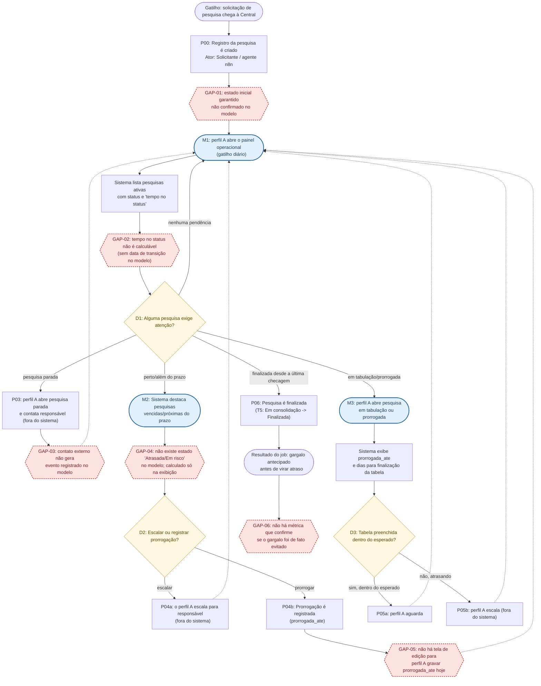

# Fluxo de Integração do Projeto

## Sumário

- [1. Expectativas derivadas do JTBD do perfil operacional principal](#1-expectativas-derivadas-do-jtbd-do-perfil-operacional-principal)
    - [1.1 Perfil operacional principal — [nome]](#11-perfil-operacional-principal--nome)
    - [1.2 Perfil secundário — [nome]](#12-perfil-secundário--nome)
    - [1.3 Momentos de verificação selecionados](#13-momentos-de-verificação-selecionados)
    - [1.4 Diferenciação entre fatos, inferências e hipóteses](#14-diferenciação-entre-fatos-inferências-e-hipóteses)
- [2. Fluxo proposto e correspondência com o modelo de dados](#2-fluxo-proposto-e-correspondência-com-o-modelo-de-dados)
    - [2.1 Fluxo do perfil principal (ponta a ponta)](#21-fluxo-do-perfil-principal-ponta-a-ponta)
    - [2.2 Fluxo do perfil secundário (trecho da divergência)](#22-fluxo-do-perfil-secundário-trecho-da-divergência)
    - [2.3 Transições do modelo não produzidas por nenhum passo do fluxo](#23-transições-do-modelo-não-produzidas-por-nenhum-passo-do-fluxo)
- [3. Confronto e decisões](#3-confronto-e-decisões)
    - [3.1 Acomodação](#31-acomodação)
    - [3.2 Ruptura deliberada](#32-ruptura-deliberada)
    - [3.3 Lacuna no modelo](#33-lacuna-no-modelo)
- [4. Representação visual](#4-representação-visual)
    - [4.1 Legenda / chave de leitura da notação adotada](#41-legenda--chave-de-leitura-da-notação-adotada)
    - [4.2 Premissas assumidas](#42-premissas-assumidas)
    - [4.3 Arquivo do diagrama](#43-arquivo-do-diagrama)

## Objetivo

Este documento registra o fluxo de interação anotado do projeto Governança e Integração de Dados da Central de Pesquisas (Sindusfarma), explicitando os pontos de divergência entre o modelo mental dos usuários e o ciclo de vida do dado modelado pelo grupo. Para cada divergência identificada, o documento deve registrar uma decisão de projeto fundamentada e o suporte que ela exige.

### 1.1 Perfil operacional principal e job retomado

O perfil operacional principal é o perfil A - Equipe interna da Central de Pesquisas (Fabio Moreira, Felipe Rojas, Reinaldo Nobrega, Lucas Andrade), retomado do JTBD produzido pelo grupo. É o único perfil que tem como "job" operar o ciclo de vida da pesquisa no dia a dia; os perfis B e C consultam ou validam em cadência mais espaçada, o que os torna adequados para etapas posteriores do fluxo.

| Elemento do JTBD | Conteúdo retomado |
|---|---|
| Situação | "Estou acompanhando dezenas de pesquisas simultâneas espalhadas entre Excel, SurveyMonkey, Trello e o repositório do site." |
| Motivação (o "quero") | "Visualizar em um único painel o status e o tempo decorrido de cada etapa do ciclo (solicitação -> planejamento -> execução -> resultado)." |
| Resultado desejado (o "para que") | "Antecipar gargalos de tabulação e prorrogação antes que virem atraso de entrega, sem gastar horas consolidando planilhas manualmente." |
| Restrição herdada do escopo do projeto | O painel deve refletir dados originários das ferramentas atuais (Excel/SurveyMonkey/Trello/site); o projeto integra e governa essas fontes, não as substitui. |

### 1.2 Critérios de sucesso

Critérios de sucesso extraídos do JTBD e dos critérios funcionais do perfil A, cada um ligado à evidência ou ao requisito que o sustenta.

| ID | Critério de sucesso | Tipo | Evidência / requisito de origem |
|---|---|---|---|
| CS-01 | O usuário enxerga, em um único lugar, o status atual de qualquer pesquisa ativa, sem abrir Excel, Trello ou SurveyMonkey separadamente. | Fato | RF03: critério de aceite "o dashboard exibe... status em tempo real"; PN01 |
| CS-02 | O usuário identifica em qual etapa do ciclo uma pesquisa está e há quanto tempo ela está nessa etapa. | Fato / Inferência | RF01: "status correspondente às etapas... histórico de mudança de status com data/hora"; PN01, PN04 |
| CS-03 | O usuário distingue pesquisas dentro do prazo de pesquisas atrasadas ou em risco de atraso, antes de chegar a data limite. | Fato | PN05: "Quais pesquisas estão atrasadas ou em risco de atraso?" |
| CS-04 | O usuário vê quando uma pesquisa foi prorrogada e até quando, sem ter de perguntar ao responsável da planilha. | Fato | Critério funcional do perfil A ("% de pesquisas prorrogadas") |
| CS-05 | O tempo de consolidação dos dados em uma tabela e o ciclo total exibidos vêm de um cálculo automático consistente, não de uma estimativa feita na hora pelo usuário. | Fato | RF03: "dados... atualizados automaticamente a partir do banco central, sem intervenção manual"; KPI-04 (docs/specs/spec-analise-quantitativa-dados.md) |

### 1.3 Momentos de verificação selecionados

Três momentos em que o perfil A confere se o "job" está avançando dentro do intervalo exigido, cobrindo início, avanço e conclusão do acompanhamento diário.

*M1: Abertura do painel no início do expediente* (início)

- *Critérios relacionados:* CS-01, CS-02.
- *Expectativa:* Quando o usuário abre o painel operacional pela manhã, ele espera ver, para cada pesquisa ativa, o status atual e há quanto tempo ela está nesse status, para decidir em quais pesquisas agir primeiro.
- *Condição de sucesso:* para uma amostra de pesquisas conferidas manualmente no Trello/Excel no mesmo dia, o painel mostra o mesmo status, e o campo "há quanto tempo" corresponde à data em que o status mudou pela última vez.
- *Condição de falha:* o painel mostra um status desatualizado em relação à fonte original, ou o "há quanto tempo" é calculado a partir de data_solicitacao (data fixa de abertura da pesquisa) em vez da data da última mudança de status.
- *Evidência/regra objetiva:* comparação amostral painel x fonte original, registrada como teste de usuário, sendo o mesmo formato do critério de aceite do RF01.
- *Situação frente ao modelo de dados atual:* pesquisas.csv só guarda um valor de status por pesquisa (snapshot atual) e um conjunto de datas de marco absolutas (data_solicitacao, data_aprov, data_divulgacao, data_limite, prorrogada_ate, data_entrega), não existe, na fonte atual, uma data de transição de status. O RF01 já prevê essa exigência, mas o modelo hoje não a comporta, passando a ser um requisito de arquitetura futura, não é algo que a ingestão do CSV atual resolve. Sem essa tabela, "há quanto tempo está nesse status" não pode ser calculado com fidelidade; só é possível fazer uma aproximação com data_solicitacao, que mede o tempo desde a abertura, não tempo no status atual.

*M2: Verificação de pesquisas em risco de atraso* (avanço)

- *Critérios relacionados:* CS-03.
- *Expectativa:* Durante o acompanhamento do dia, o usuário espera que pesquisas próximas da data limite ou já vencidas, e ainda não finalizadas, apareçam destacadas sem que ele precise calcular isso manualmente.
- *Condição de sucesso:* toda pesquisa com data_limite vencida e status diferente do estado final aparece marcada como atrasada; as pesquisas dentro de uma janela de dias antes do vencimento aparecem marcadas como "em risco".
- *Condição de falha:* uma pesquisa vencida e não finalizada não aparece destacada, ou uma pesquisa já finalizada aparece como atrasada.
- *Evidência/regra objetiva:* regra já registrada em PN05.
- *Situação frente ao modelo de dados atual:* a regra de negócio já escrita usa nomes que não correspondem aos nomes reais confirmados no inventário, o campo real é pesquisas.data_limite, não data_prevista_entrega; e o valor real de status para pesquisa concluída é "Finalizada", não "concluída". Isso é um desalinhamento de nomenclatura entre o requisito já escrito e o schema real validado, que precisa ser corrigido antes de a regra ser implementada. Além disso, a largura da "janela de risco" não está definida em nenhum documento, podendo ser uma hipótese ou um ponto a ser validado com o parceiro.

*M3: Conferência de uma pesquisa prorrogada ou em tabulação* (conclusão)

- *Critérios relacionados:* CS-04, CS-05.
- *Expectativa:* Ao investigar por que uma pesquisa específica está demorando, o usuário espera ver se ela foi prorrogada e até quando foi, e quanto tempo ela levou isoladamente na etapa de consolidação dos dados em uma tabela, para separar atraso de coleta de atraso de tabulação.
- *Condição de sucesso:* o painel mostra até quando foi prorrogada e indica "não prorrogada" quando não tiver nenhuma data estipulada; o tempo de consolidação dos dados em uma tabela exibido bate com os dias para preenchimento da tabela.
- *Condição de falha:* a ausência de uma campo que indica até quando foi prorrogado acabda sendo exibida como erro/dado faltante em vez de "não prorrogada"; ou o tempo de consolidação dos dados em uma tabela mostrado mistura etapas.
- *Evidência/regra objetiva:* completude documentada em docs/inventario_das_bases.md, prorrogada_ate presente em 68 pesquisas de 366 totais; dias para tabulação presente em 330 de 366 totais.
- *Situação frente ao modelo de dados atual:* o dado existe e a semântica condicional já está documentada. O ponto em aberto é de negócio, não de schema: hoje não há confirmação do parceiro sobre se o campo vazio sempre significa "não houve prorrogação" ou se pode representar um registro simplesmente não preenchido.

### 1.4 Diferenciação entre fatos, inferências e hipóteses

| Tipo | Uso nesta etapa |
|---|---|
| *Fato* | Conteúdo já registrado e aprovado pelo grupo ou medido diretamente do dado real. |
| *Inferência* | Conclusão do grupo a partir de fatos combinados. |
| *Hipótese* | Afirmação ainda não confirmada pelo parceiro. Precisando ainda de uma validação direta com os representates da Sindusfarma antes de virarem regra de negócio definitiva. |

## 2. Fluxo desenhado e mapeado contra o modelo de dados

### 2.1 Modelo de estados vigente

| ID | Estado real observado (pesquisas.status) | Macro-etapa RF01 correspondente | Tipo |
| --- | --- | --- | --- |
| S1 | Em análise da Central de Pesquisas | Solicitação / triagem | Inferência |
| S2 | Em análise da Área Técnica | Planejamento / validação técnica | Inferência |
| S3 | Aguardando data predefinida | Planejamento | Inferência |
| S4 | Em desenvolvimento | Planejamento | Inferência |
| S5 | Em andamento | Execução | Inferência |
| S6 | Em desenvolvimento da tabela | Resultado | Inferência |
| S7 | Finalizada | Resultado | Fato |

Transições propostas (reconstruídas a partir do processo textual, pois ainda não tem um diagrama existente):

| ID | Transição | Evento que a produz |
| --- | --- | --- |
| T1 | S1 -> S2 | Central aprova triagem e encaminha para validação técnica |
| T2 | S2 -> S3 ou S2 -> S4 | Área técnica aprova o questionário |
| T3 | S3/S4 -> S5 | Lançamento e divulgação |
| T4 | S5 -> S6 | Encerramento da coleta |
| T5 | S6 -> S7 | Preenchimento da tabela concluída e resultado publicado |

### 2.2 Fluxo principal (perfil A do gatilho ao resultado do job)

**Legenda do Fluxo principal**
| Elemento visual | Significado |
| --- | --- |
| (["texto"]) caixa de texto azul | Ponto de verificação do usuário |
| ["texto"] retângulo | Ação do usuário ou resposta do sistema |
| {"texto"} losango amarelo | Decisão |
| {{"texto"}} hexágono vermelho tracejado | GAP: passo ou transição sem correspondência no modelo |
| Seta sólida (-->) | Sequência direta |
| Seta tracejada (-.->) | Retorno/loop para um passo anterior |

### 2.3 Tabela de rastreamento passo -> transição do modelo

| Passo | Ator | Tipo de passo | Estado de origem | Evento | Estado de destino | Transição do modelo | Correspondência |
| --- | --- | --- | --- | --- | --- | --- | --- |
| P00 | Solicitante / n8n | Ação externa | (inexistente) | Criação do registro | S1 (hipótese) | ND | Parcial, GAP-01: estado inicial não confirmado |
| P01 | Perfil A | Consulta (M1) | ND | Leitura do painel | (sem transição) | ND | Não se aplica, é leitura |
| SYS1 | Sistema | Resposta | ND | Cálculo de "tempo no status" | ND | ND | Sem correspondência, GAP-02 |
| P03 | Perfil A | Ação externa | Sn (qualquer) | Contato informal | Sn (inalterado no sistema) | T1 ou T2, dependendo do caso | Sem correspondência, GAP-03: ação não gera evento no modelo |
| P04 | Sistema | Cálculo derivado | Sn (ativo) | Vencimento de data_limite | (nenhuma transição real) | ND | Sem correspondência, GAP-04 |
| P04b | Perfil A | Ação | Sn (ativo) | Registro de prorrogação | Sn (inalterado; prorrogada_ate setado) | Tx, transição lateral, sem estado próprio | Sem correspondência, GAP-05: sem tela de edição hoje |
| P05 | Perfil A | Consulta (M3) | S6 | Leitura de detalhe | ND | ND | Não se aplica, é leitura |
| P06 | Sistema/Central | Evento de negócio | S6 | Tabulação concluída e publicada | S7 | T5 | Fato, corresponde ao modelo |
| RESULT | ND | Resultado do job | S7 | ND | ND | ND | Sem correspondência, GAP-06: sem métrica de "gargalo evitado" |

### 2.4 Transições do modelo sem passo correspondente no fluxo

| Transição | Por que não aparece como passo do Perfil A |
| --- | --- |
| T1 (S1 → S2) | Executada pela própria Central/Área Técnica nas ferramentas externas (Trello/e-mail); o perfil A apenas observa que já ocorreu no próximo P01, não a produz dentro deste fluxo. |
| T2 (S2 → S3 ou S2 → S4) | Ambiguidade: ainda não há nenhum documento que esclarece o critério que separa "Aguardando data predefinida" de "Em desenvolvimento", podendo ser o mesmo evento de negócio com nomenclatura inconsistente na origem, ou dois eventos distintos ainda não descritos. Nenhum passo do fluxo consegue resolver essa ambiguidade sem ter uma confirmação. |
| Rejeição/cancelamento de uma solicitação | A Seção 2.3 do documento de contexto descreve "triagem e aprovação" como uma etapa que pode reprovar uma demanda, mas nenhuma das 7 categorias reais de status representa isso (não há "Rejeitada"/"Cancelada" observada). É uma transição prevista no processo de negócio sem estado correspondente no modelo de dados atual. |

## 3. Confronto e decisões

*Cada divergência identificada nas Etapas 1 e 2 recebe uma linha aqui, com a categoria e os campos que essa categoria exige. Não classificar por conveniência: a categoria determina o que precisa ser justificado.*

### 3.1 Acomodação
*O fluxo se ajusta à expectativa existente. Registrar por que a expectativa merece ser preservada — não apenas que preservá-la é mais fácil.*

| Divergência (ref. 1.x / 2.x) | Expectativa acomodada | Por que essa expectativa merece ser preservada |
|---|---|---|
| [preencher] | [preencher] | [preencher] |

### 3.2 Ruptura deliberada
*O fluxo contraria a expectativa por uma razão de projeto. Todos os campos abaixo são exigidos.*

| Divergência (ref. 1.x / 2.x) | Expectativa contrariada | Ganho que sustenta a ruptura (após aprendizagem) | Frequência com que o usuário passa por esse ponto | O que determina se haverá repetição suficiente para se acostumar | Mecanismo de suporte (e em que ponto do fluxo ele aparece) |
|---|---|---|---|---|---|
| [preencher] | [preencher] | [preencher] | [preencher] | [preencher] | [preencher] |

### 3.3 Lacuna no modelo
*A divergência não se resolve por decisão de interação porque o modelo de dados não comporta o que o usuário espera. Não usar esta categoria para divergências que o grupo apenas preferiu não decidir.*

| Divergência (ref. 1.x / 2.x) | O que o modelo precisaria ter | Status (já ajustado / pendente) |
|---|---|---|
| [preencher] | [preencher] | [preencher] |

## 4. Representação visual

*O diagrama em si (imagem/PDF) é o artefato de entrega; esta seção documenta o que ele precisa tornar legível e serve de texto de apoio às justificativas que não couberem na anotação visual.*

### 4.1 Legenda / chave de leitura da notação adotada

| Símbolo / marcação | Significado |
|---|---|
| [preencher] | Ator |
| [preencher] | Ponto de divergência |
| [preencher] | Acomodação |
| [preencher] | Ruptura deliberada |
| [preencher] | Lacuna no modelo |
| [preencher] | Mudança de estado do dado |
| [preencher] | Premissa assumida |

### 4.2 Premissas assumidas

*Toda premissa usada na análise deve estar marcada como tal também no artefato visual.*

- [preencher]
- [preencher]

### 4.3 Arquivo do diagrama

Caminho/link do arquivo de imagem ou PDF incorporado ao repositório: [preencher]