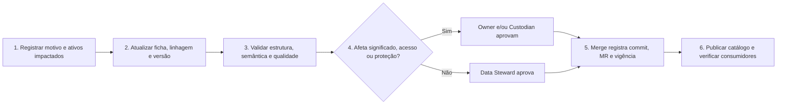
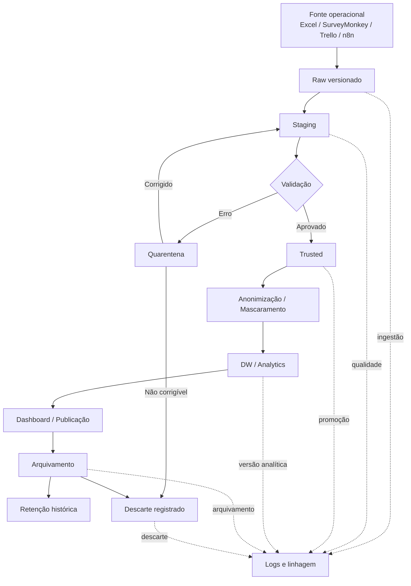
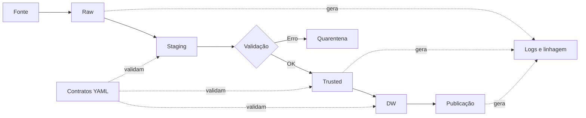
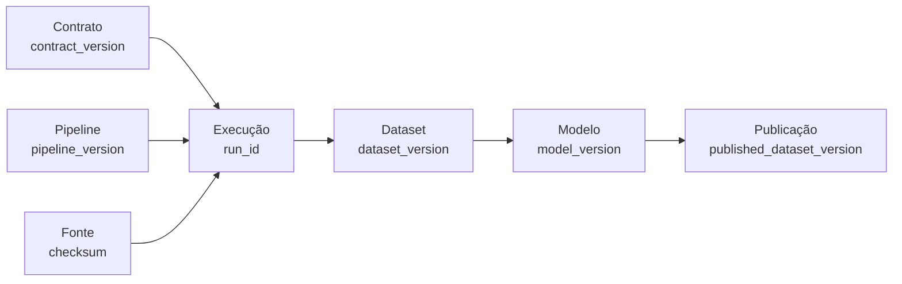
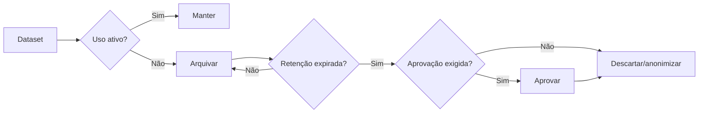
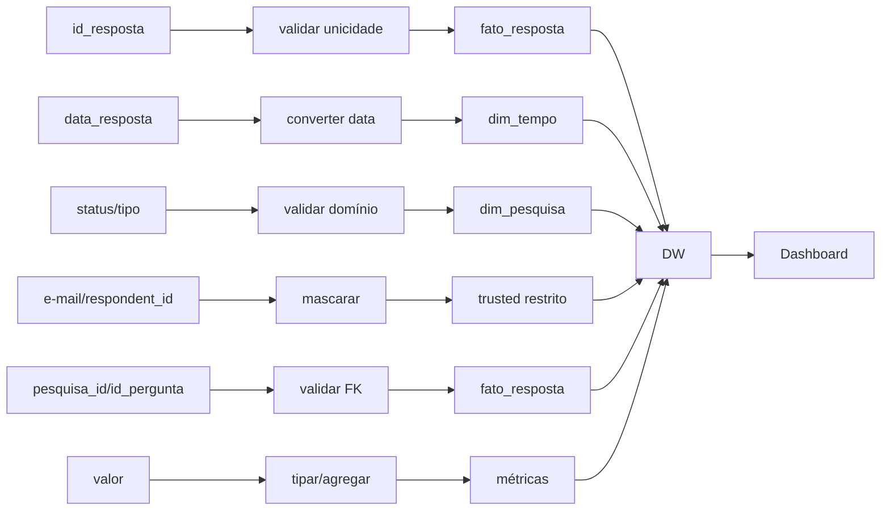

# Governança de Dados do Projeto

| Campo | Valor |
| :--- | :--- |
| Artefato | Artefato 1 — Governança de Dados do Projeto |
| Seção | §3 — Gestão de Metadados e Catálogo de Dados |
| Escopo desta contribuição | Metadados obrigatórios, ficha de exemplo e procedimentos de atualização/versionamento |
| Estado | Definição, exemplo lógico e procedimentos concluídos; modelo físico do DW fora do escopo atual |

## 3. Gestão de Metadados e Catálogo de Dados

Esta contribuição estabelece o contrato mínimo de metadados do Data Warehouse (DW) e da camada semântica do projeto. O objetivo é permitir que os ativos sejam compreendidos, descobertos e auditados sem depender de conhecimento verbal da equipe. A definição considera o Data Model Canvas, o inventário das seis bases do Sindusfarma, os contratos analíticos da `SPEC-001` e os requisitos de governança, qualidade, segurança e manutenibilidade já registrados.

Os metadados descrevem os ativos; eles não devem reproduzir amostras de e-mail, respostas individuais nem outros valores pessoais. Todo campo classificado como obrigatório deve possuir valor verificável. Quando um campo legitimamente não se aplicar, o registro deve usar `Não se aplica` acompanhado da justificativa, em vez de permanecer vazio. Um ativo com campo obrigatório vazio não pode ser considerado aprovado para uso analítico.

### Escopo dos ativos catalogados

A obrigatoriedade cobre os três tipos de ativos que sustentam a solução analítica:

- **tabelas fato**, incluindo o snapshot acumulativo do ciclo de vida da pesquisa, o fato transacional de adesão e participação e o snapshot periódico de qualidade previstos em `docs/dmc.json`;
- **dimensões**, incluindo Tempo, Pesquisa, Área, Status, Responsável, Empresa, Cliente/Respondente, Fonte de Dados, Conjunto de Dados e Regra de Qualidade, conforme aplicável a cada cubo;
- **medidas e KPIs**, incluindo contagens, durações, percentuais e diagnósticos de qualidade consumidos pelos painéis e relatórios.

O catálogo deve distinguir metadados de negócio, técnicos, operacionais, de governança e de qualidade. Essa separação evita que uma tabela seja documentada apenas pelo nome de suas colunas ou que uma medida seja registrada apenas pela expressão DAX/SQL, sem universo, limitações e responsável.

### Metadados comuns obrigatórios

Os campos abaixo são obrigatórios para tabelas fato, dimensões e medidas. Eles formam o núcleo comum usado para identificar, governar e localizar qualquer ativo.

| ID | Metadado | Categoria | Regra de preenchimento |
| :--- | :--- | :--- | :--- |
| `MC-01` | Identificador estável | Técnico | ID único e imutável no padrão `<camada>.<nome_do_ativo>`; não pode ser reutilizado por outro ativo |
| `MC-02` | Nome físico | Técnico | Nome usado no banco, modelo semântico ou ferramenta de BI; para ativo ainda conceitual, registrar o nome lógico proposto e marcar seu estado |
| `MC-03` | Nome de negócio | Negócio | Nome legível, sem siglas ambíguas, empregado nos dashboards e na comunicação com o parceiro |
| `MC-04` | Tipo de ativo | Técnico | Um entre `Tabela fato`, `Dimensão` ou `Medida/KPI` |
| `MC-05` | Definição | Negócio | Explicar o significado, a finalidade e os limites do ativo, incluindo o que ele não representa |
| `MC-06` | Estado | Governança | Um entre `Proposto`, `Aprovado`, `Descontinuado` ou `Retirado` |
| `MC-07` | Data Owner | Governança | Papel ou pessoa que responde pelo significado, finalidade e autorização de uso do ativo |
| `MC-08` | Data Steward | Governança | Papel ou pessoa responsável por definição, documentação e qualidade dos metadados |
| `MC-09` | Responsável técnico/Data Custodian | Governança | Responsável pelo armazenamento, disponibilidade, segurança e suporte técnico |
| `MC-10` | Fonte de origem | Linhagem | Sistema, arquivo, tabela e campos de origem; a autoridade deve ser declarada como confirmada ou provisória |
| `MC-11` | Linhagem | Linhagem | Caminho verificável da fonte até o ativo e seus consumidores, incluindo transformações relevantes |
| `MC-12` | Camada e localização | Técnico | Ambiente, banco, schema, arquivo ou modelo semântico onde o ativo reside; ativos conceituais devem ser identificados como tais |
| `MC-13` | Periodicidade de atualização | Operacional | Frequência ou evento de carga, por exemplo, por execução aprovada; não usar expressões vagas como “periodicamente” |
| `MC-14` | Latência esperada | Operacional | Intervalo máximo entre a mudança na fonte e sua disponibilidade para consumo; registrar `Não definida` com justificativa enquanto não houver SLA aprovado |
| `MC-15` | Classificação da informação | Segurança | Um entre `Público`, `Interno`, `Confidencial` ou `Restrito`; o ativo herda a maior restrição entre seus campos e fontes |
| `MC-16` | Presença de dado pessoal | Privacidade | Indicar `Sim` ou `Não`, categorias de titulares e campos afetados, sem copiar valores; distinguir dado pessoal comum de dado pessoal sensível da LGPD |
| `MC-17` | Perfis autorizados | Segurança | Papéis que podem ler, alterar ou administrar o ativo, coerentes com o princípio do menor privilégio |
| `MC-18` | Regra de retenção | Ciclo de vida | Prazo ou referência inequívoca à política aplicável; se ainda não aprovada, registrar a limitação e impedir descarte automático |
| `MC-19` | Regras e indicadores de qualidade | Qualidade | Regras aplicáveis, dimensão avaliada, fórmula, limite de aceite, responsável e evidência da medição |
| `MC-20` | Requisitos e consumidores | Rastreabilidade | RFs, RNFs, perguntas de negócio, dashboards, relatórios ou processos que criam ou consomem o ativo |
| `MC-21` | Versão da definição | Governança | Identificador da versão vigente do metadado, separado da versão dos dados |
| `MC-22` | Data de vigência e última revisão | Governança | Datas em formato ISO 8601 e identificação da revisão que aprovou o conteúdo vigente |
| `MC-23` | Limitações conhecidas | Negócio | Restrições de cobertura, autoridade, granularidade, qualidade ou interpretação que possam afetar decisões |

No estado atual do projeto, `MC-10` deve preservar que os CSVs possuem autoridade **provisória**, pois a precedência entre CSV e XLSX ainda depende de confirmação do parceiro. Em `MC-15` e `MC-16`, dados de contato ou resposta individual identificável devem ser tratados como `Restrito`, mesmo que a base acadêmica disponibilizada esteja anonimizada.

### Metadados obrigatórios de tabelas fato

Uma tabela fato representa um evento, medição ou estado observável. Além dos metadados comuns, toda tabela fato deve registrar:

| ID | Metadado específico | Regra de preenchimento |
| :--- | :--- | :--- |
| `MF-01` | Processo de negócio e evento | Nomear o processo medido e o evento que produz ou altera a linha |
| `MF-02` | Tipo de fato | Informar `Transacional`, `Snapshot periódico`, `Snapshot acumulativo` ou outro tipo justificado |
| `MF-03` | Grão | Declarar obrigatoriamente no formato “uma linha por...”, antes de listar dimensões e medidas |
| `MF-04` | Chave da fato | Documentar chave técnica, chave de negócio rastreável e regra de unicidade |
| `MF-05` | Chaves estrangeiras | Listar cada FK, a dimensão referenciada, cardinalidade esperada e tratamento de relacionamento ausente |
| `MF-06` | Dimensões conformadas | Identificar dimensões reutilizadas por outros fatos e o contrato de conformidade |
| `MF-07` | Dimensões temporais e papéis de data | Distinguir papéis como solicitação, divulgação, entrega e data da carga |
| `MF-08` | Medidas armazenadas e derivadas | Listar medidas, tipo físico, unidade, origem ou derivação e ID da respectiva ficha semântica |
| `MF-09` | Aditividade | Classificar cada medida como aditiva, semiaditiva ou não aditiva e informar dimensões nas quais a soma é inválida |
| `MF-10` | Modo de carga | Indicar carga completa ou incremental, chave de detecção de mudança e regra de idempotência/reprocessamento |
| `MF-11` | Tratamento de chegada tardia | Definir como fatos ou dimensões atrasadas são identificados e reconciliados sem perder rastreabilidade |
| `MF-12` | Data/hora de referência | Para snapshots, registrar o instante representado; para transações, registrar o instante do evento e da ingestão |
| `MF-13` | Regras de integridade e qualidade | Documentar unicidade no grão, FKs, domínios, nulos, ordem temporal e limites aplicáveis às medidas |

Esses campos atendem aos fatos conceituais já previstos: ciclo de vida da pesquisa como snapshot acumulativo, adesão/participação como fato transacional e qualidade dos dados como snapshot periódico. Essa classificação deve permanecer registrada para impedir agregações incompatíveis entre eventos, estados e medições de períodos diferentes.

### Metadados obrigatórios de dimensões

Uma dimensão fornece o contexto descritivo usado para filtrar, agrupar e interpretar as medidas. Além dos metadados comuns, toda dimensão deve registrar:

| ID | Metadado específico | Regra de preenchimento |
| :--- | :--- | :--- |
| `MD-01` | Entidade representada | Definir o conceito de negócio descrito pela dimensão e seus limites |
| `MD-02` | Grão | Declarar o que torna uma linha única, sem confundir entidade, versão histórica e relacionamento |
| `MD-03` | Chave natural | Informar coluna(s), fonte, estabilidade, completude e regra para sentinelas ou valores ausentes |
| `MD-04` | Chave substituta | Informar coluna, geração, imutabilidade e relacionamento com a chave natural; justificar quando não aplicável |
| `MD-05` | Atributos descritivos | Para cada atributo: nome, definição, tipo, domínio, origem, nulabilidade e classificação |
| `MD-06` | Hierarquias | Registrar níveis, ordem, relações e caminhos de drill-down; justificar ausência de hierarquia |
| `MD-07` | Tipo de SCD | Indicar tipo 0, 1, 2, 3 ou estratégia equivalente, com justificativa por atributo sujeito a mudança |
| `MD-08` | Controle de vigência | Para histórico: data inicial/final e indicador de registro atual; para SCD sem histórico, declarar `Não se aplica` |
| `MD-09` | Membro desconhecido | Definir chave e descrição usadas quando a referência estiver ausente ou chegar depois do fato |
| `MD-10` | Fonte prioritária e reconciliação | Definir precedência entre fontes e tratamento de divergência sem sobrescrita silenciosa |
| `MD-11` | Deduplicação | Informar chave, normalizações, critério de sobrevivência e evidência de registros mesclados |
| `MD-12` | Uso como dimensão conformada | Listar fatos consumidores e atributos cujo significado deve ser idêntico entre cubos |
| `MD-13` | Privacidade por atributo | Identificar atributos pessoais, confidenciais ou publicáveis e as restrições de exposição no BI |

O registro de chave e reconciliação é especialmente relevante porque `clientes.id_cliente` possui o sentinela textual `s/i`, existem relações órfãs na remessa analisada e não há uma chave demonstrável que associe `respostas.respondent_id` a `respondentes`. O catálogo deve preservar essas limitações e proibir a documentação de joins inferidos como se fossem relacionamentos confirmados.

### Metadados obrigatórios de medidas e KPIs

Uma medida deve ser semanticamente reproduzível: duas pessoas autorizadas, usando a mesma versão das fontes e os mesmos filtros, devem conseguir obter o mesmo resultado. Além dos metadados comuns, cada medida ou KPI deve registrar:

| ID | Metadado específico | Regra de preenchimento |
| :--- | :--- | :--- |
| `MM-01` | Objetivo e pergunta de negócio | Explicar qual decisão a medida apoia e vincular a pergunta de negócio correspondente |
| `MM-02` | Definição semântica | Descrever o fenômeno medido e diferenciar o indicador de conceitos semelhantes |
| `MM-03` | Fórmula | Registrar DAX, SQL ou fórmula matemática completa, com precedência e funções explícitas |
| `MM-04` | Tabelas e colunas de origem | Listar IDs catalogados, colunas, joins autorizados e transformações anteriores ao cálculo |
| `MM-05` | Numerador e denominador | Definir componentes, grão e população; usar `Não se aplica` justificado para medidas sem razão |
| `MM-06` | Universo e unidade de análise | Declarar a população elegível e se cada observação representa pesquisa, empresa, participação, resposta ou célula |
| `MM-07` | Filtros e exclusões | Documentar filtros obrigatórios, categorias incluídas, exclusões e justificativa |
| `MM-08` | Tratamento de nulos, zeros e inválidos | Distinguir ausência, zero observado/materializado, falha de parsing e registro fora do universo |
| `MM-09` | Agregação e aditividade | Informar soma, contagem, contagem distinta, média ou outra regra e os contextos em que não pode ser agregada |
| `MM-10` | Unidade, formato e arredondamento | Informar unidade, casas decimais, escala percentual e regra de arredondamento de exibição |
| `MM-11` | Janela temporal | Definir data de referência, período, calendário e regra para dias úteis quando aplicável |
| `MM-12` | Cobertura | Registrar observações válidas, total elegível, percentual de cobertura e motivo das exclusões |
| `MM-13` | Estado do indicador | Um entre `Oficial`, `Descritivo`, `Proxy` ou `Diagnóstico`, com critério para uso e comunicação |
| `MM-14` | Meta ou limite | Registrar meta aprovada e sua fonte; quando inexistente, declarar que o indicador não deve ser interpretado contra um SLA |
| `MM-15` | Regra de validação | Definir cenário, resultado esperado, tolerância e evidência automatizada ou revisão aplicável |
| `MM-16` | Consumidores | Vincular dashboard, visual, relatório, API, RF e RNF que usam a medida |
| `MM-17` | Limitações interpretativas | Explicitar vieses, proxies, denominadores ainda não validados e comparações indevidas |

No projeto, esses campos impedem dois desvios semânticos já identificados: a cobertura de empresas cadastradas não pode ser chamada de taxa oficial de adesão enquanto não houver denominador validado de empresas elegíveis/convidadas; e o tempo calculado a partir de `dias_uteis_para_entrega` permanece uma proxy, não um SLA oficial. Ambos devem conservar universo, cobertura, estado e limitação em suas fichas.

### Exemplo de metadados de uma tabela do DW

A tabela abaixo aplica integralmente os metadados comuns (`MC`) e os metadados de fato (`MF`) ao ativo lógico `dw.fato_ciclo_pesquisa`. A escolha é rastreável ao cubo **Ciclo de Vida da Pesquisa** do Data Model Canvas e aos KPIs de volume, status e prazo da `SPEC-001`. Como a ADR-001 adiou a construção física do DW, a ficha está no estado `Proposto`: valores marcados como **Confirmado** provêm dos artefatos existentes; **Proposto** identifica uma decisão de modelagem ainda sujeita a aprovação; e **Limitação registrada** impede que uma lacuna seja apresentada como fato.

| ID | Metadado | Valor preenchido | Natureza da evidência |
| :--- | :--- | :--- | :--- |
| `MC-01` | Identificador estável | `dw.fato_ciclo_pesquisa` | Proposto segundo o padrão do catálogo |
| `MC-02` | Nome físico | `fato_ciclo_pesquisa` | Proposto; a tabela física ainda não existe |
| `MC-03` | Nome de negócio | Fato Ciclo de Vida da Pesquisa | Confirmado pelo nome do `cubo-1` em `docs/dmc.json` |
| `MC-04` | Tipo de ativo | `Tabela fato` | Confirmado pelo modelo conceitual |
| `MC-05` | Definição | Consolida os marcos e o estado operacional de cada pesquisa, da solicitação à entrega/publicação, para medir volume, duração e atraso; não representa respostas individuais nem adesão de empresas | Confirmado pelo processo e pelas métricas do `cubo-1` |
| `MC-06` | Estado | `Proposto` | Confirmado pelo adiamento do DW físico na ADR-001 |
| `MC-07` | Data Owner | Fabio Moreira, Gestor da Central de Pesquisas | Confirmado em `docs/dmc.json` e no documento de contexto |
| `MC-08` | Data Steward | Felipe Rojas, Reinaldo Nobrega e Lucas Andrade | Confirmado em `docs/dmc.json` e no documento de contexto |
| `MC-09` | Responsável técnico/Data Custodian | Rodrigo Giorgetto (TI do Sindusfarma) | Confirmado para armazenamento e infraestrutura interna/nuvem em `docs/dmc.json` |
| `MC-10` | Fonte de origem | `pesquisas.csv`: `id`, `status`, `area`, `data_solicitacao`, `data_aprov`, `data_divulgacao`, `data_limite`, `prorrogada_ate`, `data_entrega` e `dias_uteis_para_entrega`; autoridade `csv-provisional` | Confirmado pelo inventário e pela `SPEC-001`; precedência CSV×XLSX ainda aguarda decisão do parceiro |
| `MC-11` | Linhagem | Linhagem prevista: `fonte.pesquisas` → validação/normalização da `SPEC-001` → `dw.fato_ciclo_pesquisa` → KPIs de volume, status e prazo → painéis operacional e estratégico | Proposto; somente fonte, transformações analíticas e saídas agregadas existem atualmente |
| `MC-12` | Camada e localização | Camada lógica `dw`; banco, schema e plataforma ainda não selecionados | Limitação registrada; o DMC lista a plataforma como decisão em aberto |
| `MC-13` | Periodicidade de atualização | A cada carga de pesquisas validada e aprovada; não existe agendamento operacional aprovado | Proposto com gatilho objetivo; frequência de agenda é limitação registrada |
| `MC-14` | Latência esperada | `Não definida`: depende do agendamento e da infraestrutura do DW; não pode ser tratada como SLA | Limitação registrada |
| `MC-15` | Classificação da informação | `Interno`; somente indicadores agregados e aprovados podem alimentar a camada pública | Proposto em coerência com a segregação interno×público do projeto |
| `MC-16` | Presença de dado pessoal | Não deve armazenar e-mail nem resposta individual. A eventual FK para Equipe/Responsável pode permitir identificação indireta e deve elevar a consulta resultante a `Restrito` quando aplicável | Proposto; risco de privacidade explicitamente registrado |
| `MC-17` | Perfis autorizados | Pipeline: escrita; equipe interna da Central e Data Stewards: leitura; Data Custodian: administração; áreas técnicas: somente visões autorizadas; público externo: sem acesso direto | Proposto conforme RBAC e menor privilégio definidos no documento de contexto |
| `MC-18` | Regra de retenção | `Não definida`: deve herdar a política aprovada na seção de Ciclo de Vida; nenhum descarte automático fica autorizado por esta ficha | Limitação registrada |
| `MC-19` | Regras e indicadores de qualidade | Metas propostas para o DW: chave de negócio completa e única em 100%; datas preenchidas convertíveis em 100%; durações válidas não negativas em 100%; FKs resolvidas para membro válido ou desconhecido controlado em 100%; exceções registradas, nunca descartadas silenciosamente | Proposto; a medição atual cobre a fonte, não uma tabela do DW inexistente |
| `MC-20` | Requisitos e consumidores | RF01, RF02 e RF03; RNF01, RNF02 e RNF05; PN01, PN02, PN04 e PN05; Painel Operacional e Painel Estratégico | Confirmado pela matriz de rastreabilidade e pelas perguntas de negócio |
| `MC-21` | Versão da definição | `0.1.0` | Proposto; versão de rascunho do ativo, distinta da versão dos dados |
| `MC-22` | Data de vigência e última revisão | Vigência: `Não vigente`; última revisão documental: `2026-08-24` | Confirmado para a revisão; vigência depende de aprovação do modelo lógico |
| `MC-23` | Limitações conhecidas | DW físico ausente; fonte CSV provisória; plataforma, SLA e retenção não aprovados; campos temporais históricos incompletos; `dias_uteis_para_entrega` sustenta apenas uma proxy, não um SLA oficial | Confirmado pelos artefatos do projeto |
| `MF-01` | Processo de negócio e evento | Processo: ciclo de vida da pesquisa. Eventos: solicitação, triagem, planejamento, validação, divulgação, encerramento, tabulação/entrega, prorrogação e publicação | Confirmado pelo `cubo-1` |
| `MF-02` | Tipo de fato | `Snapshot acumulativo` | Confirmado por `accumulatingSnapshot: true` no `cubo-1` |
| `MF-03` | Grão | Uma linha por pesquisa, atualizada à medida que os marcos de solicitação, planejamento, execução, entrega e publicação são concluídos | Confirmado pelo grão do `cubo-1` |
| `MF-04` | Chave da fato | Chave técnica proposta: `sk_fato_ciclo_pesquisa`; chave natural rastreável: `pesquisas.id`, obrigatoriamente completa e única | Proposto com regra apoiada pela unicidade observada no inventário |
| `MF-05` | Chaves estrangeiras | FKs propostas para Tempo (por papel de data), Pesquisa, Área, Status e Equipe/Responsável; referência ausente deve usar membro desconhecido controlado, nunca eliminar silenciosamente o fato | Proposto a partir das dimensões do `cubo-1` |
| `MF-06` | Dimensões conformadas | Tempo, Pesquisa e Área | Confirmado em `dimensoesConformadas` do `cubo-1` |
| `MF-07` | Dimensões temporais e papéis de data | Solicitação, aprovação, divulgação, limite, prorrogação, entrega e carga; cada papel referencia a dimensão Tempo | Confirmado para as datas-fonte; relacionamento dimensional proposto |
| `MF-08` | Medidas armazenadas e derivadas | Contagem de pesquisas; tempos de validação, coleta, tabulação e ciclo total; dias em aberto e de atraso; quantidades e percentuais de pesquisas prorrogadas e fora do prazo | Confirmado pelas métricas do `cubo-1`; implementação no DW ainda proposta |
| `MF-09` | Aditividade | Contagens são aditivas somente em recortes sem dupla contagem; durações, dias e percentuais são não aditivos e devem ser recalculados no contexto consultado | Proposto conforme a semântica das medidas |
| `MF-10` | Modo de carga | `Upsert` incremental pela chave natural `pesquisas.id`, atualizando marcos sem criar segunda linha; reprocessar a mesma remessa e versão de regra deve produzir o mesmo estado | Proposto em coerência com snapshot acumulativo e idempotência da ADR-001 |
| `MF-11` | Tratamento de chegada tardia | Preservar chave natural e data de ingestão, associar temporariamente a membro desconhecido controlado e reconciliar após a dimensão válida chegar; registrar a correção em log | Proposto; depende da implementação do DW |
| `MF-12` | Data/hora de referência | Marcos de negócio usam as datas-fonte; `data_hora_carga` registra a ingestão técnica; o estado da linha representa a última carga aprovada | Proposto; `data_hora_carga` é metadado técnico ainda não implementado |
| `MF-13` | Regras de integridade e qualidade | Uma linha por `pesquisas.id`; FKs válidas ou membro desconhecido; status no domínio aprovado; datas convertíveis; ordem temporal validada quando os marcos forem aplicáveis; durações negativas rejeitadas para quarentena; ausências condicionais não tratadas automaticamente como erro | Proposto com base nas anomalias e regras documentadas no inventário e na `SPEC-001` |

A ficha preenche os 36 campos aplicáveis (`MC-01` a `MC-23` e `MF-01` a `MF-13`) sem usar células vazias. Ela também registra explicitamente que os thresholds de qualidade são metas propostas para a futura tabela do DW, não resultados medidos na infraestrutura atual. Assim, o exemplo demonstra organização, rastreabilidade, privacidade, controle de acesso, qualidade e ciclo de vida sem inventar evidência de implantação.

### Procedimentos de atualização e versionamento dos metadados

Os metadados devem mudar junto com o ativo que descrevem. Nenhuma alteração de schema, regra de negócio, fórmula, fonte, acesso ou qualidade pode chegar ao ramo de integração com a ficha do catálogo desatualizada. O registro vigente permanece válido até a aprovação da nova versão; uma proposta em revisão não modifica silenciosamente o significado usado pelos consumidores.

Quatro princípios regem o procedimento: o identificador estável do ativo não é reutilizado; a versão dos metadados é separada das versões do schema e dos dados; todo aceite deixa evidência no Git e na Merge Request; e correções preservam o histórico em vez de apagar registros anteriores.

#### Gatilhos e prazo de atualização

| Gatilho | Metadados afetados | Momento obrigatório da atualização | Responsável inicial |
| :--- | :--- | :--- | :--- |
| Inclusão, remoção ou renomeação de fonte, tabela ou coluna | Origem, linhagem, schema, regras de carga, qualidade e consumidores | Na mesma branch e antes da implantação da mudança | Desenvolvedor do pipeline/DW |
| Alteração de grão, chave, relacionamento, SCD ou regra de deduplicação | Definição, grão, chaves, dimensões, qualidade e limitações | Na mesma branch e antes de qualquer recarga ou consumo | Data Engineer e Data Steward |
| Alteração de fórmula, universo, filtro, unidade, arredondamento ou meta | Ficha da medida, linhagem, cobertura, validação e visuais consumidores | Na mesma branch da medida e antes da publicação do dashboard | Responsável por BI e Data Steward |
| Nova limitação ou desvio de qualidade confirmado | Qualidade, limitações, estado do indicador e evidência | Assim que o desvio for confirmado e antes de comunicar o resultado como confiável | Data Steward |
| Mudança de classificação, finalidade, base legal ou perfil autorizado | Sensibilidade, privacidade, acesso, retenção e consumidores | Antes de ampliar acesso ou finalidade; restrições emergenciais devem ser aplicadas imediatamente | Data Owner e Data Custodian |
| Mudança de Owner, Steward, Custodian, periodicidade, SLA ou retenção | Responsáveis e metadados operacionais/ciclo de vida | Antes de a nova responsabilidade ou política entrar em vigor | Papel que aprova o respectivo domínio |
| Criação, substituição ou retirada de ativo | Estado, sucessor, consumidores, data de vigência e plano de transição | Antes da disponibilização ou retirada | Data Steward, com aprovação do Data Owner |

Além dos gatilhos, o Data Steward deve revisar o catálogo em cada ciclo acadêmico do projeto. Em operação, adota-se como meta uma revisão trimestral, confrontando fichas, schemas, pipelines, medidas e perfis de acesso. Essa periodicidade é uma política proposta do projeto e não uma prática atual comprovada do Sindusfarma.

#### Fluxo de alteração e aprovação

1. **Registrar a solicitação:** o autor informa motivo, ativo, versão atual, requisitos, dados, dashboards e consumidores afetados. Ausência de issue não autoriza omitir a rastreabilidade; nesse caso, a Merge Request registra o contexto integral.
2. **Avaliar o impacto:** o Data Steward identifica alterações de semântica, grão, linhagem, qualidade e compatibilidade. O Data Custodian avalia armazenamento, acesso e segurança quando aplicável.
3. **Atualizar na mesma branch:** o autor modifica a ficha, os relacionamentos, as limitações e a versão na mesma mudança que altera o schema, pipeline ou medida. Mudanças apenas documentais também usam branch e revisão.
4. **Validar:** a equipe executa a lista de verificação definida abaixo. Uma falha bloqueia a aprovação; ela não pode ser ocultada por texto genérico ou pela remoção da evidência.
5. **Aprovar:** o Data Steward aprova consistência e qualidade; o Data Owner aprova significado, finalidade, criticidade, classificação e uso externo; o Data Custodian aprova armazenamento, acesso, retenção técnica e controles de segurança; o responsável por BI valida medidas e impactos visuais.
6. **Publicar e vigorar:** após o merge, o catálogo é reconstruído no MkDocs. A ficha recebe data de vigência e referência ao commit/Merge Request; consumidores afetados devem usar somente a versão aprovada.
7. **Verificar depois da publicação:** o Data Steward confere links, busca, linhagem e versão exposta. Quando houver código ou medida, a evidência inclui o teste ou recálculo executado.

#### Matriz de responsabilidade

| Atividade | Responsável por executar | Responsável por aprovar | Consultados | Evidência mínima |
| :--- | :--- | :--- | :--- | :--- |
| Propor e documentar mudança | Autor da mudança | Data Steward | Engenharia e BI | Descrição e diff da ficha |
| Validar definição, grão, linhagem e qualidade | Data Steward | Data Steward | Autor, Engenharia e BI | Checklist e testes aplicáveis |
| Aprovar significado, finalidade ou uso externo | Data Steward | Data Owner | Responsável de negócio e compliance | Aprovação registrada na MR |
| Aprovar acesso, proteção ou retenção técnica | Data Custodian | Data Owner | Data Steward e compliance | Parecer técnico e matriz de acesso |
| Aprovar fórmula e impacto em dashboard | Responsável por BI | Data Steward e responsável de negócio | Consumidores do indicador | Teste/recalculo e relação de visuais afetados |
| Publicar e auditar o catálogo | Data Steward | Data Owner para mudanças materiais | Data Custodian | Build, commit, MR e data de vigência |

#### Política de versão

Cada ficha usa o formato `MAJOR.MINOR.PATCH`. A versão `0.y.z` identifica ativo ainda `Proposto`; a primeira aprovação para uso gera `1.0.0`. A classificação considera o impacto sobre quem produz, consulta ou interpreta o dado:

| Incremento | Quando aplicar | Exemplos de impacto | Obrigações adicionais |
| :--- | :--- | :--- | :--- |
| `MAJOR` | Mudança incompatível de significado ou contrato | Alteração de grão, chave, fórmula, universo, unidade, SCD, finalidade, classificação ou remoção de campo | Plano de migração, aprovação do Owner, revisão de consumidores, testes comparativos e prazo de transição |
| `MINOR` | Acréscimo compatível que preserva o contrato anterior | Novo atributo opcional, fonte complementar, regra de qualidade, sinônimo, consumidor ou evidência | Validação de compatibilidade, linhagem atualizada e revisão do Steward |
| `PATCH` | Correção sem efeito semântico ou técnico | Ortografia, clareza textual, link ou referência de evidência | Revisão documental e build da documentação |

Uma mudança de segurança que restrinja acesso deve ser aplicada imediatamente; a necessidade de versionar e revisar a documentação não adia a contenção. Mudanças compostas recebem o maior incremento exigido. O identificador do ativo permanece igual em qualquer incremento; se o conceito for substituído por outro, cria-se novo ID e o anterior aponta para o sucessor.

### 7.1 Escolha e justificativa do modelo de referência

#### Decisão

O **DCAM v3 (Data Management Capability Assessment Model), do EDM Council**, será o modelo principal para avaliar a maturidade em governança de dados no escopo deste projeto. O **DAMA-DMBOK 2.0 Revised** permanecerá como referência complementar de conceitos, papéis e práticas de gestão de dados, mas não como instrumento principal de avaliação. Essa combinação preserva o vocabulário de governança já adotado pelo projeto e acrescenta uma abordagem orientada à avaliação de capacidades, evidências, lacunas e evolução.

#### Contexto da decisão

O recorte avaliado será a **Central de Pesquisas do Sindusfarma e a cadeia de dados abrangida pelo projeto**, e não toda a organização. Conforme o [levantamento organizacional e de requisitos](contexto_organizacional_+_requisitos_da_solução_analítica.md), o estado conhecido combina dados fragmentados entre Excel, SurveyMonkey, Trello e o repositório do site, consolidação manual, rastreabilidade limitada, governança informal e ausência de indicadores oficiais de qualidade. O estado desejado, registrado também no [Data Model Canvas](dmc.json), é uma fonte única, integrada e governada, apoiada por banco central, pipeline e consumo analítico. Portanto, o projeto necessita de um modelo que permita demonstrar evolução por evidências, e não apenas descrever boas práticas.

#### Alternativas consideradas

| Alternativa | Adequação à tarefa | Vantagens para o projeto | Limitação determinante | Decisão |
|---|---|---|---|---|
| **DCAM v3** | Alta | Estrutura a avaliação por capacidades, perguntas, evidências e critérios; favorece a identificação de lacunas e a construção de um roteiro de evolução. | O conteúdo integral é restrito aos membros do EDM Council; a aplicação acadêmica deve declarar essa limitação. | **Selecionado como modelo principal.** |
| **DAMA-DMBOK 2.0 Revised** | Média como modelo de avaliação e alta como referência conceitual | Oferece linguagem comum e organiza as áreas de conhecimento de gestão de dados usadas no documento. | Para esta decisão, é mais adequado como corpo de conhecimento do que como mecanismo principal de pontuação e comprovação de maturidade. | **Adotado como referência complementar.** |
| **Matriz própria sem framework** | Baixa | Poderia ser simplificada para o contexto local. | Reduziria a comparabilidade, a justificativa metodológica e a vinculação com práticas reconhecidas de mercado. | **Descartada.** |

#### Justificativa de aderência ao projeto

A escolha do DCAM v3 atende diretamente ao Artefato 1 porque sua abordagem oficial contempla avaliação objetiva do estado atual, identificação de lacunas e definição de um roteiro de melhoria. Sua matriz de avaliação considera **envolvimento, processo e evidência**, dimensões aplicáveis ao contexto da Central de Pesquisas: o envolvimento verifica se Data Owner, Data Stewards e Data Custodian exercem as responsabilidades atribuídas; o processo verifica se catálogo, qualidade, acesso, retenção e rastreabilidade estão definidos e são repetíveis; e a evidência verifica se documentos, aprovações, logs, testes, indicadores e históricos comprovam a execução desses controles.

O modelo também é adequado à evolução incremental prevista: a avaliação poderá estabelecer uma linha de base do MVP e ser reaplicada quando novas fontes, automações e controles forem incorporados. Assim, a maturidade não será inferida pela existência de textos ou pela implantação isolada de tecnologia; ela dependerá da combinação entre responsabilidade organizacional, processo executado e evidência verificável. Essa regra reduz subjetividade e conecta a avaliação ao Data Warehouse, ao pipeline ETL, aos dashboards e aos controles de governança documentados.

#### Escopo e regra para aplicação posterior

| Elemento | Definição para o projeto |
|---|---|
| Unidade de avaliação | Central de Pesquisas do Sindusfarma e os dados cobertos pela solução analítica do projeto. |
| Fronteira técnica | Fontes priorizadas, ingestão e transformação, Data Warehouse, camada analítica e publicação de dados no escopo do MVP. |
| Perspectivas exigidas | Técnica, organizacional e cultural, conforme o critério de diagnóstico do Artefato 1. |
| Evidências aceitas | Políticas e catálogo versionados, matriz de responsabilidades e acessos, aprovações, regras de qualidade, execuções do pipeline, logs, testes, indicadores, registros de incidentes e validações do parceiro. |
| Responsabilidades | Data Stewards reúnem as evidências; Data Custodian comprova controles técnicos; Data Owner valida o diagnóstico e prioriza a evolução. |
| Regra de confiabilidade | Capacidade sem evidência verificável será registrada como **não evidenciada**, sem presumir adoção ou atribuir resultado positivo. |
| Versionamento da linha de base | Cada diagnóstico registrará data, escopo, fontes consultadas, responsáveis pela validação e versão dos artefatos avaliados. |

O nível atual de maturidade **não é atribuído nesta decisão**, pois depende da coleta e validação das evidências que comporão o diagnóstico da Seção 7.2. Essa separação distingue fatos documentados, decisão metodológica e resultado de avaliação, evitando uma classificação sem comprovação.

#### Limitações e consequências

A descrição pública do DCAM v3 informa que o acesso ao framework completo é exclusivo para organizações associadas ao EDM Council. Por isso, o trabalho será apresentado como **avaliação acadêmica orientada pelo DCAM v3**, baseada nos elementos publicamente documentados e nas evidências do projeto; não será declarada certificação, benchmark oficial ou avaliação homologada pelo EDM Council. Caso a equipe ou o parceiro obtenha acesso autorizado ao material integral, os critérios poderão ser refinados sem alterar a decisão de modelo. Como consequência operacional, a escolha exige coleta periódica de evidências e validação pelos responsáveis, mas produz um diagnóstico auditável e um plano de melhoria rastreável.

#### Rastreabilidade da decisão

| ID | Critério de aceitação da tarefa | Evidência nesta seção | Status |
|---|---|---|---|
| MAT-REF-01 | Identificar inequivocamente o modelo e sua versão. | Decisão pelo DCAM v3 como modelo principal. | Atendido |
| MAT-REF-02 | Justificar a escolha com base no contexto do parceiro e do projeto. | Contexto da decisão e justificativa de aderência. | Atendido |
| MAT-REF-03 | Registrar alternativas e consequências da decisão. | Tabela comparativa e subseção de limitações e consequências. | Atendido |
| MAT-REF-04 | Definir fronteira, evidências e responsáveis para tornar a escolha aplicável. | Tabela de escopo e regra para aplicação posterior. | Atendido |
| MAT-REF-05 | Diferenciar fatos, decisão, limitações e diagnóstico ainda não executado. | Contexto fundamentado, decisão explícita, limitação de acesso e separação da Seção 7.2. | Atendido |

#### Referências utilizadas

- EDM Council. **DCAM: Data Management Capability Assessment Model — Version 3**. Disponível em: [página oficial do DCAM](https://edmcouncil.org/frameworks/dcam/). Acesso em: 25 ago. 2026.
- DAMA International. **DAMA Data Management Body of Knowledge (DAMA-DMBOK)**. Disponível em: [página oficial do DAMA-DMBOK](https://dama.org/learning-resources/dama-data-management-body-of-knowledge-dmbok/). Acesso em: 25 ago. 2026.
- Sindusfarma / Inteli. **Contextualização e Especificação de Requisitos da Solução Analítica**. Evidência interna: [`docs/contexto_organizacional_+_requisitos_da_solução_analítica.md`](contexto_organizacional_+_requisitos_da_solução_analítica.md).
- Grupo 2. **Data Model Canvas do projeto**. Evidência interna: [`docs/dmc.json`](dmc.json).

Para descontinuar um ativo, o Data Steward registra motivo, sucessor, consumidores, riscos, prazo de transição e aprovação do Data Owner. A ficha permanece pesquisável; seu ID não é apagado nem reutilizado. A retirada só ocorre depois de verificar que dashboards, pipelines, relatórios e APIs deixaram de depender do ativo.

Se uma versão publicada estiver incorreta, a equipe bloqueia seu uso, reverte a alteração no Git quando isso for seguro e publica uma nova versão com motivo, impacto e evidência da correção. Reverter metadados não reverte automaticamente schema ou dados: o Data Custodian e a Engenharia devem coordenar restauração, reprocessamento e validação dos consumidores. O histórico defeituoso permanece auditável.

#### Validações e registro de mudanças

Antes da aprovação, a Merge Request deve demonstrar:

- **estrutura:** IDs únicos, campos obrigatórios completos, estado e versão válidos, links resolvidos e build do MkDocs aprovado;
- **semântica:** definição, grão, fórmula, universo, unidade e limitações revisados contra os requisitos e perguntas de negócio;
- **linhagem:** fonte, transformações e consumidores atualizados, sem joins inferidos ou autoridade de fonte promovida sem decisão;
- **qualidade:** regra, métrica, threshold, responsável, resultado e evidência; mudança de fórmula inclui teste ou recálculo comparativo;
- **segurança e privacidade:** classificação, dados pessoais, perfis, retenção e risco de exposição avaliados antes de ampliar acesso;
- **impacto:** RFs, RNFs, dashboards, relatórios, APIs, pipelines e plano de transição identificados;
- **evidência:** motivo, autor real, aprovadores, versão anterior/nova, data de vigência, comandos executados e resultados registrados.

O registro de mudança é composto pela ficha atualizada, pelo diff, pelo commit e pela Merge Request. Ele deve permitir responder quem alterou, o que mudou, por que mudou, quem aprovou, quando entrou em vigor, quais consumidores foram afetados e como validar ou reverter. Falhas conhecidas permanecem registradas como limitações; não é permitido marcar um ativo como `Aprovado` apenas porque a documentação compila.

### Critérios de aceite e rastreabilidade

| ID | Critério verificável | Evidência neste documento | Requisitos relacionados | Estado |
| :--- | :--- | :--- | :--- | :--- |
| `META-01` | Nome, definição, fonte, periodicidade, sensibilidade, responsáveis, qualidade e linhagem são obrigatórios para todos os ativos | `MC-01` a `MC-23` | RF01, RF02, RF03; RNF01, RNF02, RNF05 | Atendido documentalmente |
| `META-02` | Fatos registram evento, tipo, grão, chaves, dimensões, medidas, aditividade e carga | `MF-01` a `MF-13` | RF01, RF02, RF03; RNF02, RNF05 | Atendido documentalmente |
| `META-03` | Dimensões registram entidade, chaves, atributos, hierarquias, SCD, deduplicação e privacidade | `MD-01` a `MD-13` | RF01, RF02, RF03; RNF01, RNF02, RNF05 | Atendido documentalmente |
| `META-04` | Medidas registram fórmula, universo, fontes, filtros, nulos/zeros, agregação, cobertura, estado e limitações | `MM-01` a `MM-17` | RF03; RNF02, RNF05 | Atendido documentalmente |
| `META-05` | Nenhum ativo aprovado contém campo obrigatório vazio ou relacionamento inferido sem evidência | Regra de obrigatoriedade e ressalvas do inventário | RF02; RNF01, RNF02, RNF05 | Atendido documentalmente |
| `META-06` | Uma tabela do DW possui exemplo preenchido com todos os metadados comuns e específicos de fato | Ficha de `dw.fato_ciclo_pesquisa`, `MC-01` a `MC-23` e `MF-01` a `MF-13` | RF01, RF02, RF03; RNF01, RNF02, RNF05 | Atendido como modelo lógico proposto |
| `META-07` | O exemplo distingue evidência confirmada, decisão proposta e limitação real | Coluna `Natureza da evidência` e ressalva sobre DW físico | RNF01, RNF02, RNF05 | Atendido documentalmente |
| `META-08` | Gatilhos e momento obrigatório de atualização estão definidos | Tabela de gatilhos e regra de alteração na mesma branch | RF01, RF02, RF03; RNF02, RNF05 | Atendido documentalmente |
| `META-09` | Responsáveis, aprovadores e evidências estão definidos por atividade | Fluxo de aprovação e matriz de responsabilidade | RNF01, RNF02, RNF05 | Atendido documentalmente |
| `META-10` | Versões de metadado, schema, dados e medidas são distinguíveis e auditáveis | Política `MAJOR.MINOR.PATCH` e tabela de objetos versionados | RF02, RF03; RNF02, RNF05 | Atendido documentalmente |
| `META-11` | Aprovação exige validação estrutural, semântica, de qualidade, segurança, privacidade e impacto | Checklist da Merge Request | RF01, RF02, RF03; RNF01, RNF02, RNF05 | Atendido documentalmente |
| `META-12` | Descontinuação, retirada e rollback preservam consumidores e histórico | Tabela de estados e procedimentos de transição/reversão | RNF02, RNF05 | Atendido documentalmente |

### Fontes internas consultadas

- `docs/dmc.json`: cubos, grãos, fatos, dimensões, medidas e papéis de governança.
- `docs/inventario_das_bases.md`: fontes, chaves, granularidades, classificação de campos e limitações observadas.
- `docs/specs/spec-analise-quantitativa-dados.md`: contratos de fonte, regras de cálculo, universo, cobertura e semântica dos KPIs.
- `docs/contexto_organizacional_+_requisitos_da_solução_analítica.md`: RFs, RNFs, responsabilidades de governança e restrições de segurança e LGPD.

## 6. Ciclo de Vida dos Dados

Esta seção define o ciclo de vida dos dados do projeto Sidusfarma, da ingestão ao descarte. A proposta parte do inventário estrutural já documentado em [`docs/inventario_das_bases.md`](./inventario_das_bases.md), que lista bases, colunas, chaves, relações e exemplos reais, e o complementa com uma visão de governança: tipos de dado, sensibilidade, responsabilidades, camadas percorridas, retenção e descarte.

A modelagem foi construída com base no TAPI, no Workshop Sindusfarma, no inventário das bases e no relatório [`docs/modelagem_quantitativa_de_dados_do_parceiro.md`](./modelagem_quantitativa_de_dados_do_parceiro.md). O TAPI estabelece como objetivo uma fonte única da verdade para o ciclo de vida das pesquisas, com rastreabilidade e auditabilidade da solicitação à publicação. O Workshop reforça a necessidade de RBAC, anonimização, ingestão contínua, Data Warehouse analítico em ClickHouse e consumo por dashboards. O relatório quantitativo evidencia problemas de qualidade, como baixa completude em campos operacionais, registros órfãos e necessidade de quarentena.

As responsabilidades citadas nesta seção seguem os papéis definidos em [`Contexto Organizacional`, seção 3.1 - Estrutura de Governança](./contexto_organizacional_+_requisitos_da_solução_analítica.md): Data Owner, Data Steward e Data Custodian. Quando a política depender de decisão de negócio, LGPD ou compliance do parceiro, a regra é marcada como proposta a validar.

Os pontos marcados como `A confirmar` não representam ausência de proposta técnica. Eles indicam informações que não podem ser inferidas com segurança a partir dos CSVs e dos artefatos atuais: sistema operacional original de cada dado, autoridade final por regra de retenção, política oficial de exposição externa e critérios jurídicos de descarte de dados pessoais. As decisões técnicas do grupo, como uso de raw versionado, staging, trusted, contratos YAML, validação por CI, logs, linhagem e evidências mínimas, ficam definidas nesta seção.

### 6.1 Inventário Complementar de Tipos de Dados

O inventário atual do projeto já descreve as bases físicas recebidas. A tabela abaixo não substitui esse inventário; ela organiza os dados em tipos governáveis para permitir classificação, retenção, descarte e rastreabilidade.

A classificação de sensibilidade segue quatro níveis:

- **Público:** dados que podem ser divulgados sem restrição relevante, como informações institucionais ou indicadores agregados aprovados para publicação.
- **Interno:** dados usados pela operação e pela equipe do projeto, sem exposição pública direta.
- **Confidencial/Restrito:** dados que identificam empresas, contatos, respostas individuais ou regras de negócio sensíveis, exigindo controle de acesso.
- **Sensível/Altamente confidencial:** dados pessoais, identificadores diretos, credenciais ou informações que exigem proteção reforçada por LGPD, segurança ou risco de reidentificação.

Essa classificação conecta inventário, data discovery, DLP, controle de acesso, auditoria e descarte.

| ID | Tipo de dado | Pelo que é formado | Origem operacional | Sensibilidade | Responsável proposto | Uso principal | Gaps |
|---|---|---|---|---|---|---|---|
| D01 | Dados mestres de pesquisa | `pesquisas.id`, `titulo`, `status`, `tipo`, `area`, `objetivos`, `complexidade` | A confirmar com parceiro; evidência sugere Excel/base histórica | Interno | [Data Owner e Data Steward](./contexto_organizacional_+_requisitos_da_solução_analítica.md) | Controle do portfólio e ciclo da pesquisa | Origem operacional campo a campo não confirmada |
| D02 | Datas e métricas operacionais | `data_solicitacao`, `data_aprov`, `data_divulgacao`, `data_limite`, `prorrogada_ate`, `data_entrega`, `dias_uteis_para_entrega`, `dias úteis aberta`, `dias entre a solicitação e a divulgação`, `dias para tabulação` | A confirmar com parceiro; evidência sugere Excel/Trello/n8n | Interno | [Data Owner e Data Steward](./contexto_organizacional_+_requisitos_da_solução_analítica.md) | SLA, gargalos e ciclo operacional da pesquisa | Origem e regra oficial de preenchimento não confirmadas |
| D03 | Cadastro institucional de empresas | `empresas.ID`, `Nome Fantasia`, `% de mercado`, `Nacionalidade`, `Associado`, `Tipo de Associado`, `Cidade`, `Estado`, `País` | A confirmar com parceiro | Confidencial/Restrito quando identificável | [Data Owner](./contexto_organizacional_+_requisitos_da_solução_analítica.md) + Compliance | Segmentação, adesão e representatividade | Política oficial de exposição externa não informada |
| D04 | Cadastro de contatos/respondentes | `clientes.id_cliente`, `id_empresa`, `cargo`, `departamento`, `e-mail` | A confirmar com parceiro | Sensível/Altamente confidencial por conter contato | [Data Owner](./contexto_organizacional_+_requisitos_da_solução_analítica.md) + Compliance/LGPD | Relacionamento e perfil de respondentes | Política oficial de retenção de contato não informada |
| D05 | Participação de empresa em pesquisa | `respondentes.id_pesq`, `hora_inicio`, `hora_termino`, `id_empresa`, `market_share`, `id_cliente` | A confirmar com parceiro; hipótese: SurveyMonkey/exportações de resposta | Confidencial/Restrito | [Data Owner e Data Steward](./contexto_organizacional_+_requisitos_da_solução_analítica.md) | Adesão, recorrência, tempo de resposta e vínculo empresa-pesquisa | Granularidade pode permitir reidentificação |
| D06 | Questionários e perguntas | `questoes.id_pergunta`, `pesquisa_id`, `pesquisa_titulo`, `enunciado`, `tipo`, `qtd_alternativas`, `alternativas`, `linhas_matriz`, `colunas_matriz`, `confianca`, `formato_arquivo`, `col_origem`, `observacoes` | A confirmar com parceiro; evidência sugere SurveyMonkey/LLM/n8n/base histórica | Interno | [Data Steward](./contexto_organizacional_+_requisitos_da_solução_analítica.md) | Estrutura do instrumento e qualidade das perguntas | Origem por campo não confirmada; há órfãos em `pesquisa_id` |
| D07 | Respostas individuais | `respostas.id_resposta`, `pesquisa_id`, `id_pergunta`, `respondent_id`, `id_empresa`, `alternativa`, `linha_matriz`, `coluna_matriz`, `valor` | A confirmar com parceiro; hipótese: SurveyMonkey/exportações de resposta | Sensível/Altamente confidencial quando identificável | [Data Owner, Data Steward e Data Custodian](./contexto_organizacional_+_requisitos_da_solução_analítica.md) + Compliance/LGPD | Microdados para agregação e benchmark | Não pode ir para camada pública com identificadores |
| D08 | Dados de qualidade e quarentena | checks de completude, unicidade, integridade referencial e domínio; registros órfãos; `quality_report.json`; IDs órfãos como `424`, `1116`, `1139`, `1147`, `304` | Pipeline de qualidade do projeto | Interno | [Data Steward e Data Custodian](./contexto_organizacional_+_requisitos_da_solução_analítica.md) | Controle de qualidade, correção e rejeição | Regras finais de aceite por campo são detalhadas nos controles de auditoria |
| D09 | Artefatos analíticos derivados | `kpis_summary.json`, gráficos em `docs/images/`, dashboards, relatórios, medidas e KPIs | Pipeline, BI e documentação | Interno ou público conforme publicação | [Data Steward](./contexto_organizacional_+_requisitos_da_solução_analítica.md) + responsável pelo relatório | Consumo analítico e evidência de entrega | Versionamento/publicação são detalhados nos controles de auditoria |
| D10 | Metadados, logs e eventos de ciclo | `run_id`, `source_file`, `source_system`, `loaded_at`, `pipeline_version`, `row_count`, `checksum`, `dq_status`, logs da DAG/ETL, registros de descarte | ETL/CI/orquestrador proposto | Interno | [Data Custodian](./contexto_organizacional_+_requisitos_da_solução_analítica.md) | Rastreabilidade, auditoria e descarte verificável | Estrutura final é detalhada nos controles de auditoria |

### 6.2 Modelo do Ciclo de Vida

O ciclo de vida proposto separa a origem operacional, a cópia bruta versionada, a validação, a camada confiável, a anonimização, o uso analítico, a publicação, o arquivamento e o descarte. Essa separação é necessária porque o projeto não deve apenas carregar dados no DW; ele precisa preservar rastreabilidade, tratar qualidade, proteger dados sensíveis e manter evidências de transformação.

A camada **Raw versionado** garante reprocessamento e auditoria. A camada **Staging** permite validar dados antes que eles sejam considerados confiáveis. A **Quarentena** isola problemas como registros órfãos ou schema inválido. A camada **Trusted** concentra dados tratados e padronizados. A etapa de **Anonimização/Mascaramento** atende ao requisito de proteção e uso seguro dos dados. O **DW/Analytics** organiza consumo analítico, enquanto **Dashboard/Publicação** representa a entrega de valor ao usuário. Por fim, **Arquivamento** e **Descarte registrado** encerram o ciclo com controle formal.

| Ordem | Camada | Por que existe | O que entra | O que acontece | O que sai | Evidência gerada |
|---:|---|---|---|---|---|---|
| 1 | Fonte operacional | Respeitar o escopo do TAPI, que integra sistemas existentes sem substituí-los | Excel, SurveyMonkey, Trello, site, n8n, ou CSVs exportados | Dado nasce ou é atualizado na operação do parceiro | Arquivo, exportação ou evento de origem | Identificação da fonte quando disponível |
| 2 | Raw versionado | Preservar cópia fiel para auditoria e reprocessamento | Exportação original da fonte | Gravação sem transformação, com hash e metadados mínimos | Snapshot bruto | `source_file`, `loaded_at`, `checksum`, `run_id` |
| 3 | Staging | Separar carga técnica de dado confiável | Raw lido pelo pipeline | Parsing, tipagem, padronização inicial e checks básicos | Registros candidatos à validação | Log de carga, contagem de linhas, schema lido |
| 4 | Validação de qualidade | Impedir avanço de dados inválidos | Registros em staging | Checks de completude, unicidade, integridade referencial e domínio | Aprovado ou reprovado | `dq_status`, relatório de qualidade |
| 5 | Quarentena | Isolar erro sem contaminar Trusted/DW | Registros reprovados, como órfãos ou schema inválido | Registro do motivo, análise e tentativa de correção | Retorno ao staging ou descarte registrado | Log de quarentena, motivo, ação tomada |
| 6 | Trusted | Consolidar dado confiável | Registros aprovados | Deduplicação, normalização de domínio, remoção de colunas sem uso analítico e padronização | Dados limpos e governados | Versão da regra aplicada, contagem final |
| 7 | Anonimização/Mascaramento | Cumprir LGPD e regra do workshop sobre anonimização, especialmente para consumo externo/dev | Trusted com identificadores | Mascaramento/hash/remoção de `e-mail`, `respondent_id`, `Nome Fantasia` quando o consumo não exigir identificação | Dataset seguro por perfil | Log de mascaramento e teste de bloqueio de identificadores |
| 8 | DW/Analytics | Estruturar dados para análise e dashboards | Trusted ou dataset anonimizado | Criação de fatos, dimensões, medidas e agregações | Tabelas analíticas | Versão do dataset analítico |
| 9 | Dashboard/Publicação | Entregar valor analítico | Tabelas do DW | Visualização, filtros, KPIs e relatórios | Dashboard, relatório ou acervo publicado | Versão de publicação |
| 10 | Arquivamento | Preservar histórico com menor uso operacional | Versões antigas, raw antigo, relatórios publicados, logs antigos | Armazenamento controlado e redução de acesso ativo | Arquivo consultável | `archive_id`, data e responsável |
| 11 | Descarte registrado | Encerrar ciclo de dados vencidos, inválidos ou sem finalidade | Dados vencidos pela política ou registros não corrigíveis | Exclusão lógica/física ou anonimização irreversível conforme tipo de dado | Evidência de descarte | `disposal_id`, `run_id`, tipo de dado, lote, ação, data, responsável |

### 6.3 Regras de Descarte e Anonimização

As regras abaixo fecham o comportamento esperado por classe de dado. Dados identificáveis não devem ser publicados nem consumidos por dashboards externos. Dados analíticos agregados podem ter retenção histórica, pois sustentam comparações temporais e benchmarking. Dados inválidos ou não corrigíveis devem ser descartados apenas com registro formal.

| Classe de dado ou evento | Contrato aplicável | Regra aplicada | Evidência mínima |
|---|---|---|---|
| Dado identificável usado em analytics/publicação | `contrato_dw_analytics.yml` e `contrato_retencao_arquivamento.yml` | Mascarar ou anonimizar antes de sair da camada Trusted restrita | Log de mascaramento, versão da regra aplicada e teste de ausência de identificadores na camada de destino |
| Dado reprovado e não corrigível em quarentena | `contrato_staging.yml` e `contrato_retencao_arquivamento.yml` | Descartar apenas com registro formal | `disposal_id`, motivo da rejeição, lote afetado, quantidade de registros, responsável e `run_id` |
| Raw vencido | `contrato_fontes_raw.yml` e `contrato_retencao_arquivamento.yml` | Arquivar ou descartar conforme o cronograma de retenção e descarte do tipo de dado | `archive_id` ou `disposal_id`, `source_file`, `checksum/hash_lote`, critério de disparo e data de execução |
| Dado agregado/analítico histórico | `contrato_dw_analytics.yml`, `contrato_dashboard_publicacao.yml` e `contrato_retencao_arquivamento.yml` | Reter enquanto tiver valor para série temporal, benchmarking ou acervo | `dataset_version`, período coberto, relatório ou dashboard consumidor e responsável pelo dado |
| Qualquer descarte executado | `contrato_retencao_arquivamento.yml` e `contrato_execucao_linhagem.yml` | Registrar evidência formal de descarte antes de concluir a ação | `disposal_id`, `run_id`, `tipo_dado`, `dataset`, `camada`, `criterio_disparo`, `data_execucao`, `responsavel_aprovacao`, `executado_por`, `checksum/hash_lote`, `quantidade_registros`, `acao_executada` |

### 6.4 Cronograma de Retenção e Descarte

O cronograma de retenção e descarte referencia os IDs do inventário complementar da seção 6.1 e deve ser operacionalizado pelo `contrato_retencao_arquivamento.yml`. Como os materiais do projeto não definem uma política oficial de retenção do parceiro, as regras abaixo são propostas iniciais de governança. A validação final deve ser feita pelo Data Owner e pelas áreas responsáveis por LGPD/compliance.

| ID | Tipo de dado | Contrato aplicável | Responsabilidade | Regra proposta | Justificativa da regra | Descarte/anonimização | Finalidade no ciclo de vida | Status |
|---|---|---|---|---|---|---|---|---|
| D01 | Dados mestres de pesquisa | `contrato_retencao_arquivamento.yml` | Data Owner + Data Steward | Reter enquanto a pesquisa existir no acervo; revisão anual | A regra acompanha a permanência da pesquisa no acervo, evitando descarte de dados que ainda estruturam relatórios, histórico e consulta operacional. | Descarte apenas por decisão formal do Data Owner | Base do portfólio e do ciclo de vida da pesquisa | Proposta a validar |
| D02 | Datas e métricas operacionais | `contrato_retencao_arquivamento.yml` | Data Owner + Data Steward | Reter por no mínimo 5 anos em analytics | A janela mínima sustenta análise temporal, comparação anual, sazonalidade e leitura de evolução de SLA sem depender apenas do ano corrente. | Descarte apenas se pesquisa sair do acervo ou por decisão formal | SLA, tendências, gargalos e comparação anual | Proposta a validar |
| D03 | Cadastro institucional de empresas | `contrato_retencao_arquivamento.yml` e `contrato_dw_analytics.yml` | Data Owner + Compliance | Manter identificável apenas em camadas restritas | A identificação da empresa é útil para operação interna, mas aumenta risco de exposição em consumo externo; por isso, fica restrita. | Anonimizar/agregar antes de publicação externa | Segmentação, adesão e representatividade com controle de exposição | Proposta a validar |
| D04 | Cadastro de contatos/respondentes | `contrato_retencao_arquivamento.yml` e `contrato_dw_analytics.yml` | Data Owner + Compliance/LGPD | Manter `e-mail` e contato apenas em camada restrita | O contato é necessário para relacionamento operacional, mas não é necessário para dashboards; a restrição reduz risco LGPD. | Remover ou hashear antes de analytics; excluir mediante solicitação formal validada | Relacionamento operacional e perfil agregado de respondentes | Proposta a validar |
| D05 | Participação de empresa em pesquisa | `contrato_retencao_arquivamento.yml`, `contrato_pesquisas_trusted.yml` e `contrato_dw_analytics.yml` | Data Owner + Data Steward | Manter microdado em Trusted restrito; analytics usa agregação | O microdado sustenta adesão e recorrência, mas seu uso amplo pode permitir reidentificação; a agregação preserva valor analítico. | Mascarar identificadores para consumo externo | Adesão, recorrência e vínculo empresa-pesquisa | Proposta a validar |
| D06 | Questionários e perguntas | `contrato_retencao_arquivamento.yml` e `contrato_pesquisas_trusted.yml` | Data Steward | Reter enquanto a pesquisa/relatório existir no acervo | As perguntas explicam a interpretação das respostas e preservam comparabilidade entre relatórios e anos. | Descarte junto ao descarte formal da pesquisa | Contexto do instrumento e comparabilidade dos resultados | Proposta a validar |
| D07 | Respostas individuais | `contrato_retencao_arquivamento.yml`, `contrato_pesquisas_trusted.yml` e `contrato_dw_analytics.yml` | Data Owner + Compliance/LGPD | Manter microdado restrito para auditoria e agregação | O microdado é necessário para recomputar resultados e auditar agregações, mas não deve ser exposto fora de ambiente controlado. | Publicar apenas agregado/anonimizado; excluir ou anonimizar mediante regra formal do parceiro | Agregação, benchmark e auditoria restrita | Proposta a validar |
| D08 | Qualidade e quarentena | `contrato_staging.yml`, `contrato_pesquisas_trusted.yml` e `contrato_retencao_arquivamento.yml` | Data Steward + Custodian | Manter registros de quarentena até resolução; logs de qualidade por no mínimo 12 meses | A retenção até resolução garante tratamento de erro; a janela anual de logs permite auditoria das cargas recentes. | Registros não corrigíveis descartados com `disposal_id` | Correção, auditoria de qualidade e proteção do DW | Proposta técnica |
| D09 | Artefatos derivados | `contrato_dashboard_publicacao.yml` e `contrato_retencao_arquivamento.yml` | Data Steward + responsável do relatório | Manter versões publicadas enquanto fizerem parte da documentação/acervo | Versões publicadas são evidência de entrega, suporte a revisão e base de comparação entre ciclos de publicação. | Remover versões obsoletas por release ou decisão formal | Evidência de entrega, publicação e comparação | Proposta técnica |
| D10 | Metadados, logs e eventos de ciclo | `contrato_execucao_linhagem.yml` e `contrato_retencao_arquivamento.yml` | Data Custodian | Manter logs detalhados por no mínimo 12 meses; manter linhagem enquanto o dado analítico existir | Logs detalhados cobrem auditoria operacional recente; a linhagem precisa acompanhar o dado analítico enquanto ele for usado. | Descarte de logs vencidos com registro de descarte | Auditabilidade, rastreabilidade e reprocessamento | Proposta técnica |

A janela de 5 anos para dados analíticos é proposta para sustentar comparação histórica, tendências e benchmarking. A janela mínima de 12 meses para logs detalhados cobre um ciclo anual de operação e permite auditoria das cargas recentes. Para dados pessoais ou identificáveis, a regra principal não é retenção longa, mas restrição de acesso, minimização, anonimização/mascaramento e descarte mediante regra formal validada pelo parceiro.

### 6.5 Controles Preparatórios Para Auditoria e Linhagem

Para que o ciclo de vida definido nesta seção seja auditável, cada transição entre camadas deve gerar metadados mínimos. Esses metadados são controlados por [contratos de dados](#66-contratos-de-dados-como-base-de-controle), [versionamento](#68-versionamento), [arquivamento](#69-arquivamento-orientado-por-politica), [reuso e rastreabilidade](#610-reuso-e-rastreabilidade-fonte-dw).

| Controle | Aplicação no ciclo de vida | Contrato aplicável | Evidência mínima |
|---|---|---|---|
| Identificação da execução | Raw, staging, validação, trusted e DW | `contrato_execucao_linhagem.yml` | `run_id`, `pipeline_version`, `executed_at` |
| Identificação da fonte | Raw versionado | `contrato_fontes_raw.yml` | `source_system`, `source_file`, `checksum` |
| Controle de qualidade | Staging, validação e quarentena | `contrato_staging.yml` e `contrato_pesquisas_trusted.yml` | `dq_status`, contagem de linhas, erros por regra |
| Controle de anonimização | Trusted para analytics/publicação | `contrato_dw_analytics.yml` e `contrato_retencao_arquivamento.yml` | log de mascaramento e teste de ausência de identificadores |
| Controle de publicação | DW para dashboard/acervo | `contrato_dashboard_publicacao.yml` | `dataset_version`, versão do relatório, data de publicação |
| Controle de arquivamento | Arquivamento | `contrato_retencao_arquivamento.yml` | `archive_id`, data, lote, responsável |
| Controle de descarte | Descarte registrado | `contrato_retencao_arquivamento.yml` e `contrato_execucao_linhagem.yml` | `disposal_id`, critério de disparo, ação executada, responsável |

### 6.6 Contratos de Dados Como Base de Controle

O grupo adotou contratos de dados versionados e validados por CI como mecanismo de controle do ciclo de vida. A decisão reduz dependência de validação manual recorrente: as regras ficam declaradas em arquivos YAML, versionadas no repositório e verificáveis pelo pipeline sempre que houver ingestão, validação, transformação, arquivamento, descarte ou publicação.

Os contratos abaixo são os contratos propostos para esta entrega. Eles definem o comportamento esperado dos datasets, das transformações e das evidências geradas pelo pipeline.

A pasta `contracts/` contém os arquivos YAML e o `README.md` com o resumo de escopo e uso de cada contrato.

| Contrato | Arquivo | Escopo | Camadas relacionadas | Finalidade |
|---|---|---|---|---|
| Contrato de fonte raw | `contrato_fontes_raw.yml` | Arquivos CSV recebidos do parceiro | Fonte operacional, raw versionado | Definir arquivos esperados, chaves, codificação, delimitador, checksum, identificador de ingestão e evidências mínimas da entrada |
| Contrato de staging | `contrato_staging.yml` | Dados carregados para validação inicial | Staging, quarentena | Definir campos obrigatórios, validação estrutural, status de validação e critérios de envio para quarentena |
| Contrato de trusted | `contrato_pesquisas_trusted.yml` | Dados aprovados para uso analítico | Trusted | Definir qualidade mínima, unicidade, nulidade, integridade referencial, versão do dataset e critérios de promoção |
| Contrato analítico/DW | `contrato_dw_analytics.yml` | Tabelas, dimensões, fatos e métricas consumidas no DW | DW/Analytics | Definir modelos analíticos, grão, campos finais, métricas, transformações aceitas e linhagem campo a campo |
| Contrato de publicação | `contrato_dashboard_publicacao.yml` | Dados expostos em dashboards ou entrega final | Dashboard/Publicação | Definir versão publicada, dataset consumido, data de publicação e evidências mínimas de rastreabilidade |
| Contrato de retenção e arquivamento | `contrato_retencao_arquivamento.yml` | Retenção, arquivamento, descarte e anonimização | Todas as camadas | Definir prazos, gatilhos, aprovações e evidências exigidas para arquivar, descartar ou anonimizar dados |
| Contrato de execução e linhagem | `contrato_execucao_linhagem.yml` | Logs, execuções, jobs, datasets e rastreabilidade | Pipeline, logs e linhagem | Definir `run_id`, `pipeline_version`, `contract_version`, `dataset_version`, entradas, saídas, status de execução e linhagem |

### 6.7 Auditoria Orientada Por Contratos

A auditoria deve registrar evidências geradas pelo pipeline e validadas contra os contratos aplicáveis. O objetivo é permitir que cada execução seja auditável: qual fonte foi usada, qual contrato validou o dado, qual versão foi gerada, quais validações passaram ou falharam e qual foi o destino do dataset.

O diagrama acima não substitui o ciclo de vida da seção 6.2. Ele mostra apenas o papel dos contratos e dos logs: contratos validam a passagem entre camadas, enquanto logs e linhagem registram evidências das execuções.

| Evento auditável | Camada | Contrato aplicável | O que deve ser registrado | Evidência mínima | Critério de aceite |
|---|---|---|---|---|---|
| Ingestão de arquivo fonte | Raw versionado | `contrato_fontes_raw.yml` | `run_id`, `source_file`, `source_checksum`, `ingested_at`, conforme contrato de fonte raw | `run_id`, `source_file`, `source_checksum`, conforme contrato de fonte raw | Pipeline só aceita arquivo com checksum calculado, nome de fonte registrado e `run_id` único |
| Validação estrutural | Staging | `contrato_staging.yml` | `run_id`, campos obrigatórios, tipos esperados, campos ausentes, campos extras, conforme contrato de staging | `validation_status`, `schema_errors`, `contract_version`, conforme contrato de staging | CI/pipeline deve falhar quando campo obrigatório, tipo obrigatório ou chave definida no contrato for quebrada |
| Validação de qualidade | Staging/Trusted | `contrato_pesquisas_trusted.yml` | `run_id`, regra validada, status da regra, registros aprovados, registros rejeitados, motivo da rejeição, conforme contrato trusted | `validation_status`, `row_count_input`, `row_count_output`, `rejected_row_count`, conforme contrato trusted | Dados só avançam para trusted se as regras obrigatórias do contrato trusted forem aprovadas |
| Promoção para trusted | Trusted | `contrato_pesquisas_trusted.yml` | `dataset_name`, `dataset_version`, `contract_version`, `pipeline_version`, `promoted_at`, conforme contrato trusted | `dataset_version`, `contract_version`, `pipeline_version`, conforme contrato trusted | Toda promoção deve referenciar versão do dataset, versão do contrato e versão do pipeline |
| Geração de tabela analítica | DW/Analytics | `contrato_dw_analytics.yml` | `model_name`, `model_version`, campos de origem, transformações aplicadas, campos de destino, conforme contrato analítico | `model_version`, `dataset_version`, `pipeline_version`, conforme contrato analítico | Tabela analítica só pode ser gerada a partir de dataset trusted aprovado e versionado |
| Publicação em dashboard | Dashboard/Publicação | `contrato_dashboard_publicacao.yml` | `dashboard_name`, `published_dataset_version`, `published_at`, responsável pela publicação, conforme contrato de publicação | `published_dataset_version`, `dashboard_name`, `published_at`, conforme contrato de publicação | Dashboard deve apontar explicitamente para versão publicada de dataset aprovado |
| Arquivamento | Arquivo | `contrato_retencao_arquivamento.yml` | `archive_id`, `dataset_name`, `dataset_version`, motivo, data, local lógico, conforme contrato de retenção e arquivamento | `archive_id`, `dataset_version`, `archived_at`, conforme contrato de retenção e arquivamento | Arquivamento só ocorre quando o gatilho previsto no contrato for atendido |
| Descarte ou anonimização | Descarte/Anonimização | `contrato_retencao_arquivamento.yml` | `disposal_id`, dataset afetado, regra aplicada, aprovação exigida, método de descarte ou anonimização, conforme contrato de retenção e arquivamento | `disposal_id`, `dataset_version`, `approved_by`, `disposed_at`, conforme contrato de retenção e arquivamento | Descarte só ocorre com retenção expirada, regra contratual atendida e aprovação exigida registrada |

### 6.8 Versionamento

O versionamento deve permitir reconstruir qual dado foi usado, por qual pipeline, com qual contrato e em qual momento. Para isso, o projeto controla versões de contratos, pipelines, arquivos de entrada, datasets, modelos analíticos e publicações.

O diagrama acima resume a cadeia de versionamento. O contrato versiona as regras, o pipeline versiona a transformação, o checksum versiona a entrada, o dataset versiona o resultado validado, o modelo versiona a regra analítica e a publicação versiona o que foi exposto no dashboard.

| Item versionado | Identificador | Origem do identificador | Quando muda | Como validar | Evidência gerada |
|---|---|---|---|---|---|
| Contrato de dados | `contract_id` + `contract_version` | Arquivo YAML versionado no repositório | Quando mudam schema, regra de qualidade, política de retenção, evidência obrigatória ou responsabilidade | Pull request, validação de YAML e revisão do responsável | Histórico Git do contrato |
| Pipeline ETL/ELT | `pipeline_name` + commit hash ou tag | Repositório de código e execução do pipeline | Quando muda regra de ingestão, tratamento, transformação ou carga | CI executa testes e valida contratos afetados | Commit, log de CI e versão do job |
| Dataset raw | `source_file` + `source_checksum` + `ingested_at` | Arquivo recebido e cálculo de checksum na ingestão | A cada novo arquivo ou nova extração da fonte | Pipeline calcula checksum e registra metadados de ingestão | Log de ingestão |
| Dataset staging | `dataset_name` + `run_id` | Execução do pipeline de carga para staging | A cada execução de carga | Contrato de staging valida schema e tipos | Log de validação estrutural |
| Dataset trusted | `dataset_name` + `dataset_version` | Promoção aprovada após validação | A cada carga aprovada para trusted | Contrato trusted valida regras obrigatórias | Log de promoção e validação de qualidade |
| Modelo analítico/DW | `model_name` + `model_version` | Código de transformação e contrato analítico | Quando muda regra de negócio, agregação, métrica ou relacionamento | Testes de modelo e validação do contrato analítico | Log de transformação e matriz de linhagem |
| Dashboard/publicação | `dashboard_name` + `published_dataset_version` | Registro de publicação do dataset consumido | Quando muda dataset publicado, métrica exposta ou regra visual relevante | Conferência contra dataset aprovado e contrato de publicação | Registro de publicação |

### 6.9 Arquivamento Orientado Por Política

O arquivamento deve ser orientado por política definida no `contrato_retencao_arquivamento.yml`. A decisão humana não deve ser o mecanismo principal para decidir quando arquivar; ela deve atuar apenas em aprovações de negócio, compliance ou descarte definitivo. A validação técnica deve ocorrer por pipeline ou CI, usando os gatilhos definidos no contrato.

O diagrama acima mostra a regra operacional: dados em uso permanecem ativos; dados sem uso ativo são arquivados; descarte ou anonimização só ocorre após expiração da retenção e registro da aprovação quando o contrato exigir.

| Tipo de dado | Contrato aplicável | Exigência do contrato | Quando arquivar | Como validar | Quem aprova | Evidência mínima |
|---|---|---|---|---|---|---|
| Arquivos raw versionados | `contrato_retencao_arquivamento.yml` | Retenção ativa de 12 meses; arquivar quando `file_ingested` e `source_checksum_registered`; descarte exige `owner_approval_registered` | Quando o arquivo já tiver sido ingerido, versionado e houver registro de checksum | Pipeline valida `source_file`, `source_checksum`, `run_id`, conforme contrato de retenção e arquivamento | Custodian operacional | `archive_id`, `source_file`, `source_checksum`, `run_id`, conforme contrato de retenção e arquivamento |
| Dados em staging | `contrato_retencao_arquivamento.yml` | Retenção ativa de 30 dias; arquivar quando `validation_status` for `approved` ou `rejected`; descarte não exige aprovação adicional | Quando a execução for promovida para trusted ou encerrada como rejeitada | Pipeline valida `run_id`, `validation_status`, `dataset_status`, conforme contrato de retenção e arquivamento | Custodian operacional | `run_id`, `validation_status`, `archived_at`, conforme contrato de retenção e arquivamento |
| Dados em quarentena | `contrato_retencao_arquivamento.yml` | Retenção ativa de 90 dias; arquivar quando `resolution_status` for `corrected`, `reprocessed` ou `discarded`; descarte exige resolução registrada | Quando houver correção, reprocessamento ou decisão formal de descarte técnico | Pipeline valida `run_id`, `rejection_reason`, `resolution_status`, conforme contrato de retenção e arquivamento | Steward ou responsável por qualidade | `rejection_reason`, `resolution_status`, `resolved_at`, conforme contrato de retenção e arquivamento |
| Dados trusted | `contrato_retencao_arquivamento.yml` | Retenção ativa de 24 meses; arquivar quando `dataset_version_superseded` ou `analytical_cycle_closed`; descarte exige aprovação do Owner | Quando forem substituídos por versão mais recente aprovada ou quando o ciclo analítico for encerrado | Pipeline valida `dataset_version`, `contract_version`, `published_status`, conforme contrato de retenção e arquivamento | Data Owner ou Steward | `dataset_version`, `contract_version`, `archive_id`, conforme contrato de retenção e arquivamento |
| Dados analíticos/DW | `contrato_retencao_arquivamento.yml` | Retenção ativa de 24 meses; arquivar quando `model_version_superseded` ou `metric_discontinued`; descarte exige aprovação do Owner | Quando tabela, métrica ou versão analítica for substituída | CI/pipeline valida `model_version`, `dataset_version`, `pipeline_version`, conforme contrato de retenção e arquivamento | Data Owner | `model_version`, `dataset_version`, `archived_at`, conforme contrato de retenção e arquivamento |
| Logs e linhagem | `contrato_retencao_arquivamento.yml` | Retenção ativa de 24 meses; arquivar quando `audit_window_closed`; descarte só quando não houver dependência ativa | Quando expirar o prazo ativo de auditoria e não houver dataset dependente ativo | Política valida `run_id`, `dataset_version`, `retention_status`, conforme contrato de retenção e arquivamento | Custodian operacional | `run_id`, `dataset_version`, `retention_status`, conforme contrato de retenção e arquivamento |
| Dados publicados em dashboard | `contrato_retencao_arquivamento.yml` | Retenção ativa de 24 meses; arquivar quando `published_dataset_version_superseded` ou `publication_removed`; descarte exige aprovação do Owner | Quando a versão publicada for substituída, removida ou encerrada | Registro de publicação valida `dashboard_name`, `published_dataset_version`, `publication_status`, conforme contrato de retenção e arquivamento | Data Owner | `dashboard_name`, `published_dataset_version`, `publication_status`, conforme contrato de retenção e arquivamento |

### 6.10 Reuso e Rastreabilidade Fonte-DW

A rastreabilidade deve permitir responder, para qualquer métrica ou tabela do DW: de qual fonte veio, qual campo original foi usado, qual transformação ocorreu, qual contrato validou o dado, qual execução gerou o resultado e qual versão foi publicada.

Neste contexto, reuso significa reaproveitar dados já validados, versionados e governados para novos consumos analíticos sem retornar à fonte bruta nem recriar regras de transformação do zero. Não se trata apenas de converter formato de arquivo. Um dado trusted pode ser reutilizado em métricas, dashboards, relatórios e comparações históricas, desde que mantenha contrato vigente, versão, evidência de execução e linhagem entre fonte e DW.

O diagrama abaixo detalha a linhagem de campo em nível conceitual. Ele não lista todos os campos das bases, mas cobre os principais tipos de transformação exigidos pelo projeto: chaves, datas, domínios categóricos, identificadores sensíveis, relações entre tabelas e valores de resposta.

A matriz abaixo complementa o diagrama porque registra a rastreabilidade em nível auditável. O diagrama mostra o fluxo visual; a matriz permite verificar campo, transformação, destino, contrato e evidência mínima.

| ID | Fonte | Campo de origem | Transformação | Destino no DW | Contrato aplicável | Evidência mínima |
|---|---|---|---|---|---|---|
| LIN-001 | `respostas.csv` | `id_resposta` | Validação de obrigatoriedade e unicidade | Chave da resposta em `fato_resposta` | `contrato_pesquisas_trusted.yml` | `run_id`, `source_file`, `source_checksum`, `dataset_version`, conforme contrato trusted |
| LIN-002 | `pesquisas.csv` | `data_solicitacao`, `data_divulgacao`, `data_limite`, `data_entrega` | Conversão para tipo data e validação de preenchimento | Campos temporais e dimensão de tempo | `contrato_pesquisas_trusted.yml` | `run_id`, `validation_status`, `dataset_version`, conforme contrato trusted |
| LIN-003 | `pesquisas.csv` | `status`, `tipo`, `area`, `complexidade` | Padronização de categorias conforme domínio aceito | Dimensão ou atributo de segmentação da pesquisa | `contrato_pesquisas_trusted.yml` | `run_id`, `validation_status`, `domain_check_status`, conforme contrato trusted |
| LIN-004 | `clientes.csv` | `e-mail` | Bloqueio em analytics público e mascaramento quando necessário | Camada trusted restrita; não publicado em dashboard externo | `contrato_dw_analytics.yml` | `run_id`, `masking_status`, `dataset_version`, conforme contrato analítico |
| LIN-005 | `respondentes.csv` | `id_pesq`, `id_empresa`, `id_cliente` | Validação de integridade referencial e vínculo empresa-pesquisa | Fato de participação ou métrica de adesão | `contrato_pesquisas_trusted.yml` | `validation_status`, `rejected_row_count`, `rejection_reason`, conforme contrato trusted |
| LIN-006 | `respostas.csv` | `pesquisa_id`, `id_pergunta`, `id_empresa` | Validação de integridade referencial | `fato_resposta` | `contrato_pesquisas_trusted.yml` | `validation_status`, `rejected_row_count`, `rejection_reason`, conforme contrato trusted |
| LIN-007 | `respostas.csv` | `valor`, `alternativa`, `linha_matriz`, `coluna_matriz` | Tipagem, normalização e agregação conforme pergunta | Métricas e agregações analíticas | `contrato_dw_analytics.yml` | `model_version`, `pipeline_version`, `dataset_version`, conforme contrato analítico |
| LIN-008 | Execução do pipeline | `run_id` | Associação da execução aos datasets gerados | Metadados de auditoria e linhagem | `contrato_execucao_linhagem.yml` | `run_id`, `pipeline_version`, `contract_version`, conforme contrato de execução e linhagem |
| LIN-009 | Publicação | Dataset analítico aprovado | Seleção da versão exposta no dashboard | Dashboard/Publicação | `contrato_dashboard_publicacao.yml` | `dashboard_name`, `published_dataset_version`, `published_at`, conforme contrato de publicação |

Regras de reuso:

| Regra | Aplicação | Quem valida | Como valida | Critério de aceite |
|---|---|---|---|---|
| Reutilizar apenas dados aprovados | Dados de staging ou quarentena não devem alimentar dashboards ou tabelas finais | Pipeline/CI | Verifica se a origem do consumo é trusted ou DW | Consumo falha se apontar para staging, quarentena ou dataset sem `validation_status = approved` |
| Reutilizar sempre por versão | Todo consumo deve referenciar `dataset_version` ou `published_dataset_version` | Pipeline/CI | Verifica presença de versão no contrato e no log de execução | Consumo falha se dataset, modelo ou dashboard não indicar versão consumida |
| Reutilizar com contrato vigente | Dados só podem ser reaproveitados se estiverem aderentes ao contrato aplicável | Pipeline/CI | Valida `contract_version` usada na execução contra contrato vigente no repositório | Execução falha se contrato estiver ausente, inválido ou incompatível |
| Registrar transformação derivada | Toda métrica, agregação ou tabela derivada deve apontar fontes e transformação | CI e revisão de PR | Verifica matriz de linhagem e contrato analítico | PR ou execução falha se modelo analítico não registrar fonte, transformação e destino |
| Bloquear reuso de dados sensíveis sem regra explícita | Campos classificados como confidenciais ou sensíveis exigem regra de acesso, mascaramento ou anonimização | Pipeline/CI e responsável por segurança | Verifica classificação do campo e controle previsto no contrato | Consumo falha se campo sensível não tiver regra de mascaramento, anonimização ou permissão |
| Manter evidência de execução | Todo reuso deve preservar `run_id`, `pipeline_version` e `contract_version` | Pipeline | Registra identificadores em log de execução e linhagem | Execução falha ou fica marcada como inválida se não gerar evidência mínima |
