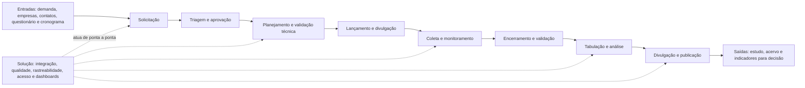
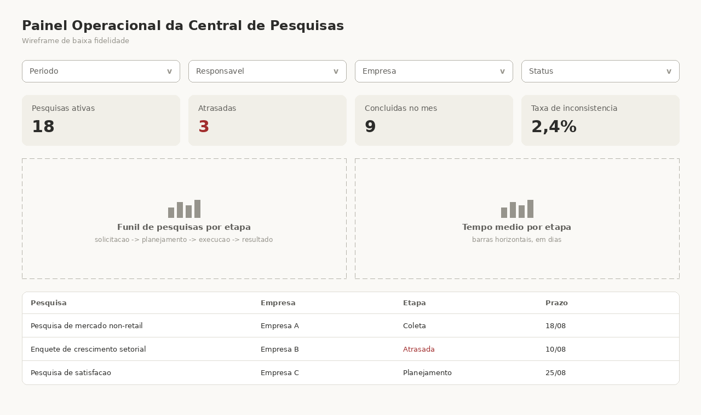
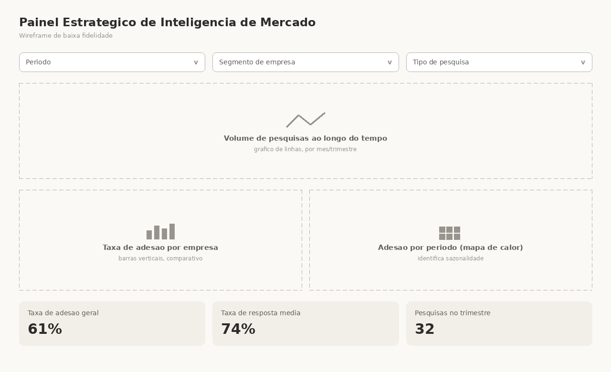

# Contexto Organizacional e Requisitos da Solução Analítica

Este documento registra a contextualização organizacional e o alinhamento estratégico do projeto **Governança e Integração de Dados da Central de Pesquisas**, realizado em parceria com o Sindusfarma. Nesta contribuição, o Termo de Abertura de Projeto (TAPI) é a fonte de verdade principal. O Data Model Canvas fornecido pelo professor é usado como referência preliminar apenas quando complementa decisões já compatíveis com o TAPI; ele não substitui o Data Model Canvas que a equipe elaborará. Informações institucionais ausentes no TAPI foram complementadas pela página oficial do Sindusfarma.

## Sumário

- [1. Cenário Organizacional e Contexto do Projeto](#1-cenário-organizacional-e-contexto-do-projeto)
  - [1.1 Visão Geral do Parceiro](#11-visão-geral-do-parceiro)
  - [1.2 Contexto do Negócio](#12-contexto-do-negócio)
  - [1.3 Objetivos do Projeto](#13-objetivos-do-projeto)
  - [1.4 Escopo do Projeto](#14-escopo-do-projeto)
- [2. Alinhamento Estratégico](#2-alinhamento-estratégico)
  - [2.1 Fluxo de Valor](#21-fluxo-de-valor)
  - [2.2 Análise de Stakeholders](#22-análise-de-stakeholders)
  - [2.3 Processos Impactados](#23-processos-impactados)
  - [2.4 Objetivos Estratégicos Atendidos](#24-objetivos-estratégicos-atendidos)
- [Rastreabilidade das tasks](#rastreabilidade-das-tasks)
- [3. Governança de Dados](#3-governança-de-dados)
  - [3.1 Estrutura de Governança](#31-estrutura-de-governança)
  - [3.2 Segurança da Informação](#32-segurança-da-informação)
  - [3.3 LGPD e Aspectos Regulatórios](#33-lgpd-e-aspectos-regulatórios)
  - [3.4 Qualidade dos Dados](#34-qualidade-dos-dados)
  - [3.5 Matriz de Papéis e Controles](#35-matriz-de-papéis-e-controles)
- [4. Especificação dos Requisitos](#4-especificação-dos-requisitos)
  - [4.1 Requisitos Funcionais](#41-requisitos-funcionais)
  - [4.2 Requisitos Não Funcionais](#42-requisitos-não-funcionais)
- [Referências](#referências)
- [5. Especificação da Solução Analítica](#5-especificação-da-solução-analítica)
  - [5.1 Perguntas de Negócio](#51-perguntas-de-negócio)
  - [5.2 Indicadores e Métricas de Negócio](#52-indicadores-e-métricas-de-negócio)
  - [5.3 Dashboards Propostos](#53-dashboards-propostos)
- [6. Matriz de Rastreabilidade](#6-matriz-de-rastreabilidade)

## 1. Cenário Organizacional e Contexto do Projeto

### 1.1 Visão Geral do Parceiro

O parceiro é o **Sindusfarma - Sindicato da Indústria de Produtos Farmacêuticos no Estado de São Paulo**, uma entidade sindical e representativa da indústria farmacêutica, não de uma fabricante de medicamentos. Sua atuação conecta empresas nacionais e multinacionais e oferece apoio técnico, regulatório e estratégico ao setor. A área diretamente envolvida no projeto é a **Inteligência de Mercado e Pesquisas**, especificamente a Central de Pesquisas, que conduz estudos de mercado e levantamentos setoriais para subsidiar decisões das empresas participantes.

| Aspecto | Caracterização fundamentada |
|---|---|
| Nome da organização | Sindusfarma - Sindicato da Indústria de Produtos Farmacêuticos no Estado de São Paulo. |
| Setor de atuação | Representação sindical e institucional da indústria farmacêutica, com atuação técnica, regulatória, econômica, trabalhista e de inteligência de mercado. |
| Localização geográfica | Sede na Rua Alvorada, 1280, Vila Olímpia, São Paulo/SP, e escritório institucional em Brasília/DF. A abrangência é nacional, pois a entidade congrega empresas instaladas no Brasil. |
| Porte | Como o parceiro é uma entidade representativa, as classificações empresariais usuais por faturamento ou número de empregados não são adequadas e esses dados não constam no TAPI. Para esta análise, considera-se uma entidade de **grande representatividade setorial**: seus associados respondem por mais de 95% do mercado brasileiro de medicamentos, enquanto a Central opera aproximadamente 120 pesquisas por ano, com cerca de 60 empresas envolvidas em cada pesquisa. |
| Principais produtos e serviços | Representação e interlocução institucional; apoio técnico e regulatório; pesquisas de opinião e benchmarking; estudos e publicações; auditorias compartilhadas; comitês e grupos de trabalho; protocolos de cooperação; cursos, workshops e seminários. Para este projeto, o serviço central é a produção e disponibilização de pesquisas setoriais. |
| Breve histórico | O Sindusfarma foi fundado em 1933 e consolidou-se como entidade de representação da indústria farmacêutica instalada no país. Sua trajetória inclui interlocução com autoridades, difusão de conhecimento e ampliação de serviços às empresas associadas. |
| Missão ou propósito institucional | A página institucional não apresenta, no trecho consultado, uma frase formal intitulada “missão”. Como síntese fiel do propósito declarado, o Sindusfarma defende as causas da indústria farmacêutica, contribui para o aprimoramento dos sistemas público e privado de saúde e difunde conhecimento científico e tecnológico para desenvolver o setor e promover saúde e bem-estar. |

O projeto se concentra na capacidade informacional da Central de Pesquisas, e não na totalidade das frentes institucionais do Sindusfarma. Essa delimitação é importante, pois a solução deve ter o foco de tornar o ciclo das pesquisas mais integrado, confiável e mensurável, preservando a responsabilidade das áreas técnicas e de negócio sobre o conteúdo dos levantamentos.

### 1.2 Contexto do Negócio

#### Características da indústria e do serviço de pesquisas

A indústria farmacêutica é um ambiente de forte exigência regulatória, diversidade de especialidades e necessidade permanente de interlocução entre empresas, autoridades e especialistas, características refletidas nas áreas de atuação do Sindusfarma. Nesse contexto, informação setorial confiável tem valor estratégico: a Central transforma solicitações, questionários e respostas de empresas e profissionais em estudos que permitem comparar práticas, acompanhar o mercado e apoiar decisões. O volume aproximado de 120 pesquisas anuais e 60 empresas participantes por pesquisa evidencia uma operação recorrente, multiator e intensiva em dados.

O ciclo de uma pesquisa envolve solicitação, aprovação, planejamento, validação técnica, divulgação, coleta, encerramento, tabulação e publicação. As informações atravessam Excel, SurveyMonkey, Trello, Outlook, um workflow em n8n e o repositório do site. As ferramentas atendem a etapas específicas, mas não formam hoje uma cadeia integrada. Assim, o valor da pesquisa depende tanto da qualidade metodológica quanto da capacidade de manter identidade, estado, prazos, participação e resultado consistentes durante todo o ciclo.

#### Desafios enfrentados

- **Fragmentação e silos:** os dados ficam distribuídos entre ferramentas operacionais e o repositório publicado, sem integração estruturada.
- **Rastreabilidade limitada:** o n8n replica novas solicitações, mas não governa o ciclo completo; não existe vínculo automatizado ponta a ponta entre solicitação, execução, resultado e publicação.
- **Esforço e latência operacional:** dashboards, cruzamentos e partes da tabulação dependem de atualizações manuais, aumentando tempo de entrega e risco de divergência.
- **Consistência entre ambientes:** o repositório público funciona como silo e pode divergir do controle interno devido à alimentação manual.
- **Qualidade e confiança:** campos incompletos ou inválidos, duplicidades e falta de padronização exigem tratamento antes do uso analítico.
- **Confidencialidade:** dados reais de empresas, respostas individuais identificáveis e contatos não podem ser expostos no repositório acadêmico; o uso público exige anonimização ou dados fictícios.

#### Oportunidades identificadas

O TAPI propõe uma espinha dorsal de dados composta por banco relacional centralizado na nuvem, pipeline de integração e data app com indicadores operacionais e estratégicos. A oportunidade imediata é transformar registros dispersos em uma fonte única de verdade, com identificadores e estados consistentes para cada pesquisa. A base fornecida é tecnicamente favorável a um MVP: os quatro arquivos estruturados somam cerca de 3 MB, com aproximadamente 400 pesquisas, 6 mil clientes, 20 mil respondentes e 800 empresas. Isso permite validar modelagem, ingestão, deduplicação, regras de qualidade e consumo analítico antes de ampliar a solução.

Também há oportunidade de aproveitar ativos existentes. O n8n pode continuar como camada de orquestração caso a avaliação arquitetural confirme sua adequação, e o agente de IA já empregado na entrada de solicitações pode permanecer integrado ao fluxo. A centralização possibilita automatizar a alimentação de dashboards e do acervo público, medir adesão e tempos de ciclo e detectar empresas ou públicos pouco engajados. Essas capacidades aproximam a Central do objetivo de tornar-se referência de dados do setor e reduzem a dependência de conhecimento operacional disperso.

#### Tendências relevantes e justificativa do projeto

As fontes apontam quatro movimentos de gestão relevantes para o parceiro: decisões orientadas por dados; centralização em nuvem; automação de integrações; e governança com controle de acesso, rastreabilidade e conformidade com a LGPD. No contexto deste documento, esses movimentos são tratados como direções estratégicas do projeto, e não como alegações estatísticas sobre todo o mercado farmacêutico.

A realização do projeto se justifica pela combinação entre escala operacional, valor estratégico e risco de continuidade. A Central processa um volume expressivo de pesquisas, mas a arquitetura atual limita a rapidez, a auditabilidade e a confiança dos indicadores. Ao mesmo tempo, já existem dados estruturados, fontes conhecidas, usuários validadores e um MVP delimitado. Portanto, a iniciativa pode gerar ganho verificável sem substituir as ferramentas consolidadas: integra o que já existe, governa o dado ao longo do ciclo e entrega visão analítica consistente para operação e decisão.

### 1.3 Objetivos do Projeto

Os objetivos abaixo traduzem o objetivo macro do TAPI em resultados de ação verificáveis. Onde o TAPI define apenas uma direção, a evidência proposta explicita como a equipe poderá demonstrar o resultado sem inventar um percentual de melhoria ainda não acordado com o parceiro.

| ID | Objetivo mensurável | Evidência de êxito | Valor para o parceiro |
|---|---|---|---|
| OBJ-01 | **Centralizar** em banco relacional na nuvem os dados necessários para representar solicitação, planejamento, execução e resultado de uma pesquisa. | No MVP, uma pesquisa percorre as quatro macroetapas no modelo central, com identificador persistente e registros consultáveis. | Cria a fonte única de verdade e reduz divergências entre controles locais. |
| OBJ-02 | **Integrar** ao banco central pelo menos uma fonte atual por meio de pipeline automatizado no MVP. | Execução reproduzível carrega dados de SurveyMonkey e/ou Excel, com registro de início, fim, resultado e falhas. | Reduz esforço de consolidação e estabelece um padrão escalável para novas fontes. |
| OBJ-03 | **Tratar** inconsistências, duplicidades e padrões de campos nos dados ingeridos. | A carga executa regras documentadas de validação e deduplicação e produz contagens de registros válidos, inválidos e corrigidos. | Aumenta a confiança nos indicadores e torna problemas de qualidade visíveis. |
| OBJ-04 | **Disponibilizar** um conjunto inicial de indicadores operacionais e estratégicos alimentado pelo banco central, sem atualização manual para a fonte coberta pelo MVP. | O data app consulta o banco central e apresenta volume, status, adesão e tempos do ciclo definidos para o incremento. | Dá visibilidade tempestiva à operação e sustenta decisões com dados consistentes. |
| OBJ-05 | **Rastrear** o ciclo de vida da pesquisa, da solicitação à publicação, registrando etapas, responsáveis funcionais e marcos temporais disponíveis. | Um usuário autorizado consulta o histórico ordenado de uma pesquisa e identifica seu estado e seus marcos. | Facilita acompanhamento, auditoria, identificação de gargalos e prestação de contas. |
| OBJ-06 | **Controlar** o acesso por perfil e **proteger** informações restritas por anonimização ou uso de dados fictícios nos ambientes públicos. | Perfis autorizados visualizam apenas os dados previstos; nenhuma base real identificável é publicada no repositório acadêmico público ou no acervo de demonstração. | Preserva a confiança de empresas e respondentes e reduz exposição regulatória e reputacional. |
| OBJ-07 | **Sincronizar** o acervo público com os registros aprovados do banco central no escopo de evolução da solução. | Uma publicação aprovada é disponibilizada sem recadastro manual e mantém correspondência com o registro interno. | Evita retrabalho e inconsistência entre o sistema interno e a informação externa. |

### 1.4 Escopo do Projeto

O escopo combina a visão macro e o MVP definidos no TAPI. A visão macro orienta a arquitetura final; o MVP comprova o valor com banco central, ao menos um pipeline, indicadores iniciais e controle de acesso. Essa distinção evita prometer integração total de todas as fontes no primeiro incremento.

#### Escopo incluído

| Categoria | Entregas e limites incluídos |
|---|---|
| Funcionalidades previstas | Modelagem e implementação de banco relacional em nuvem; ingestão automatizada de pelo menos uma fonte no MVP; tratamento de inconsistências, deduplicação e padronização; data app web; consulta ao acervo; rastreabilidade do ciclo; controle de acesso por perfil; e integração progressiva com o repositório público. O n8n pode ser reutilizado como orquestrador após validação de adequação. |
| Análises desenvolvidas | Volume e evolução das pesquisas; distribuição por área, tipo e estado; fluxo de pesquisas ainda não finalizadas; adesão por pesquisa, empresa, área e período; empresas sem participação; engajamento de respondentes por cargo ou departamento; tempos de validação, coleta, tabulação e ciclo total em dias úteis; prorrogações; representatividade das participantes; recorrência de temas; e qualidade dos registros. O conjunto exato do MVP deverá ser priorizado com a Central. |
| Dashboards produzidos | **Gestão do Portfólio e Fluxo de Pesquisas**, para volume, estado e prazos; **Adesão e Engajamento**, para participação de empresas e respondentes; e **Eficiência e Qualidade**, para tempos de ciclo, prorrogações, completude e validade. O data app também contempla um acervo consultável de pesquisas publicadas. Esses agrupamentos são uma organização preliminar coerente com os KPIs do TAPI; a especificação visual definitiva pertence à seção de Solução Analítica. |
| Processos contemplados | Solicitação; triagem e aprovação; planejamento de cronograma e questionário; validação técnica; lançamento e divulgação; coleta e monitoramento; encerramento e validação das respostas; tabulação; divulgação dos resultados e publicação no repositório. |
| Documentação e sustentação | Modelo de dados documentado, arquitetura e pipeline descritos, protocolos de governança e qualidade, diretrizes de conformidade com a LGPD e orientação de uso do data app. |

#### Escopo não incluído

| Exclusão | Justificativa |
|---|---|
| Substituir SurveyMonkey, Trello, Outlook, n8n ou o repositório público por novas ferramentas operacionais. | O TAPI determina que a solução integre e governe as ferramentas existentes, não que as substitua. |
| Publicar ou tratar em ambiente acadêmico aberto dados pessoais reais sem anonimização ou mascaramento. | Bases com empresas reais, respostas identificáveis e contatos são conteúdo restrito. O repositório acadêmico e as demonstrações públicas devem usar dados anonimizados ou fictícios. |
| Integrar todas as fontes e automatizar todo o acervo já no MVP. | O mínimo acordado é um pipeline funcional cobrindo ao menos uma fonte. A expansão para as demais fontes é evolução posterior, condicionada à validação do MVP. |
| Redefinir a metodologia científica, aprovar questionários ou substituir a validação das áreas técnicas. | A solução oferece dados, rastreabilidade e indicadores; a responsabilidade sobre conteúdo e validação técnica permanece com as áreas competentes do Sindusfarma. |
| Tomar decisões estratégicas automaticamente ou substituir a análise dos gestores. | Dashboards apoiam decisão, mas interpretação, priorização e ação continuam sob responsabilidade dos usuários de negócio. |
| Contratar fornecedor de nuvem ou definir unilateralmente a plataforma definitiva. | O TAPI admite Amazon RDS, Google Cloud SQL ou equivalente, e o Canvas registra a escolha da plataforma como decisão pendente. |

## 2. Alinhamento Estratégico

O projeto contribui para a estratégia do Sindusfarma ao fortalecer um serviço que transforma participação coletiva em conhecimento setorial. Seu valor não está apenas no banco de dados ou no dashboard, mas em reduzir o intervalo e a incerteza entre uma demanda de pesquisa e uma informação confiável disponível para decisão. A solução também protege a credibilidade institucional: uma pesquisa rastreável, consistente e governada oferece melhor serviço às associadas e preserva a confidencialidade de empresas e respondentes.

### 2.1 Fluxo de Valor

O fluxo de valor da Central começa com uma necessidade informacional e termina com resultados validados e publicados. A solução proposta insere uma camada transversal de integração, governança e análise; ela não elimina as atividades humanas de aprovação, desenho do questionário e interpretação dos resultados.

| Etapa de valor | Entradas principais | Atores | Saídas de valor | Contribuição do projeto |
|---|---|---|---|---|
| Identificar e aprovar a demanda | Solicitação, tema, área demandante, público e finalidade | Solicitantes, Central de Pesquisas e áreas técnicas | Pesquisa aprovada, identificada e priorizada | Registra a origem e cria um identificador que acompanha todo o ciclo. |
| Planejar e validar | Questionário, cronograma, critérios e lista de participantes | Central, áreas técnicas e solicitantes | Questionário validado e plano de execução | Conecta versão, responsáveis, prazos e aprovações ao registro da pesquisa. |
| Lançar, coletar e acompanhar | Questionário publicado, convites, empresas e respondentes | Central, empresas participantes e respondentes | Respostas e indicadores de adesão e andamento | Consolida estado e participação, permitindo acompanhamento sem cruzamentos manuais. |
| Encerrar e tabular | Respostas coletadas e regras de validação | Central e áreas técnicas | Base validada, indicadores e resultados | Aplica controles de qualidade, registra exceções e reduz duplicidade e retrabalho. |
| Divulgar e aprender | Resultado aprovado, metadados e regras de acesso | Central, solicitantes, participantes e público autorizado | Estudo divulgado, acervo consistente e aprendizado para novas pesquisas | Alimenta dashboards e repositório a partir da mesma fonte governada e preserva trilha até a publicação. |

Atualmente, cada ferramenta gera valor localmente, mas as transições entre etapas exigem conferências e atualizações manuais. A melhoria pretendida ocorre justamente nessas passagens: uma mudança de estado, prazo ou participação deve ser capturada uma vez, validada e reaproveitada nos indicadores e na publicação. Isso reduz espera, retrabalho e ambiguidade, enquanto a equipe mantém o controle das decisões que exigem julgamento técnico.

### 2.2 Análise de Stakeholders

As preocupações listadas abaixo são hipóteses de adoção e risco derivadas do escopo. Elas devem ser validadas em entrevistas ou cerimônias com o parceiro; não são apresentadas como opiniões já manifestadas pelas pessoas citadas.

| Stakeholder | Papel na organização/projeto | Interesse no projeto | Benefícios esperados | Preocupações ou resistências potenciais |
|---|---|---|---|---|
| Fabio Moreira - gestor da Central e Data Owner | Líder executivo e responsável de negócio pelos dados da Central. | Garantir que a solução sustente prioridades e decisões da área. | Visão consolidada do portfólio, indicadores confiáveis e melhor prestação de contas. | Custo de sustentação, aderência ao fluxo real e comprovação do valor do MVP. |
| Felipe Fernandes Rojas - analista de dados sênior | Líder do projeto, líder técnico, Data Steward e referência técnica. | Assegurar integração, regras de dados e utilidade analítica. | Menos consolidação manual, modelo reutilizável e maior rastreabilidade. | Sobrecarga de validação, regras implícitas nas planilhas e manutenção da solução. |
| Reinaldo Nobrega e Lucas Andrade - equipe de dados | Ponto focal, liderança de negócio e apoio técnico/curadoria. | Representar necessidades operacionais e validar dados e indicadores. | Rotinas mais previsíveis, identificação rápida de inconsistências e melhor acompanhamento. | Curva de adoção, perda de flexibilidade de controles locais e qualidade das fontes legadas. |
| Equipe da Central de Pesquisas | Usuária principal, opera o ciclo e valida a entrega. | Gerenciar pesquisas, prazos, respostas, tabulação e publicação. | Redução de recadastro, visão de status e acesso a histórico confiável. | Mudança de rotina, usabilidade, desempenho e necessidade de corrigir dados na origem. |
| Áreas técnicas do Sindusfarma | Validam questionários e acompanham adesão. | Obter informação correta sobre pesquisas sob sua responsabilidade. | Acompanhamento de participação, prazos e resultados com menos solicitações manuais. | Permissões inadequadas, indicadores fora de contexto ou registros sem explicação metodológica. |
| Empresas associadas, solicitantes e respondentes | Fornecem demandas e dados e consomem estudos e resultados. | Receber pesquisas relevantes, participar com segurança e acessar resultados. | Experiência mais consistente, melhor acervo e pesquisas orientadas por evidências de adesão. | Confidencialidade, finalidade de uso, identificação indireta e fadiga por excesso de pesquisas. |
| Rodrigo Giorgetto (TI) e RentalHost | Custódia de armazenamento/infraestrutura interna e do repositório público, respectivamente. | Manter disponibilidade, segurança e integração entre ambientes. | Contratos de dados mais claros, alimentação controlada e menor intervenção manual. | Compatibilidade, credenciais, suporte, custos, monitoramento e divisão de responsabilidades. |
| Equipe do Inteli | Desenvolve e documenta o MVP em parceria com o Sindusfarma. | Entregar solução verificável dentro do escopo acadêmico. | Aprendizado aplicado e evidências de impacto real. | Acesso restrito a dados reais, dependências externas e risco de extrapolar o MVP. |
| Usuários do acervo público | Consultam pesquisas autorizadas e baixam resultados. | Encontrar publicações corretas e atuais. | Acervo mais consistente e pesquisável. | Indisponibilidade, publicação indevida ou ausência de contexto sobre os resultados. |

### 2.3 Processos Impactados

| Processo | Situação atual | Limitações existentes | Melhoria esperada após a solução |
|---|---|---|---|
| Solicitação da pesquisa | Um agente em JSON e um workflow n8n apoiam a entrada, replicando a nova solicitação para ferramentas do fluxo. | A conexão é pontual e não governa o dado ao longo de todo o ciclo. | Criar o registro mestre da pesquisa na entrada, com identificador, origem, responsável e trilha de mudanças. |
| Triagem e aprovação | A Central e as áreas envolvidas avaliam a demanda antes do planejamento. | Aprovações e estados podem ficar distribuídos entre ferramentas, reduzindo a rastreabilidade. | Registrar decisão, data, responsável e motivo no histórico central, permitindo visualizar a fila aprovada e rejeitada. |
| Planejamento de cronograma e questionário | O agente existente pode otimizar questionários com LLM, criar tarefas no Trello e questionário no SurveyMonkey. | Artefatos e versões ficam dispersos; a automação de criação não consolida o ciclo. | Vincular cronograma, versão do questionário, tarefas e metadados ao mesmo registro governado. |
| Validação técnica | Áreas técnicas validam questionários e acompanham pesquisas. | Falta uma visão consolidada de pendências, responsáveis, versões e tempo de validação. | Exibir estado da validação e seus marcos, preservando que a aprovação continue humana. |
| Lançamento e divulgação | Questionários e comunicações são preparados nas ferramentas atuais. | A data efetiva de divulgação pode exigir atualização posterior em planilhas e dashboards. | Registrar o lançamento uma vez e reutilizar o marco no acompanhamento de coleta e nos cálculos de tempo. |
| Coleta e monitoramento de respostas | O SurveyMonkey recebe respostas; a Central acompanha adesão e andamento. | Consolidação e dashboard manuais dificultam visão tempestiva e comparações por empresa, área ou período. | Atualizar automaticamente os dados cobertos pelo pipeline e sinalizar adesão, pendências e evolução. |
| Encerramento e validação das respostas | A equipe encerra a coleta e verifica os registros antes da tabulação. | Campos incompletos ou inválidos e duplicidades podem demandar limpeza manual sem métricas consolidadas. | Aplicar regras documentadas, separar exceções e medir completude, validade e correções. |
| Tabulação | Resultados são preparados com dependência de cruzamentos e esforço manual. | Retrabalho, maior tempo de entrega e risco de usar versões inconsistentes. | Fornecer base validada e central para tabulação e indicadores, mantendo memória das transformações. |
| Divulgação e publicação no repositório | O acervo do site é um silo alimentado separadamente. | Atualização manual e possível divergência entre registro interno e conteúdo publicado. | Publicar apenas resultados aprovados a partir do banco central e manter correspondência rastreável entre origem e acervo. |

O impacto esperado não é apenas acelerar tarefas isoladas. A mudança principal é tornar as transições observáveis: saber quando uma etapa começou e terminou, qual informação foi aprovada, qual regra alterou um registro e qual versão chegou ao público. Essa visibilidade permite identificar gargalos com evidência e priorizar melhorias sem perder a autonomia das áreas responsáveis.

### 2.4 Objetivos Estratégicos Atendidos

Os objetivos estratégicos abaixo vêm do Data Model Canvas preliminar e foram mantidos apenas quando encontram suporte no problema, objetivo ou benefícios do TAPI. A coluna de evidência evita confundir contribuição esperada com resultado já alcançado.

| Objetivo estratégico do parceiro | Contribuição do projeto | Evidência futura de contribuição |
|---|---|---|
| Tornar-se referência de dados do setor farmacêutico | Consolida histórico, catálogo, estados e resultados das pesquisas em uma fonte governada, aumentando consistência e capacidade de consulta. | Crescimento do acervo integrado e disponibilidade de séries por período, área e tema. |
| Aumentar engajamento e adesão das indústrias às pesquisas | Identifica padrões de participação, empresas sem adesão e públicos mais ou menos engajados, permitindo ações de relacionamento mais direcionadas. | Taxa de adesão por pesquisa e período; empresas sem participação; respondentes únicos. |
| Aprimorar qualidade e relevância dos questionários | Permite analisar temas recorrentes, adesão por tipo/área, prorrogações e qualidade das respostas como insumos para o planejamento. A decisão metodológica permanece com as áreas técnicas. | Comparações de adesão, recorrência, prorrogação e campos inválidos associadas a cada pesquisa. |
| Reduzir esforço manual e tempo de entrega | Automatiza ingestão e reaproveita os mesmos dados validados em acompanhamento, dashboard e publicação. | Tempos de validação, coleta, tabulação e ciclo total; execuções do pipeline; redução de recadastros identificados no fluxo. |
| Sustentar decisões estratégicas com dados | Entrega indicadores consolidados sobre volume, andamento, participação, eficiência e representatividade de mercado. | Dashboards alimentados pelo banco central e registros de decisões apoiadas pelos indicadores. |
| Garantir governança, rastreabilidade e conformidade com a LGPD | Define responsáveis, perfis de acesso, trilha do ciclo, validações e restrição de dados identificáveis em ambientes públicos. | Histórico por pesquisa, resultados de qualidade, testes de permissão e verificação de anonimização/publicação. |

O alinhamento deverá ser reavaliado com o parceiro após a priorização dos requisitos e dashboards. As métricas propostas indicam como demonstrar valor, mas metas numéricas de redução de tempo, aumento de adesão ou melhoria de completude só devem ser estabelecidas após medir a linha de base; o TAPI e o Canvas não fornecem esses valores iniciais.

## Rastreabilidade das tasks

| Task | Critérios cobertos | Implementação/evidência | Status |
|---|---|---|---|
| `docs(artefato-1): contextualizar parceiro e escopo` | Parceiro, setor, porte, serviços, desafios, oportunidades, objetivos e escopo incluído/não incluído. | Seções 1.1 a 1.4; TAPI como fonte principal. | Atendido |
| `docs(artefato-1): mapear fluxo de valor e stakeholders` | Entradas, saídas, atores, ponto de inserção, stakeholders, processos impactados, limitações, melhorias e objetivos estratégicos. | Seções 2.1 a 2.4; diagrama do fluxo e tabelas de stakeholders e processos. | Atendido |
| `docs(governanca): estrutura, segurança, LGPD e qualidade dos dados` | Papéis e responsáveis, áreas envolvidas, processos de aprovação, políticas e ferramentas; controle de acesso, auditoria, rastreabilidade, backup, criptografia e prevenção de vazamento; dados pessoais, sensíveis, consentimento, anonimização, retenção, direitos dos titulares e impactos da LGPD; desafios, indicadores, validação e correção de qualidade. | Seções 3.1 a 3.5; matriz de papéis e controles (3.5). | Atendido |

## 3. Governança de Dados

A Central de Pesquisas do Sindusfarma opera hoje um volume aproximado de 120 pesquisas por ano, com cerca de 60 empresas envolvidas por pesquisa, apoiando-se em ferramentas consolidadas por etapa (Excel, SurveyMonkey, Trello e o repositório interno do site) e em um workflow em n8n que apenas replica novas solicitações. Como não há uma camada que consolide e governe o dado ao longo do ciclo de vida da pesquisa, a governança existe hoje de forma **informal e distribuída**: as decisões sobre o dado são tomadas caso a caso pelas pessoas que operam cada ferramenta. Esta seção formaliza a estrutura de governança, os controles de segurança, o tratamento de dados pessoais sob a LGPD e a política de qualidade que passarão a reger o banco de dados centralizado, o pipeline de integração e o data app entregues pelo projeto.

### 3.1 Estrutura de Governança

O modelo de governança adota os papéis clássicos de gestão de dados (DAMA-DMBOK) e os associa às pessoas já indicadas pelo parceiro no onboarding do projeto. Como ainda não existe um comitê formal de dados no Sindusfarma, a estrutura abaixo é a **proposta de governança do projeto**, construída a partir das responsabilidades reais informadas pelo parceiro; ela deve evoluir conforme a maturidade da área aumenta.

| Papel | Responsável | Responsabilidades principais | Área |
|---|---|---|---|
| Data Owner | Fabio Moreira (Gestor da Central de Pesquisas) | Propriedade de negócio do dado, priorização, aprovação de políticas de acesso e uso, decisão final sobre publicação | Central de Pesquisas |
| Data Steward | Felipe Rojas, Reinaldo Nobrega, Lucas Andrade | Definição de regras de negócio, padrões, dicionário de dados, monitoramento e correção de qualidade | Central de Pesquisas / Dados |
| Data Custodian | Rodrigo Giorgetto (TI) | Armazenamento, infraestrutura em nuvem, backups, controle técnico de acesso e sustentação | TI Sindusfarma |
| Custódia externa | RentalHost | Hospedagem e disponibilidade do repositório público do acervo | Fornecedor |
| Líder técnico | Felipe Rojas | Condução técnica da arquitetura, integração e validação | Central de Pesquisas / Dados |
| Líder de negócio | Reinaldo Nobrega | Tradução das necessidades de negócio em requisitos e aceite das entregas | Central de Pesquisas |

**Áreas envolvidas.** A Central de Pesquisas (operação e gestão do fluxo), as áreas técnicas do Sindusfarma (validação de questionários e acompanhamento de adesão) e a TI (infraestrutura, segurança e sustentação) participam diretamente da governança. Os solicitantes e participantes externos são consumidores do acervo público e não têm papel decisório sobre o dado.

**Processos de aprovação.** As decisões seguem um fluxo de escalonamento: mudanças em regras de negócio e definições de dados são propostas pelos Data Stewards; alterações em políticas de acesso, classificação e publicação são aprovadas pelo Data Owner; mudanças de infraestrutura, retenção técnica e backup são executadas pelo Data Custodian após aprovação do Owner. Decisões estruturais ainda em aberto — como a definição da plataforma de banco de dados em nuvem (Amazon RDS, Google Cloud SQL ou equivalente) e a manutenção ou substituição do n8n como camada de orquestração — são registradas como decisões de arquitetura e submetidas ao Owner e ao Líder técnico.

**Políticas existentes e ferramentas.** Não há, atualmente, uma política de dados formalizada; a gestão ocorre por convenção operacional em cada ferramenta (Excel, SurveyMonkey, Trello, repositório do site e n8n). O projeto introduz, como instrumentos de governança, o banco de dados relacional central como fonte única da verdade, um dicionário/catálogo de dados descrevendo entidades, campos, tipos, origem, regras e responsáveis, e o versionamento da documentação no repositório GitHub do projeto. Esses instrumentos substituem o controle tácito e distribuído por controles explícitos e rastreáveis.

### 3.2 Segurança da Informação

A segurança é tratada em torno dos três perfis de uso previstos para o data app — **equipe interna da Central de Pesquisas** (usuário principal), **áreas técnicas do Sindusfarma** (usuário secundário) e **solicitantes/participantes externos** (usuário terciário) — e do princípio do menor privilégio: cada perfil acessa apenas o conjunto de dados e funcionalidades necessários à sua função.

**Controle de acesso e níveis de permissão.** O acesso é baseado em papéis (RBAC). A equipe interna tem acesso completo ao ciclo de vida das pesquisas e aos dados operacionais; as áreas técnicas têm acesso de leitura a questionários, status e indicadores de adesão; os solicitantes e participantes externos acessam apenas o acervo público, com dados anonimizados ou fictícios. Dados reais de empresas participantes, respostas individuais identificáveis e dados de contato são restritos e nunca expostos à camada pública nem versionados no repositório aberto do GitHub.

**Auditoria e rastreabilidade.** Um dos objetivos centrais do parceiro é a rastreabilidade e auditabilidade ponta a ponta — da solicitação à publicação da pesquisa. O banco central deve registrar, para cada etapa (solicitação → planejamento → execução → resultado → publicação), o responsável, o carimbo de tempo e a transição de status, de modo que qualquer indicador exibido no dashboard possa ser reconstituído até sua origem. Logs de acesso e de alteração devem permitir identificar quem leu ou modificou cada registro sensível.

**Backups, criptografia e prevenção de vazamento.** A infraestrutura em nuvem deve prover backups automáticos e periódicos sob responsabilidade do Data Custodian (TI), criptografia de dados em trânsito (TLS) e em repouso, e credenciais e segredos mantidos fora do código-fonte (variáveis de ambiente e cofre de segredos), nunca versionados. Como prevenção de vazamento, a fronteira entre o ambiente interno (dados reais) e a camada pública (dados anonimizados/fictícios) é um controle explícito: nenhuma base com dado real de empresa ou respondente identificável trafega para o repositório público ou para o GitHub do projeto.

### 3.3 LGPD e Aspectos Regulatórios

O tratamento de dados no projeto é regido pela Lei Geral de Proteção de Dados (Lei nº 13.709/2018). É necessário distinguir dois conjuntos de dados: os **dados pessoais de respondentes** (base `respondentes.csv`, ~20.000 registros — pessoas físicas identificáveis, como nome, cargo e e-mail corporativo) e os **dados de pessoa jurídica** (bases `empresas.csv` e `clientes.csv` — empresas participantes), que não são dados pessoais na acepção da LGPD, mas são informações comerciais confidenciais e igualmente restritas.

**Dados pessoais e dados sensíveis.** Os dados de respondentes são dados pessoais comuns. A equipe **não** identificou, nas bases disponibilizadas, dados pessoais sensíveis na acepção do art. 5º, II da LGPD (origem racial/étnica, convicção religiosa, opinião política, saúde, vida sexual, dado genético ou biométrico) — esta é uma constatação da equipe a partir do escopo informado, e deve ser reconfirmada caso o conjunto de dados evolua. Ainda assim, todos os dados de respondentes recebem tratamento restrito por conterem informação identificável.

**Consentimento e base legal.** O documento de escopo do parceiro determina conformidade com a LGPD, mas **não especifica a base legal** do tratamento; portanto, ela não é afirmada como fato neste artefato. Como **decisão a validar** com o parceiro e sua área jurídica/DPO, as hipóteses legais candidatas para os dados de respondentes são o **consentimento** (art. 7º, I) para a participação nas pesquisas e o **legítimo interesse** (art. 7º, IX) para a produção de inteligência setorial agregada. Independentemente da base que vier a ser adotada, as respostas devem ser utilizadas apenas para as finalidades das pesquisas, sem uso desvinculado desse propósito.

**Anonimização.** É a principal salvaguarda técnica do projeto e uma restrição explícita do parceiro: o repositório público e qualquer material versionado abertamente devem usar dados anonimizados ou fictícios; o projeto não contempla o tratamento de dados pessoais reais sem anonimização/mascaramento. A anonimização remove a associação entre resposta e indivíduo, permitindo análise agregada (adesão, tempos, representatividade) sem expor titulares.

**Retenção, arquivamento e descarte.** Os dados pessoais de respondentes devem ser retidos apenas pelo tempo necessário à execução e ao histórico analítico das pesquisas; recomenda-se que, encerrado o ciclo de uma pesquisa, os identificadores diretos sejam anonimizados, preservando-se apenas a informação agregada para análise histórica. O descarte e a política de retenção técnica (incluindo backups) ficam sob responsabilidade do Data Custodian, com definição de prazo aprovada pelo Data Owner.

**Direitos dos titulares.** O projeto deve preservar a capacidade de a organização atender aos direitos previstos no art. 18 da LGPD — confirmação de tratamento, acesso, correção, anonimização/eliminação, portabilidade e revogação de consentimento. Como os identificadores de respondente ficam no ambiente interno controlado, o atendimento a solicitações de titulares é operacionalmente viável (localização e eliminação do registro correspondente).

**Impactos no projeto.** As restrições da LGPD moldam decisões de arquitetura e escopo: (a) o repositório público e o GitHub só recebem dados anonimizados/fictícios, exigindo uma etapa de mascaramento no pipeline antes de qualquer publicação; (b) o controle de acesso por perfil deixa de ser desejável e passa a ser requisito de conformidade; (c) a retenção e o descarte precisam de regra explícita, e não podem depender do acúmulo indefinido de planilhas; (d) a rastreabilidade ponta a ponta, além de valor de negócio, é evidência de accountability exigível pela lei.

### 3.4 Qualidade dos Dados

A baixa qualidade e a fragmentação dos dados são a causa-raiz do problema do parceiro: as informações estão dispersas entre planilhas e sistemas, sem padronização e com registros legados de qualidade heterogênea, o que hoje exige consolidação e conferência manuais.

**Problemas conhecidos.** Foram relatados pelo parceiro e evidenciados no levantamento: campos incompletos ou inválidos; duplicidade de registros entre fontes (ex.: uma mesma empresa ou respondente representado de formas diferentes em Excel, SurveyMonkey e no repositório); ausência de padronização de formatos e nomenclaturas; e dados legados com qualidade inconsistente. Esses problemas comprometem a confiabilidade dos indicadores quando cruzados manualmente.

**Indicadores utilizados pela organização.** O parceiro não possui, hoje, indicadores formais de qualidade de dados — o acompanhamento é informal e feito por conferência manual ao consolidar planilhas, sem métrica registrada ou monitorada ao longo do tempo. O Problem Canvas do projeto lista indicadores de qualidade (completude, inconsistências corrigidas) apenas como demonstrativos, sem valores oficiais. Diante disso, os indicadores abaixo são a **proposta do projeto**, não uma prática já adotada pelo Sindusfarma, e devem ser validados com o parceiro antes de se tornarem KPIs oficiais do data app.

**Dimensões e indicadores de qualidade propostos.** A política de qualidade do projeto adota dimensões reconhecidas de qualidade de dados, com indicadores mensuráveis a serem monitorados pelos Data Stewards:

| Dimensão | Indicador | Descrição |
|---|---|---|
| Completude | % de campos obrigatórios preenchidos | Proporção de registros sem valores nulos em campos-chave |
| Validade | % de registros em conformidade de formato/domínio | Datas, e-mails, códigos e categorias dentro do padrão esperado |
| Unicidade | % de registros sem duplicidade | Ausência de duplicatas após deduplicação por chave natural |
| Consistência | % de convergência entre fontes e acervo | Concordância entre banco central, sistema interno e repositório publicado |
| Acurácia | % de registros consistentes com a fonte de origem | Fidelidade do dado carregado em relação à fonte |

**Mecanismos de validação.** O pipeline de integração deve validar esquema e domínio na ingestão (tipos, formatos, campos obrigatórios), aplicar deduplicação por chave natural, padronizar nomenclaturas e formatos, e tratar nulos e registros inválidos segundo regra definida (rejeição, quarentena ou correção). Registros que falham na validação devem ser sinalizados, e não silenciosamente descartados.

**Processos de correção.** As inconsistências identificadas são encaminhadas aos Data Stewards, responsáveis por decidir a regra de correção e registrá-la no dicionário de dados, garantindo que a mesma inconsistência seja tratada de forma consistente nas cargas futuras. Os KPIs de governança (completude, validade, consistência e correções aplicadas) tornam o estado de qualidade visível e comparável ao longo do tempo, sustentando a evolução da área de um cenário fragmentado para uma fonte única e governada.

### 3.5 Matriz de Papéis e Controles

A tabela abaixo consolida os controles de governança em uma matriz verificável, associando cada controle a seu objetivo, ao responsável, à evidência que comprova sua aplicação e à periodicidade de verificação. Ela conecta as decisões descritas em 3.1–3.4 aos papéis definidos e serve como checklist de auditoria da governança de dados do projeto.

| # | Controle | Objetivo | Responsável | Evidência / Verificação | Periodicidade |
|---|---|---|---|---|---|
| C1 | Controle de acesso por perfil (RBAC) | Menor privilégio; proteger dados restritos | Data Custodian (TI); aprovação do Data Owner | Matriz de permissões e teste de autorização (positivo/negativo) | A cada mudança de perfil / trimestral |
| C2 | Autenticação de usuários internos | Garantir identidade antes do acesso | Data Custodian (TI) | Exigência de login para perfis internos; log de autenticação | Contínua |
| C3 | Rastreabilidade e auditoria ponta a ponta | Reconstituir qualquer indicador da solicitação à publicação | Data Steward; Data Custodian | Registro de responsável, timestamp e transição de status por etapa | Contínua |
| C4 | Backup automático | Recuperabilidade dos dados | Data Custodian (TI) | Configuração de backup e teste de restauração | Diária (backup) / trimestral (teste) |
| C5 | Criptografia em trânsito e em repouso | Confidencialidade dos dados | Data Custodian (TI) | TLS habilitado; criptografia no armazenamento | Contínua / revisão semestral |
| C6 | Segregação ambiente interno × camada pública | Impedir vazamento de dado real | Data Owner; Data Steward | Ausência de dado real identificável no acervo público e no GitHub | A cada publicação |
| C7 | Anonimização/mascaramento antes da publicação | Conformidade com a LGPD | Data Steward | Etapa de mascaramento no pipeline; revisão amostral do acervo | A cada publicação |
| C8 | Política de retenção e descarte | Reter dado pessoal só pelo tempo necessário | Data Owner (prazo); Data Custodian (execução) | Regra de retenção documentada; anonimização de identificadores após o ciclo | Por ciclo de pesquisa / anual |
| C9 | Validação de qualidade na ingestão | Completude, validade, unicidade e consistência | Data Steward | KPIs de qualidade e log de registros sinalizados/quarentena | A cada carga do pipeline |
| C10 | Gestão de segredos fora do código | Evitar exposição de credenciais | Data Custodian (TI) | Variáveis de ambiente/cofre de segredos; nenhum segredo versionado | Contínua |

## 4. Especificação dos Requisitos

### 4.1 Requisitos Funcionais

**RF01 - Registro do ciclo de vida da pesquisa**
- **User Story:** Como analista da Central de Pesquisas, eu quero registrar cada pesquisa no banco de dados central desde a solicitação até a publicação, para que eu tenha rastreabilidade completa do processo sem depender de planilhas paralelas.

- Critérios de Aceitação: 
  - O sistema registra cada pesquisa com status correspondente às etapas solicitação → planejamento → execução → resultado
  - Cada pesquisa possui identificador único e histórico de mudança de status com data/hora
  - É possível consultar o status atual de qualquer pesquisa em andamento

- **Teste de Usuário:** o analista cria uma nova solicitação de pesquisa e acompanha, ao longo dos dias seguintes, a mudança de status até a publicação, conferindo se cada transição fica registrada corretamente.

**RF02 - Ingestão automatizada de dados das fontes existentes**
- **User Story:** Como coordenador de dados, eu quero que os dados do SurveyMonkey e/ou da planilha Excel sejam automaticamente ingeridos no banco central, para que eu não precise tabular manualmente as respostas das pesquisas.

- Critérios de Aceitação:
  - Existe pelo menos um pipeline funcional consolidando dados de uma das fontes atuais no banco central
  - O pipeline identifica e trata duplicidades (ex.: mesmo respondente enviando duas vezes)
  - O pipeline padroniza formatos inconsistentes entre a fonte original e o banco central (datas, nomes de empresas, categorias)

- **Teste de Usuário:** o coordenador insere uma nova resposta duplicada de propósito no SurveyMonkey e verifica se o pipeline identifica e não duplica o registro no banco central.

**RF03 - Dashboard operacional com KPIs de acompanhamento**
- **User Story:** Como analista da Central de Pesquisas, eu quero visualizar em tempo real o volume de pesquisas por período, a taxa de adesão por empresa/departamento, o tempo médio de entrega e o status de pesquisas em andamento, para que eu não precise atualizar manualmente um dashboard.

- Critérios de Aceitação:
  - O dashboard exibe, no mínimo, os quatro KPIs citados no TAPI (volume, taxa de adesão, tempo médio de entrega, status em tempo real)
  - Os dados exibidos são atualizados automaticamente a partir do banco central, sem intervenção manual
  - É possível filtrar os indicadores por período e por empresa/departamento

- **Teste de Usuário:** o analista registra uma nova pesquisa no sistema e verifica se o KPI de "volume de pesquisas por período" é atualizado automaticamente no dashboard, sem precisar editar nada manualmente.

**RF04 - Acervo consultável de pesquisas publicadas**
- **User Story:** Como solicitante ou participante de uma pesquisa, eu quero consultar o acervo de pesquisas já publicadas, para que eu possa acessar resultados relevantes sem depender de solicitação manual à equipe interna.

- Critérios de Aceitação:
  - O acervo público lista as pesquisas publicadas, com filtros de busca (ex.: por tema, período, empresa)
  - O conteúdo do acervo é alimentado automaticamente pelo banco central, sem atualização manual
  - Dados sensíveis (identificação de respondentes, dados de contato) não aparecem no acervo público

- **Teste de Usuário:** um usuário externo acessa o acervo público, busca uma pesquisa específica e confirma que os dados exibidos não incluem informações identificáveis de respondentes.

**RF05 - Controle de acesso por perfil de usuário**
- **User Story:** Como gestor da Central de Pesquisas, eu quero que o sistema restrinja o que cada perfil de usuário pode ver e fazer, para que dados sensíveis fiquem protegidos e cada público acesse apenas o que é pertinente ao seu papel.

- Critérios de Aceitação:
  - Existem, no mínimo, três perfis de acesso: equipe interna, áreas técnicas e solicitantes/participantes externos
  - Cada perfil só visualiza os dados e funcionalidades definidos para seu nível de acesso
  - Tentativas de acesso não autorizado a dados restritos são bloqueadas

- **Teste de Usuário:** um usuário com perfil "solicitante externo" tenta acessar uma tela restrita à equipe interna e o sistema bloqueia o acesso, redirecionando ou exibindo mensagem de permissão negada.

**RF06 - Publicação automática no repositório público do site**
- **User Story:** Como gestor da Central de Pesquisas, eu quero que o acervo público do site seja alimentado automaticamente pelo banco de dados central, para que não haja mais inconsistência entre o sistema interno e o que está publicado externamente.

- Critérios de Aceitação:
  - Uma pesquisa marcada como "publicada" no banco central aparece automaticamente no repositório do site, sem republicação manual
  - Os dados publicados no site são anonimizados/mascarados conforme os requisitos de LGPD
  - Qualquer atualização no banco central reflete no repositório público em um prazo definido pelo grupo (ex: minutos ou horas)

- **Teste de Usuário:** a equipe marca uma pesquisa como "publicada" no sistema interno e verifica se ela aparece corretamente no site público, com os dados sensíveis devidamente anonimizados.

### 4.2 Requisitos Não Funcionais

**RNF01 - Segurança**
- **Categoria ISO 25010:** Segurança

- **User Story:** Como gestor da Central de Pesquisas, eu quero que o acesso aos dados sensíveis seja controlado e protegido, para garantir a confidencialidade das informações de empresas e respondentes.

- Critérios de Aceitação:
  - Autenticação obrigatória para acessar qualquer perfil que não seja o acervo público
  - Dados sensíveis (identificação de respondentes, dados de contato) são armazenados de forma protegida (ex: criptografados ou mascarados)
  - Registros de acesso (logs) são mantidos para fins de auditoria

- **Teste de Usuário:** um avaliador tenta acessar o banco de dados sem autenticação válida e confirma que o acesso é negado; em seguida, verifica se as ações realizadas por um usuário autenticado ficam registradas em log.

**RNF02 - Confiabilidade**
- **Categoria ISO 25010:** Confiabilidade

- **User Story:** Como analista da Central de Pesquisas, eu quero que o dashboard sempre reflita dados corretos e atualizados, para que eu possa confiar nas informações ao tomar decisões.

- Critérios de Aceitação:
  - O pipeline de ingestão trata falhas (ex: fonte temporariamente indisponível) sem corromper os dados já consolidados
  - Em caso de falha na ingestão, o sistema registra o erro e não interrompe a disponibilidade do dashboard com dados desatualizados sem aviso
  - A taxa de disponibilidade do data app é definida e monitorada (ex: 95% do tempo em horário comercial)

- **Teste de Usuário:** o time simula uma falha na fonte de dados (ex: SurveyMonkey indisponível) e verifica se o sistema continua funcionando com os últimos dados válidos, sinalizando a falha sem quebrar o dashboard.

**RNF03 - Eficiência de desempenho**
- **Categoria ISO 25010:** Eficiência de desempenho

- **User Story:** Como analista da Central de Pesquisas, eu quero que o dashboard carregue rapidamente mesmo com o volume atual de dados, para que eu não perca tempo esperando a interface responder.

- Critérios de Aceitação:
  - O dashboard carrega os KPIs principais em um tempo máximo definido pelo grupo (ex: até 3 segundos, considerando o volume atual de ~27 mil registros no total)
  - Consultas ao acervo público retornam resultados em tempo aceitável mesmo com filtros aplicados

- **Teste de Usuário:** o time mede o tempo de carregamento do dashboard com a base completa carregada e confirma se está dentro do limite estabelecido.

**RNF04 - Usabilidade**
- **Categoria ISO 25010:** Usabilidade

- **User Story:** Como membro da equipe interna da Central de Pesquisas, eu quero uma interface intuitiva no data app, para que eu consiga operar o sistema sem precisar de treinamento extenso.

- Critérios de Aceitação:
  - Um novo usuário da equipe interna consegue localizar os principais KPIs sem apoio externo em uma primeira utilização
  - A navegação entre as telas de solicitação, acompanhamento e acervo é intuitiva e consistente

- **Teste de Usuário:** um membro da equipe que não participou do desenvolvimento é convidado a usar o data app pela primeira vez e reporta o tempo/dificuldade para encontrar um KPI específico.

**RNF05 - Manutenibilidade**
- **Categoria ISO 25010:** Manutenibilidade

- **User Story:** Como desenvolvedor do projeto, eu quero que o pipeline de ingestão seja modular, para que seja fácil adicionar novas fontes de dados no futuro sem reescrever toda a arquitetura.

- Critérios de Aceitação:
  - Cada fonte de dados (Excel, SurveyMonkey, Trello, site) possui um conector isolado e documentado
  - É possível adicionar uma nova fonte de dados sem alterar a lógica dos conectores já existentes
  - O código e a arquitetura estão documentados o suficiente para que outra pessoa dê manutenção

- **Teste de Usuário:** um membro do grupo que não escreveu o pipeline original consegue, a partir da documentação, entender como adicionar uma nova fonte de dados fictícia sem precisar de explicação verbal.

**RNF06 - Compatibilidade**
- **Categoria ISO 25010:** Compatibilidade

- **User Story:** Como gestor da Central de Pesquisas, eu quero que a nova arquitetura de dados funcione em conjunto com as ferramentas atuais (Excel, SurveyMonkey, Trello, site), para que a equipe não precise abandonar processos já consolidados.

- Critérios de Aceitação:
  - O sistema se integra com as ferramentas atuais sem exigir a substituição delas
  - A migração ou ingestão de dados não quebra o funcionamento das ferramentas originais

- **Teste de Usuário:** a equipe continua usando o SurveyMonkey e o Trello normalmente durante e após a integração, sem interrupção do fluxo de trabalho atual.

## Referências 

- BRASIL. **Lei nº 13.709, de 14 de agosto de 2018** — Lei Geral de Proteção de Dados Pessoais (LGPD). Brasília, 2018. Disponível em: http://www.planalto.gov.br/ccivil_03/_ato2015-2018/2018/lei/l13709.htm
- ISO/IEC. **ISO/IEC 25012:2008 — SQuaRE — Data quality model**. Geneva: International Organization for Standardization, 2008. (Dimensões de qualidade: completude, validade, consistência, acurácia.)
- Sindusfarma / Inteli. **Projeto Parceiro ESMD11 — Governança e Integração de Dados da Central de Pesquisas** (documento de escopo do parceiro).
- **Problem Canvas — Projeto Inteli × Sindusfarma** (levantamento de requisitos com o parceiro).

## 5. Especificação da Solução Analítica

### 5.1 Perguntas de Negócio

| # | Pergunta de Negócio | Requisito(s) funcional(is) associado(s) |
|---|---|---|
| PN01 | Quantas pesquisas estão em andamento agora, e em que etapa cada uma está? | RF01, RF03 |
| PN02 | Qual é o volume de pesquisas realizadas por período (mês/trimestre/ano)? | RF03 |
| PN03 | Qual é a taxa de adesão das empresas associadas às pesquisas, por empresa e por departamento? | RF03 |
| PN04 | Qual é o tempo médio de entrega de uma pesquisa, da solicitação à publicação? | RF01, RF03 |
| PN05 | Quais pesquisas estão atrasadas ou em risco de atraso? | RF01, RF03 |
| PN06 | Quais pesquisas já foram publicadas e estão disponíveis para consulta? | RF04 |
| PN07 | Quem tem acesso a quais dados, e esse acesso está sendo respeitado? | RF05 |
| PN08 | Os dados publicados no site estão sincronizados com o banco central? | RF06 |
| PN09 | Quais fontes de dados apresentam mais inconsistências ou duplicidades? | RF02 |

### 5.2 Indicadores e Métricas de Negócio

**1. Volume de pesquisas por período**
- Objetivo: medir a quantidade de pesquisas conduzidas ao longo do tempo.
- Significado para o negócio: indica a capacidade operacional da área e apoia o planejamento de recursos.
- Granularidade: por pesquisa individual, agregável por mês/trimestre/ano.
- Dimensões de segmentação: status, departamento solicitante, tipo de pesquisa.
- Regra de cálculo: contagem de pesquisas cuja data de solicitação está dentro do período selecionado. ``Volume = COUNT(id_pesquisa) WHERE data_solicitação ENTRE início E fim do período``

**2. Taxa de adesão por empresa/departamento**
- Objetivo: medir o percentual de empresas associadas que participam efetivamente das pesquisas.
- Significado para o negócio: reflete o engajamento das associadas com a Central de Pesquisas — relevante para avaliar a saúde do relacionamento institucional.
- Granularidade: por empresa, agregável por segmento/departamento.
- Dimensões de segmentação: período, tipo de pesquisa, porte da empresa.
- Regra de cálculo: ``Taxa de adesão (%) = (nº de empresas que participaram de pelo menos uma pesquisa no período ÷ nº total de empresas associadas elegíveis) × 100``

**3. Tempo médio de entrega**
- Objetivo: medir quanto tempo leva, em média, do pedido até a publicação dos resultados.
- Significado para o negócio: indicador direto de eficiência operacional; tempos altos sinalizam gargalos no processo.
- Granularidade: por pesquisa, agregável por período.
- Dimensões de segmentação: etapa do processo, tipo de pesquisa.
- Regra de cálculo: média, em dias, da diferença entre a data de publicação e a data de solicitação, considerando apenas pesquisas concluídas no período. ``Tempo médio (dias) = AVG(data_publicação − data_solicitação)``

**4. Status em tempo real das pesquisas em andamento**
- Objetivo: mostrar a etapa atual de cada pesquisa ativa.
- Significado para o negócio: dá visibilidade operacional imediata à equipe, sem depender de planilhas.
- Granularidade: por pesquisa individual.
- Dimensões de segmentação: responsável, prazo, empresa solicitante.
- Regra de cálculo: o status exibido é o último registro de etapa no histórico da pesquisa (solicitação → planejamento → execução → resultado → publicação). Uma pesquisa é classificada como "atrasada" quando ``data_prevista_entrega < data_atual E status ≠ concluída``

**5. Taxa de resposta/participação dos respondentes**
- Objetivo: medir quantos respondentes completaram o questionário em relação ao total convidado.
- Significado para o negócio: indica a qualidade e representatividade da amostra coletada em cada pesquisa.
- Granularidade: por pesquisa.
- Dimensões de segmentação: empresa, período, canal de envio.
- Regra de cálculo: ``Taxa de resposta (%) = (nº de respondentes que completaram o questionário ÷ nº total de respondentes convidados) × 100``

**6. Taxa de inconsistência/duplicidade nos dados**
- Objetivo: medir a qualidade dos dados consolidados pelo pipeline de ingestão.
- Significado para o negócio: evidencia a redução de retrabalho manual e apoia a governança de dados.
- Granularidade: por fonte de dados, por lote de ingestão.
- Dimensões de segmentação: fonte (Excel, SurveyMonkey, Trello), período.
- Regra de cálculo: ``Taxa de inconsistência (%) = (nº de registros com inconsistência ou duplicidade identificados no lote de ingestão ÷ nº total de registros processados no lote) × 100``

### 5.3 Dashboards Propostos

**Dashboard 1 — Painel Operacional da Central de Pesquisas**
- Objetivo: dar à equipe interna visibilidade em tempo real do andamento de cada pesquisa, eliminando a atualização manual de status.
- Público-alvo: equipe interna da Central de Pesquisas (uso diário/operacional).
- Perguntas de negócio respondidas: PN01, PN04, PN05, PN09
- Indicadores apresentados: status em tempo real, tempo médio de entrega, taxa de inconsistência/duplicidade
- Visualizações previstas: cards de KPI para leitura rápida (pesquisas ativas, atrasadas, concluídas); funil mostrando quantas pesquisas estão em cada etapa (evidencia gargalos no fluxo); gráfico de barras horizontal do tempo médio por etapa (compara duração entre etapas); tabela detalhada de pesquisas em andamento (permite ação individual sobre casos específicos)
- Filtros e segmentações: período, responsável, empresa solicitante, status
- Protótipo: 

**Dashboard 2 — Painel Estratégico de Inteligência de Mercado**
- Objetivo: consolidar indicadores estratégicos para apoiar decisões da liderança e das áreas técnicas, substituindo os cruzamentos manuais feitos hoje em planilha.
- Público-alvo: liderança do Sindusfarma e áreas técnicas (uso periódico para tomada de decisão).
- Perguntas de negócio respondidas: PN02, PN03, PN06
- Indicadores apresentados: volume de pesquisas por período, taxa de adesão por empresa/departamento, taxa de resposta
- Visualizações previstas: gráfico de linhas do volume ao longo do tempo (evidencia tendência histórica); gráfico de barras comparando adesão entre empresas (facilita comparação direta); mapa de calor cruzando período × adesão (identifica sazonalidade); cards de KPI consolidados
- Filtros e segmentações: período, segmento de empresa, tipo de pesquisa
- Protótipo: 

**Dashboard 3 — Portal do Acervo Público**
- Objetivo: permitir que solicitantes e participantes consultem pesquisas publicadas sem depender da equipe interna.
- Público-alvo: solicitantes, participantes e demais empresas associadas (consulta externa).
- Perguntas de negócio respondidas: PN06, PN08
- Indicadores apresentados: não é um painel analítico no sentido estrito — funciona como catálogo consultável de pesquisas publicadas
- Visualizações previstas: grade de cards com busca textual (interface de consulta simples, priorizando encontrar rápido, não analisar)
- Filtros e segmentações: tema, período, empresa
- Protótipo: 

## 6. Matriz de Rastreabilidade

| Requisito Funcional | Pergunta(s) de Negócio | Dashboard(s) |
| --- | --- | --- |
| RF01 — Registro do ciclo de vida da pesquisa | PN01, PN04, PN05 | Painel Operacional |
| RF02 — Ingestão automatizada de dados das fontes existentes | PN09 | Painel Operacional |
| RF03 — Dashboard operacional com KPIs de acompanhamento | PN01, PN02, PN03, PN04, PN05 | Painel Operacional, Painel Estratégico |
| RF04 — Acervo consultável de pesquisas publicadas | PN06 | Portal do Acervo Público |
| RF05 — Controle de acesso por perfil de usuário | PN07 | Painel Operacional, Painel Estratégico, Portal do Acervo Público |
| RF06 — Publicação automática no repositório público do site | PN08 | Portal do Acervo Público |

### Verificação das regras de cobertura

| RF | Dashboard(s) associado(s) | OK? |
| --- | --- | --- |
| RF01 | Painel Operacional | ok |
| RF02 | Painel Operacional | ok |
| RF03 | Painel Operacional, Painel Estratégico | ok |
| RF04 | Portal do Acervo Público | ok |
| RF05 | Painel Operacional, Painel Estratégico, Portal do Acervo Público | ok |
| RF06 | Portal do Acervo Público | ok |

### Todo dashboard atende a pelo menos um requisito funcional?

| Dashboard | RF(s) atendido(s) | OK? |
| --- | --- | --- |
| Painel Operacional | RF01, RF02, RF03, RF05 | ok |
| Painel Estratégico | RF03, RF05 | ok |
| Portal do Acervo Público | RF04, RF05, RF06 | ok |