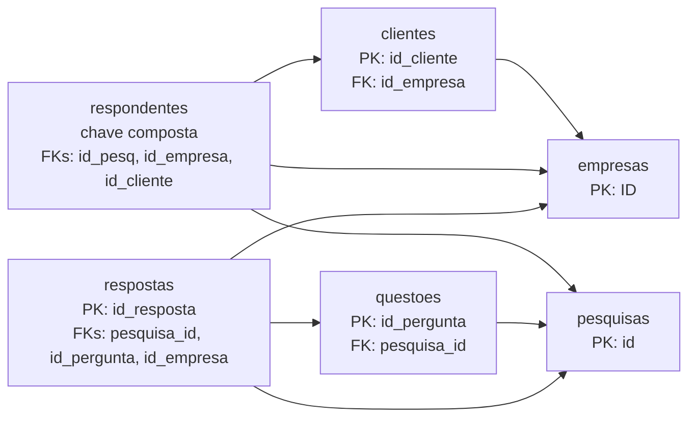

# Inventário Analítico das Bases

Este inventário descreve as seis bases CSV fornecidas pelo Sindusfarma. Ele registra volumetria, granularidade, tipos lógicos, completude e integridade referencial para sustentar a modelagem quantitativa do Artefato 3.

Os arquivos brutos são materiais protegidos do parceiro e não são versionados no repositório. A conferência foi realizada sobre a cópia local recebida em 13 de agosto de 2026, preservada fora da entrega acadêmica.

## Método de verificação

- Leitura dos CSVs em UTF-8 com BOM e separador `;`.
- Ausência definida como campo fisicamente vazio interpretado como nulo. Textos não vazios que coincidam com sentinelas genéricos, como `NA`, `N/A` e `null`, são preservados; `s/i` também permanece como sentinela de negócio auditável.
- Completude calculada por $C = (1 - n_{ausentes}/n_{registros}) \times 100$.
- Duplicidade calculada sobre a linha completa; a unicidade das chaves foi verificada separadamente.
- Tipos lógicos classificados pelo significado analítico, mesmo quando o CSV armazena datas e percentuais como texto.
- Resultados reproduzidos diretamente a partir dos seis arquivos, sem inferir valores ausentes.

Os CSVs são a fonte operacional **provisória** do inventário. O contrato v2 registra em cada output um manifesto com SHA-256, tamanho, quantidade de linhas e colunas, codificação e delimitador dos seis arquivos. A autoridade definitiva permanece pendente de confirmação do parceiro, pois a comparação com os XLSX encontrou uma linha-chave exclusiva no CSV de clientes e 72 representações brutas divergentes em `respostas.valor`, 71 após normalização numérica. `respondentes.csv` não possui equivalente XLSX e não pôde ser comparado.

## Resumo das bases

| Base | Registros | Colunas | Granularidade | Chave lógica | Linhas duplicadas |
| :--- | ---: | ---: | :--- | :--- | ---: |
| `clientes.csv` | 5.430 | 5 | um contato cadastrado | `id_cliente` | 0 |
| `empresas.csv` | 779 | 9 | uma empresa | `ID` | 0 |
| `pesquisas.csv` | 366 | 33 | uma pesquisa | `id` | 0 |
| `questoes.csv` | 231 | 13 | uma questão de uma pesquisa | `id_pergunta` | 0 |
| `respondentes.csv` | 18.735 | 6 | uma participação de contato em pesquisa | (`id_pesq`, `id_empresa`, `id_cliente`) | 0 |
| `respostas.csv` | 20.607 | 9 | um registro de resposta | `id_resposta` | 0 |

Todas as chaves simples são completas e únicas. Em `respondentes.csv`, a combinação (`id_pesq`, `id_empresa`, `id_cliente`) não se repete, inclusive quando `id_cliente` está ausente.

## Relações entre as bases

| ID | Relação | Valores órfãos | Linhas afetadas | Situação |
| :--- | :--- | ---: | ---: | :--- |
| `REL-01` | `clientes.id_empresa → empresas.ID` | 0 | 0 | íntegra entre valores preenchidos |
| `REL-02` | `questoes.pesquisa_id → pesquisas.id` | 4 | 43 | IDs `424`, `1116`, `1139` e `1147` não existem em `pesquisas` |
| `REL-03` | `respondentes.id_pesq → pesquisas.id` | 1 | 55 | ID `304` não existe em `pesquisas` |
| `REL-04` | `respondentes.id_empresa → empresas.ID` | 0 | 0 | íntegra |
| `REL-05` | `respondentes.id_cliente → clientes.id_cliente` | 0 | 0 | íntegra entre valores preenchidos |
| `REL-06` | `respostas.pesquisa_id → pesquisas.id` | 4 | 3.592 | IDs `424`, `1116`, `1139` e `1147` não existem em `pesquisas` |
| `REL-07` | `respostas.id_pergunta → questoes.id_pergunta` | 0 | 0 | íntegra |
| `REL-08` | `respostas.id_empresa → empresas.ID` | 0 | 0 | íntegra entre valores preenchidos |

Não existe uma relação direta validável entre `respostas.respondent_id` e `respondentes.csv`, porque a segunda base não contém `respondent_id`. A combinação (`id_pesq`, `id_empresa`) também não substitui essa chave: há 9 combinações repetidas, envolvendo 18 linhas de `respondentes`. Portanto, respostas individuais não devem ser atribuídas a uma participação específica sem uma chave adicional fornecida pelo parceiro.

## Dicionário estrutural e completude

### `clientes.csv`

Cadastro de contatos vinculados às empresas. O identificador `id_cliente` contém um valor sentinela `s/i`, que deve ser tratado antes de conversões numéricas.

| Variável | Tipo lógico | Ausentes | Completude |
| :--- | :--- | ---: | ---: |
| `id_cliente` | identificadora | 0 | 100,00% |
| `id_empresa` | identificadora (FK) | 1 | 99,98% |
| `cargo` | categórica nominal | 35 | 99,36% |
| `departamento` | categórica nominal | 31 | 99,43% |
| `e-mail` | identificadora / dado de contato | 1 | 99,98% |

### `empresas.csv`

Cadastro mestre das empresas, usado como dimensão institucional e geográfica.

| Variável | Tipo lógico | Ausentes | Completude |
| :--- | :--- | ---: | ---: |
| `ID` | identificadora | 0 | 100,00% |
| `Nome Fantasia` | identificadora descritiva | 0 | 100,00% |
| `% de mercado` | numérica contínua percentual, armazenada como texto | 0 | 100,00% |
| `Nacionalidade` | categórica nominal | 69 | 91,14% |
| `Associado` | categórica nominal | 1 | 99,87% |
| `Tipo de Associado` | categórica nominal | 49 | 93,71% |
| `Cidade` | categórica nominal | 42 | 94,61% |
| `Estado` | categórica nominal | 43 | 94,48% |
| `País` | categórica nominal | 58 | 92,55% |

### `pesquisas.csv`

Cadastro mestre das pesquisas. Das 33 colunas da remessa, 22 possuem conteúdo potencialmente analítico. As outras 11 colunas, de `Unnamed: 22` a `Unnamed: 32`, estão integralmente vazias e são resíduos estruturais de exportação. Elas são contabilizadas na fotografia bruta, mas são **opcionais** no contrato de ingestão v2 e não devem ser exigidas em novas exportações.

| Variável | Tipo lógico | Ausentes | Completude |
| :--- | :--- | ---: | ---: |
| `id` | identificadora | 0 | 100,00% |
| `titulo` | identificadora descritiva | 0 | 100,00% |
| `status` | categórica nominal | 0 | 100,00% |
| `tipo` | categórica nominal | 0 | 100,00% |
| `area` | categórica nominal | 0 | 100,00% |
| `participantes` | numérica discreta | 31 | 91,53% |
| `part_mercado` | numérica contínua percentual, armazenada como texto | 44 | 87,98% |
| `data_solicitacao` | temporal, armazenada como texto | 4 | 98,91% |
| `data_aprov` | temporal, armazenada como texto | 346 | 5,46% |
| `data_divulgacao` | temporal, armazenada como texto | 8 | 97,81% |
| `data_limite` | temporal, armazenada como texto | 8 | 97,81% |
| `prorrogada_ate` | temporal condicional, armazenada como texto | 298 | 18,58% |
| `data_entrega` | temporal, armazenada como texto | 32 | 91,26% |
| `dias_uteis_para_entrega` | numérica discreta | 35 | 90,44% |
| `complexidade` | categórica ordinal | 276 | 24,59% |
| `tipo de resposta` | categórica nominal | 0 | 100,00% |
| `tempo_preenchimento` | numérica contínua | 135 | 63,11% |
| `objetivos` | textual livre | 123 | 66,39% |
| `dia da semana de lançamento` | categórica ordinal codificada numericamente | 3 | 99,18% |
| `dias úteis aberta` | numérica discreta | 3 | 99,18% |
| `dias entre a solicitação e a divulgação` | numérica discreta | 34 | 90,71% |
| `dias para tabulação` | numérica discreta | 36 | 90,16% |
| `Unnamed: 22` a `Unnamed: 32` | estrutural vazia | 4.026 campos | 0,00% em cada coluna |

### `questoes.csv`

Instrumento das pesquisas, com perguntas, alternativas e estruturas de matriz. Campos de matriz são condicionais ao tipo da questão.

| Variável | Tipo lógico | Ausentes | Completude |
| :--- | :--- | ---: | ---: |
| `id_pergunta` | identificadora | 0 | 100,00% |
| `pesquisa_id` | identificadora (FK) | 0 | 100,00% |
| `pesquisa_titulo` | identificadora descritiva | 0 | 100,00% |
| `enunciado` | textual livre | 0 | 100,00% |
| `tipo` | categórica nominal | 0 | 100,00% |
| `qtd_alternativas` | numérica discreta condicional | 25 | 89,18% |
| `alternativas` | textual estruturada condicional | 29 | 87,45% |
| `linhas_matriz` | textual estruturada condicional | 228 | 1,30% |
| `colunas_matriz` | textual estruturada condicional | 228 | 1,30% |
| `confianca` | categórica ordinal | 0 | 100,00% |
| `formato_arquivo` | categórica nominal | 0 | 100,00% |
| `col_origem` | identificadora técnica | 0 | 100,00% |
| `observacoes` | textual livre | 231 | 0,00% |

### `respondentes.csv`

Participações de contatos e empresas nas pesquisas. Os horários existem em apenas 807 registros; portanto, métricas de duração não podem representar toda a série histórica sem explicitar esse recorte.

| Variável | Tipo lógico | Ausentes | Completude |
| :--- | :--- | ---: | ---: |
| `id_pesq` | identificadora (FK) | 0 | 100,00% |
| `hora_inicio` | temporal, armazenada como texto | 17.928 | 4,31% |
| `hora_termino` | temporal, armazenada como texto | 17.928 | 4,31% |
| `id_empresa` | identificadora (FK) | 0 | 100,00% |
| `market_share` | numérica contínua percentual, armazenada como texto | 5 | 99,97% |
| `id_cliente` | identificadora (FK) | 856 | 95,43% |

### `respostas.csv`

Microdados de resposta por item. `alternativa`, `linha_matriz`, `coluna_matriz` e `valor` são campos complementares cujo preenchimento depende do tipo da questão; não devem ser avaliados isoladamente como falha de coleta.

| Variável | Tipo lógico | Ausentes | Completude |
| :--- | :--- | ---: | ---: |
| `id_resposta` | identificadora | 0 | 100,00% |
| `pesquisa_id` | identificadora (FK) | 0 | 100,00% |
| `id_pergunta` | identificadora (FK) | 0 | 100,00% |
| `respondent_id` | identificadora | 0 | 100,00% |
| `id_empresa` | identificadora (FK) | 10 | 99,95% |
| `alternativa` | categórica nominal condicional | 10.266 | 50,18% |
| `linha_matriz` | categórica nominal condicional | 16.603 | 19,43% |
| `coluna_matriz` | categórica nominal condicional | 16.603 | 19,43% |
| `valor` | conteúdo misto condicional | 8.307 | 59,69% |

As ausências físicas dos quatro campos de conteúdo não medem, isoladamente, a validade de uma resposta. O contrato v2 relaciona cada linha ao tipo de sua questão e aceita as seguintes combinações:

| Tipo de questão | Representação aceita | Linhas | Válidas | Inválidas |
| :--- | :--- | ---: | ---: | ---: |
| `aberta` | `valor` | 154 | 154 | 0 |
| `numerica` | `valor` | 540 | 540 | 0 |
| `multipla_escolha` | `alternativa` ou `valor` | 5.853 | 5.853 | 0 |
| `caixas_de_selecao` | `alternativa` | 10.052 | 10.052 | 0 |
| `matriz_avaliacao` | linha + coluna ou alternativa + valor | 4.008 | 4.008 | 0 |
| **Total** | regra correspondente ao tipo | **20.607** | **20.607** | **0** |

Todas as 20.607 linhas são avaliáveis nesta remessa: não há questão desconhecida, tipo não suportado ou chave de questão ambígua. Em particular, 5.853 respostas de múltipla escolha são válidas mesmo quando sua materialização alterna entre `alternativa` e `valor`; quatro respostas matriciais usam a combinação alternativa + valor. As contagens por combinação não devem ser somadas, pois uma linha pode satisfazer mais de uma forma aceita.

## Achados de qualidade e implicações

1. **Integridade referencial:** 43 questões e 3.592 respostas apontam para quatro pesquisas ausentes da base mestre; outras 55 participações apontam para a pesquisa `304`, também ausente. Indicadores agregados por atributos de pesquisa podem excluir silenciosamente esses registros em junções internas.
2. **Colunas sem informação:** as 11 colunas `Unnamed` de `pesquisas.csv` e `observacoes` de `questoes.csv` têm completude zero e devem ser descartadas da camada analítica.
3. **Tipos físicos inadequados:** datas e percentuais chegam como texto, com separadores locais. A pipeline deve normalizá-los e registrar falhas de conversão antes de calcular prazos, médias ou participação de mercado.
4. **Ausência estrutural versus ausência problemática:** prorrogação, alternativas e campos de matriz são condicionais. Os KPIs devem avaliar completude conforme o tipo de pesquisa ou questão, em vez de usar apenas o percentual bruto.
5. **Cobertura temporal limitada:** somente 807 de 18.735 participações possuem horários de início e término. Tempo de preenchimento deve ser divulgado com denominador, período e cobertura explícitos.
6. **Identificadores inconsistentes:** `clientes.id_cliente` contém o sentinela `s/i`. A normalização precisa preservar a rastreabilidade sem convertê-lo indevidamente em número.
7. **Privacidade:** o campo `e-mail` é dado de contato. Exemplos linha a linha não são necessários para o inventário e não devem ser publicados em documentação ou dashboards.
8. **Divergências denormalizadas:** 41 questões apresentam título diferente do cadastro da pesquisa-mãe. Em `respondentes`, 140 linhas distribuídas por 105 pesquisas vinculam o contato a empresa diferente da empresa registrada na participação.
9. **Declarado versus observado:** 40 das 335 pesquisas comparáveis divergem entre `participantes` declarado e participações observadas; nove pesquisas declaram participantes, mas não têm participação válida registrada. Os 40 zeros dos KPIs 03/05 devem permanecer visíveis, não ser removidos do universo.
10. **Integração sem chave individual:** 12.076 respostas têm par pesquisa/empresa não observado em `respondentes`. Como não há chave individual compartilhada, o achado é classificado como ambiguidade e não como erro confirmado.
11. **Variação temporal de mercado:** 13.816 de 18.730 participações comparáveis têm `market_share` diferente do cadastro atual. O valor histórico pode ser um snapshot válido e não deve ser sobrescrito automaticamente.
12. **Autoridade da fonte:** as divergências CSV × XLSX impedem declarar um formato canônico sem decisão do parceiro. Até lá, cada resultado deve ser associado ao fingerprint da remessa CSV provisória.

Este inventário é uma fotografia da remessa analisada. Os cálculos do relatório final devem ser gerados novamente por script para evitar divergência quando os arquivos do parceiro forem atualizados.
