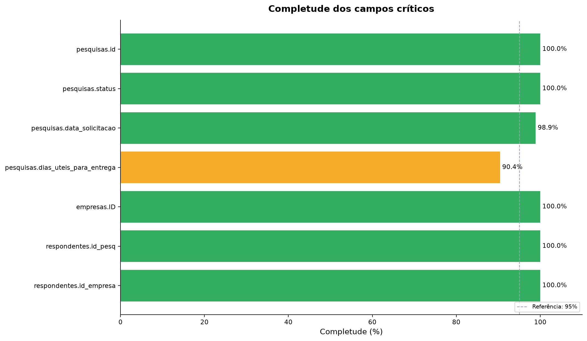
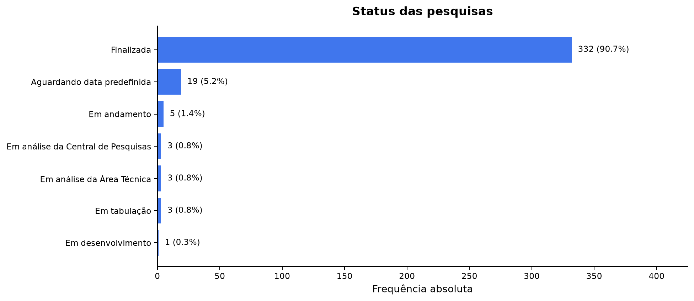
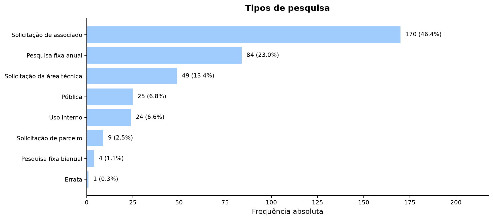
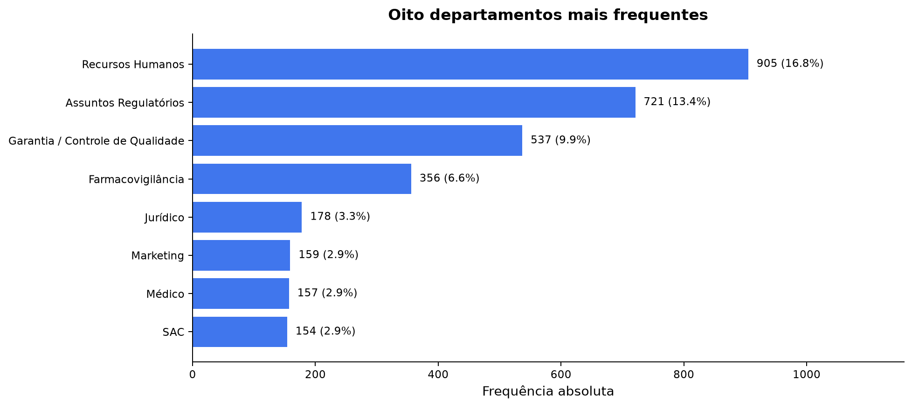
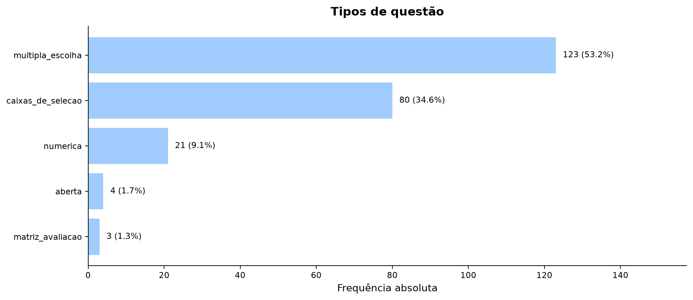
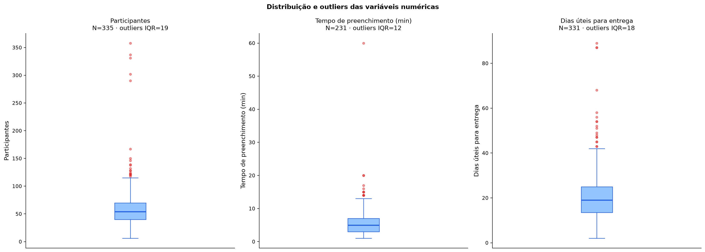
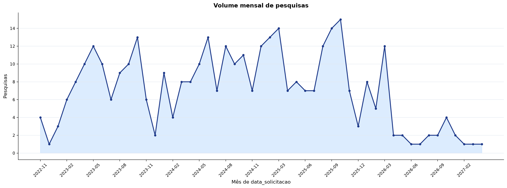

# Modelagem Quantitativa dos Dados do Parceiro

Este relatório apresenta a primeira análise matemática das seis bases fornecidas pelo **Sindusfarma** para o projeto de Governança e Integração de Dados da Central de Pesquisas. O objetivo é compreender a estrutura quantitativa dos dados antes da definição de dashboards, modelos analíticos ou automações de KPI.

Os CSVs brutos permanecem fora do versionamento por conterem dados restritos. As contagens e estatísticas foram reproduzidas pela pipeline Python e persistidas nos contratos **internos e pseudonimizados v2.0** [`quality_report.json`](data/quality_report.json) e [`kpis_summary.json`](data/kpis_summary.json). Esses contratos mantêm mapas por identificador técnico para auditoria, mas não contêm e-mails nem respostas individuais e são excluídos do pacote do site. A execução validada considera a remessa recebida em **13 de agosto de 2026**.

Os CSVs são a fonte operacional **provisória** desta análise, não uma autoridade definitiva. O manifesto dos outputs registra formato, codificação, delimitador, quantidade de linhas e colunas, tamanho e SHA-256 de cada arquivo. A precedência entre CSV e XLSX permanece pendente de confirmação do parceiro, pois há uma linha-chave presente apenas no CSV de clientes e 72 representações brutas de `respostas.valor` divergentes entre os formatos, 71 após normalização numérica. Portanto, os resultados descrevem precisamente a remessa CSV identificada pelo manifesto, mas não resolvem essas divergências de origem.

## 1. Contextualização quantitativa

As bases representam o ciclo de pesquisas da área de Inteligência de Mercado e Pesquisas do Sindusfarma. O processo começa com o cadastro de empresas e contatos, passa pela solicitação, planejamento e aplicação de uma pesquisa, registra participações e respostas e termina com a tabulação e a divulgação dos resultados.

Essas informações podem apoiar decisões sobre:

- volume e distribuição das pesquisas ao longo do tempo;
- composição do portfólio por status, tipo e área;
- adesão das empresas e volume de participações;
- esforço de preenchimento e prazo de entrega;
- qualidade, cobertura e integridade das informações usadas nos indicadores.

A **pesquisa** é a principal unidade de análise do projeto. Cada linha de `pesquisas.csv` representa um instrumento identificado por `id`, com atributos de tema, status, datas e prazos. Esse grão permite calcular indicadores de portfólio, andamento e eficiência sem confundir uma pesquisa com suas questões, empresas participantes ou respostas individuais.

Quando a pergunta de negócio exigir outro nível de detalhe, o grão deverá ser declarado explicitamente. Por exemplo, uma empresa pode participar de várias pesquisas, uma pesquisa possui várias questões e uma questão pode possuir várias respostas. Somar ou comparar esses registros sem controlar a granularidade produziria dupla contagem.

## 2. Unidades de análise e variáveis

### 2.1 Unidades de análise presentes nas bases

| Base | Unidade de análise | O que representa uma linha | Identificador ou chave observada |
|---|---|---|---|
| `pesquisas.csv` | Pesquisa | Um instrumento de pesquisa em alguma etapa do ciclo. | `id` |
| `empresas.csv` | Empresa | Uma organização cadastrada na base institucional. | `ID` |
| `clientes.csv` | Contato | Um contato associado a uma empresa. | `id_cliente` |
| `questoes.csv` | Questão | Uma pergunta pertencente a uma pesquisa. | `id_pergunta` |
| `respondentes.csv` | Participação registrada | A participação observada de uma empresa e, quando preenchido, de um contato em uma pesquisa. | combinação `id_pesq`, `id_empresa`, `id_cliente` |
| `respostas.csv` | Resposta | Um registro de resposta a uma pergunta. | `id_resposta` |

A combinação candidata de `respondentes.csv` possui `id_cliente` ausente em 856 linhas. Portanto, ela não deve ser tratada como chave primária formal sem uma regra adicional. Também não existe, nas bases recebidas, uma relação demonstrável entre `respostas.respondent_id` e uma chave de `respondentes.csv`; essa ligação não é presumida nos cálculos.

### 2.2 Classificação matemática das variáveis

| Variável | Base | Classificação | Justificativa matemática |
|---|---|---|---|
| `id` | pesquisas | Identificadora | Distingue uma pesquisa; seu valor não representa quantidade. |
| `titulo` | pesquisas | Categórica nominal | Nomeia a pesquisa sem ordem matemática. |
| `status` | pesquisas | Categórica nominal | Classifica o estado observado; a pipeline não presume uma ordem total entre categorias. |
| `tipo` | pesquisas | Categórica nominal | Separa a origem ou recorrência da pesquisa. |
| `area` | pesquisas | Categórica nominal | Representa a área temática ou demandante. |
| `participantes` | pesquisas | Numérica discreta | É uma contagem inteira de participantes informada na pesquisa. |
| `data_solicitacao` | pesquisas | Temporal | Posiciona a solicitação no calendário. |
| `dias_uteis_para_entrega` | pesquisas | Numérica discreta | Conta dias úteis até a entrega. |
| `tempo_preenchimento` | pesquisas | Numérica contínua | Representa duração e admite interpretação em escala contínua. |
| `complexidade` | pesquisas | Categórica ordinal | Possui ordem conceitual `baixa < média < alta`. |
| `ID` | empresas | Identificadora | Distingue empresas e sustenta relacionamentos. |
| `% de mercado` | empresas | Numérica contínua | Mede participação de mercado em pontos percentuais. |
| `Associado` | empresas | Categórica nominal | Registra o vínculo associativo, embora o domínio bruto precise ser normalizado. |
| `departamento` | clientes | Categórica nominal | Segmenta contatos por área funcional sem estabelecer ordem. |
| `id_pesq` | respondentes | Identificadora | Referencia a pesquisa da participação. |
| `id_empresa` | respondentes | Identificadora | Referencia a empresa participante. |
| `hora_inicio` | respondentes | Temporal | Registra o instante de início quando disponível. |
| `id_pergunta` | questões | Identificadora | Distingue uma pergunta e relaciona respostas. |
| `tipo` | questões | Categórica nominal | Define o formato da pergunta. |
| `qtd_alternativas` | questões | Numérica discreta | Conta opções de resposta. |
| `id_resposta` | respostas | Identificadora | Distingue um registro de resposta. |

Identificadores são mantidos como texto, mesmo quando contêm apenas algarismos. Essa decisão evita operações matemáticas sem sentido e preserva zeros à esquerda ou sentinelas que precisem ser auditados.

## 3. Qualidade dos dados

### 3.1 Dimensão e completude das bases

O conjunto possui **46.148 registros** e **75 colunas somadas entre os seis esquemas**. A contagem de colunas não descreve uma tabela única; ela apenas resume a largura total das fontes.

| Base | Registros | Colunas | Células ausentes | Completude da base | Linhas duplicadas |
|---|---:|---:|---:|---:|---:|
| `clientes.csv` | 5.430 | 5 | 68 | 99,75% | 0 |
| `empresas.csv` | 779 | 9 | 262 | 96,26% | 0 |
| `pesquisas.csv` | 366 | 33 | 5.442 | 54,94% | 0 |
| `questoes.csv` | 231 | 13 | 741 | 75,32% | 0 |
| `respondentes.csv` | 18.735 | 6 | 36.717 | 67,34% | 0 |
| `respostas.csv` | 20.607 | 9 | 51.789 | 72,08% | 0 |
| **Total** | **46.148** | **75** | **95.019** | **72,63% ponderada por célula** | **0** |

A média simples das completudes das seis bases é aproximadamente **77,62%**, enquanto a completude global ponderada pelas 347.115 células é **72,6261%**. A segunda responde “qual percentual de todas as células está preenchido”; a primeira atribui o mesmo peso a cada base. As duas não devem ser usadas como se fossem a mesma métrica.

Em `pesquisas.csv`, 11 colunas `Unnamed: 22` a `Unnamed: 32` estão totalmente vazias e são resíduos de exportação. Considerando apenas as 22 colunas com conteúdo potencial, a completude da base sobe de 54,94% para aproximadamente **82,41%**. Elas permanecem contabilizadas na fotografia da fonte bruta, mas são **opcionais** no contrato de ingestão v2: sua ausência em uma exportação futura não deve interromper a execução.

A política de nulos v2 considera ausente somente o campo fisicamente vazio. Textos não vazios que coincidam com sentinelas genéricos de bibliotecas, como `NA`, `N/A` ou `null`, são preservados como conteúdo; o sentinela de negócio `s/i` também é mantido para auditoria. Essa regra corrige duas células de `respostas.valor` que antes eram convertidas indevidamente em nulo.

### 3.2 Completude das variáveis importantes

| Variável | Válidos | Ausentes | Completude | Impacto principal |
|---|---:|---:|---:|---|
| `pesquisas.id` | 366 | 0 | 100,00% | Permite identificar todas as pesquisas da tabela-mãe. |
| `pesquisas.status` | 366 | 0 | 100,00% | Sustenta integralmente a distribuição de status. |
| `pesquisas.data_solicitacao` | 362 | 4 | 98,91% | Quatro pesquisas ficam fora das séries temporais. |
| `pesquisas.participantes` | 335 | 31 | 91,53% | Comparações com a contagem de participações têm cobertura parcial. |
| `pesquisas.dias_uteis_para_entrega` | 331 | 35 | 90,44% | A média de entrega não representa 35 pesquisas. |
| `pesquisas.tempo_preenchimento` | 231 | 135 | 63,11% | A análise de esforço cobre menos de dois terços das pesquisas. |
| `pesquisas.complexidade` | 90 | 276 | 24,59% | Não suporta conclusões gerais por nível de complexidade. |
| `empresas.ID` | 779 | 0 | 100,00% | O denominador cadastral está completo. |
| `empresas.Associado` | 778 | 1 | 99,87% | A segmentação exige normalização de `Sim`, `sim` e `-`. |
| `respondentes.id_pesq` | 18.735 | 0 | 100,00% | Todas as participações informam uma pesquisa, mas 55 apontam para pesquisa inexistente. |
| `respondentes.id_empresa` | 18.735 | 0 | 100,00% | Todas as participações informam uma empresa válida. |
| `respondentes.id_cliente` | 17.879 | 856 | 95,43% | Impede usar a combinação observada como chave formal em todas as linhas. |

### 3.3 Ausência estrutural e validade da representação das respostas

Alguns campos só se aplicam a determinados tipos de questão ou resposta. Medir apenas a ausência bruta poderia classificar como erro uma célula que corretamente não se aplica.

| Campo | Ausência bruta | Ausência entre casos aplicáveis | Interpretação |
|---|---:|---:|---|
| `questoes.alternativas` | 12,55% | 0,49% | Quase todas as questões fechadas aplicáveis possuem alternativas. |
| `questoes.linhas_matriz` | 98,70% | 0,00% | O campo é preenchido nas três questões matriciais em que se aplica. |
| `questoes.colunas_matriz` | 98,70% | 0,00% | A ausência bruta é estrutural, não um defeito geral. |
| `respostas.alternativa` | 49,82% | Não se aplica isoladamente | Pode ser substituída por `valor` em múltipla escolha e compor uma representação matricial alternativa. |
| `respostas.linha_matriz` | 80,57% | Não se aplica isoladamente | Em matriz, o par linha/coluna ou o par alternativa/valor pode representar validamente a resposta. |
| `respostas.valor` | 40,31% | Não se aplica isoladamente | É obrigatório em questões abertas e numéricas e pode representar múltipla escolha. |

O contrato v2 avalia cada linha pela combinação de campos permitida para o tipo da questão, em vez de exigir uma única coluna universal:

| Tipo de questão | Regra de representação válida | Linhas avaliadas | Linhas válidas |
|---|---|---:|---:|
| `aberta` | `valor` preenchido | 154 | 154 |
| `numerica` | `valor` preenchido | 540 | 540 |
| `multipla_escolha` | `alternativa` **ou** `valor` preenchido | 5.853 | 5.853 |
| `caixas_de_selecao` | `alternativa` preenchida | 10.052 | 10.052 |
| `matriz_avaliacao` | `linha_matriz` + `coluna_matriz` **ou** `alternativa` + `valor` | 4.008 | 4.008 |
| **Total** | contrato correspondente ao tipo | **20.607** | **20.607** |

Assim, as **20.607 respostas são avaliáveis e possuem representação válida**; não há tipo desconhecido, tipo não suportado nem questão ambígua nesta remessa. As contagens físicas de ausência — 10.266 em `alternativa`, 16.603 em cada campo matricial e 8.307 em `valor` — continuam relevantes para descrever o armazenamento, mas não significam 51.789 respostas incompletas.

### 3.4 Duplicidades, chaves e integridade referencial

Não foram encontradas linhas exatamente duplicadas nas seis bases. As chaves declaradas de clientes, empresas, pesquisas, questões e respostas são completas e únicas. A chave candidata de respondentes é a exceção por conter 856 ausências em `id_cliente`.

Foram auditadas **oito relações**. Três apresentam valores órfãos:

| Relação | Valores órfãos distintos | Linhas afetadas | Consequência analítica |
|---|---:|---:|---|
| `clientes.id_empresa → empresas.ID` | 0 | 0 | Junção íntegra. |
| `questoes.pesquisa_id → pesquisas.id` | 4 | 43 | Questões podem desaparecer em análises por atributos da pesquisa. |
| `respondentes.id_pesq → pesquisas.id` | 1 | 55 | Participações órfãs devem ser excluídas dos KPIs de negócio e mantidas na auditoria. |
| `respondentes.id_empresa → empresas.ID` | 0 | 0 | Junção íntegra. |
| `respondentes.id_cliente → clientes.id_cliente` | 0 | 0 | Valores não nulos possuem referência válida. |
| `respostas.pesquisa_id → pesquisas.id` | 4 | 3.592 | Junções internas por pesquisa podem descartar muitas respostas. |
| `respostas.id_pergunta → questoes.id_pergunta` | 0 | 0 | Junção íntegra. |
| `respostas.id_empresa → empresas.ID` | 0 | 0 | Valores não nulos possuem referência válida. |

Os quatro IDs órfãos de pesquisa em questões e respostas são `424`, `1116`, `1139` e `1147`; em respondentes, o ID órfão é `304`. As quantidades de linhas por relação não devem ser somadas como se fossem registros únicos, pois uma mesma anomalia pode aparecer em tabelas distintas.

### 3.5 Possíveis inconsistências e impacto em dashboards

- Há um identificador com sentinela textual `s/i` e uma variação de caixa `sim` em `empresas.Associado`.
- Em `% de mercado`, 619 das 779 empresas possuem `0,00%`. O zero pode ser legítimo, arredondado ou representar ausência; o significado precisa ser validado com o parceiro.
- Doze datas de `data_solicitacao` são posteriores à data da remessa, chegando a junho de 2027. Elas podem representar planejamento futuro, mas não devem ser interpretadas como solicitações já ocorridas sem confirmação.
- As validações de ordem temporal não encontraram entrega, divulgação ou limite anteriores aos marcos comparados, nem prazos de entrega negativos.
- `hora_inicio` e `hora_termino` têm apenas 4,31% de completude. Assim, não é possível estimar duração individual ou abandono para toda a base.
- Há 41 questões cujo título denormalizado diverge do título da pesquisa-mãe; 140 participações, distribuídas por 105 pesquisas, registram empresa diferente da empresa do contato.
- Entre 335 pesquisas comparáveis, 40 têm quantidade declarada de participantes diferente da observada e nove declaram participantes sem qualquer participação válida registrada.
- Há 12.076 respostas cujo par pesquisa/empresa não aparece em `respondentes`; sem uma chave individual comum, o achado é uma ambiguidade de integração, não prova automática de erro.
- Em 13.816 de 18.730 participações comparáveis, o `market_share` histórico diverge do cadastro atual; a diferença pode decorrer de snapshots temporais e não deve ser sobrescrita sem regra do parceiro.

Sem tratamento, as chaves órfãs podem reduzir silenciosamente contagens em joins; categorias não normalizadas podem fragmentar filtros; campos temporais futuros podem antecipar volume em dashboards; e médias com cobertura parcial podem parecer mais representativas do que realmente são. Todo KPI deve publicar seu denominador, quantidade válida, cobertura e filtros.

## 4. Estatística descritiva

### 4.1 Variáveis categóricas

| Variável | Categoria | Frequência | Percentual | Moda da variável |
|---|---|---:|---:|---|
| `pesquisas.status` | Finalizada | 332 | 90,71% | Finalizada |
|  | Aguardando data predefinida | 19 | 5,19% |  |
|  | Em andamento | 5 | 1,37% |  |
|  | Em análise da Central de Pesquisas | 3 | 0,82% |  |
|  | Em análise da Área Técnica | 3 | 0,82% |  |
|  | Em tabulação | 3 | 0,82% |  |
|  | Em desenvolvimento | 1 | 0,27% |  |
| `pesquisas.tipo` | Solicitação de associado | 170 | 46,45% | Solicitação de associado |
|  | Pesquisa fixa anual | 84 | 22,95% |  |
|  | Solicitação da área técnica | 49 | 13,39% |  |
|  | Pública | 25 | 6,83% |  |
|  | Uso interno | 24 | 6,56% |  |
|  | Solicitação de parceiro | 9 | 2,46% |  |
|  | Pesquisa fixa bianual | 4 | 1,09% |  |
|  | Errata | 1 | 0,27% |  |
| `empresas.Associado` | Sim | 612 | 78,66% | Sim |
|  | `-` | 165 | 21,21% |  |
|  | sim | 1 | 0,13% |  |
| `clientes.departamento` | Recursos Humanos | 905 | 16,76% | Recursos Humanos |
|  | Assuntos Regulatórios | 721 | 13,35% |  |
|  | Garantia / Controle de Qualidade | 537 | 9,95% |  |
|  | Farmacovigilância | 356 | 6,59% |  |
|  | Jurídico | 178 | 3,30% |  |
|  | Marketing | 159 | 2,94% |  |
|  | Médico | 157 | 2,91% |  |
|  | SAC | 154 | 2,85% |  |
| `questoes.tipo` | multipla_escolha | 123 | 53,25% | multipla_escolha |
|  | caixas_de_selecao | 80 | 34,63% |  |
|  | numerica | 21 | 9,09% |  |
|  | aberta | 4 | 1,73% |  |
|  | matriz_avaliacao | 3 | 1,30% |  |

O predomínio de pesquisas finalizadas descreve a composição do arquivo, mas não comprova uma taxa histórica de sucesso, pois não existe um campo explícito e padronizado de cancelamento. Da mesma forma, `-` em `Associado` não deve ser convertido automaticamente em “Não” sem regra de negócio confirmada.

### 4.2 Variáveis numéricas

O desvio padrão é amostral, com divisor `n - 1`. O coeficiente de variação é calculado por `CV = desvio padrão / média × 100` e deve ser interpretado com cuidado quando a média está próxima de zero.

| Variável | N válido | Ausentes | Média | Mediana | Mínimo | Máximo | Amplitude | Desvio padrão | CV |
|---|---:|---:|---:|---:|---:|---:|---:|---:|---:|
| `pesquisas.participantes` | 335 | 31 | 60,68 | 54,00 | 6 | 358 | 352 | 41,33 | 68,11% |
| `pesquisas.tempo_preenchimento` | 231 | 135 | 5,97 | 5,00 | 1 | 60 | 59 | 5,13 | 85,82% |
| `pesquisas.dias_uteis_para_entrega` | 331 | 35 | 21,11 | 19,00 | 2 | 89 | 87 | 12,16 | 57,62% |
| `pesquisas.dias_uteis_aberta` | 363 | 3 | 11,26 | 8,00 | 0 | 275 | 275 | 21,41 | 190,10% |
| `pesquisas.dias_para_tabulacao` | 330 | 36 | 7,73 | 4,00 | 0 | 77 | 77 | 10,03 | 129,72% |
| `empresas.percentual_mercado` | 779 | 0 | 0,1295 p.p. | 0,00 p.p. | 0,00 | 8,25 | 8,25 | 0,6079 | 469,25% |

As médias maiores que as medianas, especialmente em dias aberta e dias para tabulação, indicam assimetria à direita. Para esses campos, a mediana representa melhor o caso típico, enquanto a média permanece relevante para estimar carga operacional total.

### 4.3 Valores extremos

Pela regra do intervalo interquartil, um valor é sinalizado quando está fora de `[Q1 - 1,5 × IQR; Q3 + 1,5 × IQR]`.

| Variável | Q1 | Q3 | Limite superior | Extremos | Observação |
|---|---:|---:|---:|---:|---|
| `participantes` | 40 | 70 | 115 | 19 | Pesquisas acima de 115 participantes merecem análise, não exclusão automática. |
| `tempo_preenchimento` | 3 | 7 | 13 | 12 | Questionários acima de 13 minutos formam a cauda superior. |
| `dias_uteis_para_entrega` | 13,5 | 25 | 42,25 | 18 | Casos acima do limite podem representar pesquisas mais complexas. |
| `dias_uteis_aberta` | 5 | 11 | 20 | 25 | O máximo de 275 dias influencia fortemente a média. |
| `dias_para_tabulacao` | 3 | 9 | 18 | 28 | A dispersão sugere processos de tabulação heterogêneos. |
| `% de mercado` | 0 | 0 | 0 | 160 | Como Q1 e Q3 são zero, todo valor positivo é sinalizado; a regra perde utilidade prática nesse campo. |

Outliers não são erros por definição e não foram removidos. Eles devem ser investigados com contexto de negócio antes de qualquer tratamento.

### 4.4 Distribuição temporal

Há 362 datas válidas de solicitação, cobrindo de **22/11/2022** a **07/06/2027**. Quatro pesquisas não possuem data válida.

| Ano da data de solicitação | Pesquisas | Observação |
|---:|---:|---|
| 2022 | 5 | Série começa em novembro; ano incompleto. |
| 2023 | 95 | Primeiro ano completo observado. |
| 2024 | 99 | Crescimento de 4,21% sobre 2023. |
| 2025 | 119 | Maior volume anual completo da remessa. |
| 2026 | 41 | Ano em curso na data da remessa e inclui datas futuras. |
| 2027 | 3 | Datas futuras; dependem de validação semântica. |

O pico mensal é outubro de 2025, com 15 pesquisas. Comparações anuais só são adequadas entre anos completos; 2022, 2026 e 2027 não devem ser comparados diretamente com 2023–2025.

## 5. Indicadores iniciais

Os seis indicadores abaixo são calculados pela pipeline e possuem fórmula, variáveis, grão, cobertura e limitações explícitas.

### KPI-01 — Volume de pesquisas por período

- **Objetivo:** acompanhar a demanda de pesquisas ao longo do tempo.
- **Fórmula:** `COUNT(pesquisas.id)` agrupado pelo mês de `data_solicitacao` válida.
- **Variáveis:** `pesquisas.id`, `pesquisas.data_solicitacao`.
- **Resultado:** 362 pesquisas distribuídas em 51 meses; cobertura de 98,91%. O volume mensal varia de 1 a 15.
- **Interpretação:** mostra quantas solicitações estão registradas em cada mês e permite observar tendência e sazonalidade.
- **Limitação:** quatro pesquisas sem data ficam fora; 12 datas posteriores à remessa exigem validação antes de serem tratadas como demanda realizada.

### KPI-02 — Percentual de pesquisas por status

- **Objetivo:** descrever a composição operacional do portfólio.
- **Fórmula:**

$$
P(status=s)=\frac{n(status=s)}{n(status\ preenchido)}\times100
$$

- **Variável:** `pesquisas.status`.
- **Resultado:** denominador de 366 pesquisas e cobertura de 100%; 332 estão como `Finalizada`, equivalentes a 90,71%.
- **Interpretação:** cada percentual representa a participação de um status no arquivo recebido.
- **Limitação:** as categorias não possuem ordem matemática presumida e a ausência de cancelamento explícito impede chamar 90,71% de taxa histórica de sucesso.

### KPI-03 — Cobertura de empresas cadastradas por pesquisa

- **Objetivo:** estimar a cobertura institucional de cada pesquisa.
- **Fórmula:**

$$
Cobertura_p=\frac{n\ de\ empresas\ cadastradas\ distintas\ com\ participação\ na\ pesquisa\ p}{779\ empresas\ cadastradas}\times100
$$

- **Variáveis:** `respondentes.id_pesq`, `respondentes.id_empresa`, `empresas.ID`.
- **Resultado:** as 366 pesquisas cadastradas compõem o resumo, incluindo **40 com zero participação válida**. A cobertura varia de 0% a 24,0051%, com mediana de 6,6752% e média simples de 6,5486%. Foram aceitas 18.680 de 18.735 linhas de participação (99,7064%), que correspondem a 18.671 pares distintos de pesquisa/empresa. Globalmente, 419 empresas distintas participaram de ao menos uma pesquisa válida: `419 / 779 = 53,7869%`.
- **Interpretação:** evidencia a cobertura observada tanto por instrumento quanto na base histórica.
- **Limitação:** as 779 empresas são uma aproximação do universo elegível. Sem uma lista de convidadas por pesquisa, esse indicador é **cobertura sobre o cadastro**, não taxa oficial de adesão; **55 participações órfãs**, ligadas a pesquisa inexistente, são excluídas.

### KPI-04 — Proxy de tempo médio de entrega

- **Objetivo:** descrever o prazo disponível no campo pré-calculado, sem tratá-lo como SLA oficial.
- **Fórmula:**

$$
\bar{x}=\frac{\sum dias\_uteis\_para\_entrega\ válidos\ e\ não\ negativos}{n\ de\ prazos\ válidos}
$$

- **Variável:** `pesquisas.dias_uteis_para_entrega`.
- **Resultado:** `6.987 / 331 = 21,11` dias úteis; mediana de 19 dias e cobertura de 90,44%.
- **Interpretação:** entre as pesquisas com o campo preenchido, o proxy médio é de cerca de 21 dias úteis.
- **Análise de sensibilidade:** restringindo às pesquisas com status `Finalizada`, há 329 observações e média de 21,1489 dias úteis.
- **Limitação:** 35 pesquisas não entram no cálculo; a média é sensível aos 18 valores acima do limite IQR de 42,25 dias. A base não identifica inequivocamente a data real de publicação, os status elegíveis e o calendário oficial; por isso, o indicador não representa oficialmente o intervalo solicitação–publicação.

### KPI-05 — Participações registradas por pesquisa

- **Objetivo:** medir o volume de participações observado em cada pesquisa.
- **Fórmula:** `COUNT(linhas de respondentes)` por `id_pesq`, após validar a existência da pesquisa e da empresa nos respectivos cadastros.
- **Variáveis:** `respondentes.id_pesq` e `respondentes.id_empresa`.
- **Resultado:** 18.680 participações válidas distribuídas sobre o universo das 366 pesquisas cadastradas, incluindo **40 zeros**; média de 51,0383, mediana de 52, mínimo de 0 e máximo de 187 participações por pesquisa. A cobertura técnica é 99,7064% das linhas de `respondentes`.
- **Interpretação:** quantifica o volume registrado em cada instrumento; zero representa uma pesquisa cadastrada sem participação válida.
- **Limitação:** é uma contagem, não uma taxa. Não existe denominador confiável de convidados, e 55 linhas ligadas a uma pesquisa inexistente são excluídas.

### KPI-06 — Ausência em campos críticos

- **Objetivo:** quantificar lacunas nos campos mínimos necessários aos indicadores.
- **Fórmula:**

$$
Ausência=\frac{células\ críticas\ ausentes}{células\ críticas\ esperadas}\times100
$$

- **Variáveis:** `pesquisas.id`, `pesquisas.status`, `pesquisas.data_solicitacao`, `pesquisas.dias_uteis_para_entrega`, `empresas.ID`, `respondentes.id_pesq` e `respondentes.id_empresa`.
- **Resultado:** `39 / 39.713 × 100 = 0,0982%` de ausência, ou 99,9018% de completude crítica.
- **Interpretação:** a micro média indica alta completude agregada, mas os scorecards mostram onde estão as lacunas: no grão pesquisa são 39 ausências em 1.464 células críticas (2,6639%), afetando 35 de 366 pesquisas; no grão empresa são 0/779 e no grão participação, 0/37.470. Por campo, são quatro ausências em `data_solicitacao` e 35 em `dias_uteis_para_entrega`.
- **Limitação:** o resultado depende da lista declarada e dá maior peso às bases com mais células. Ele não substitui os scorecards, a integridade referencial nem mede campos importantes para análises futuras.

## 6. Granularidade e síntese final

### 6.1 Como a granularidade altera a interpretação

| Indicador | Granularidade | Resultado | Pergunta respondida |
|---|---|---:|---|
| KPI-03 | Global por empresa | 53,79% | Qual parcela das 779 empresas participou ao menos uma vez? |
| KPI-03 | Por pesquisa | média 6,5486%; mediana 6,6752%; faixa 0%–24,0051%; 40 zeros | Qual parcela do cadastro aparece em cada um dos 366 instrumentos? |
| KPI-05 | Global | 18.680 registros | Quantas participações válidas existem na remessa? |
| KPI-05 | Por pesquisa | média 51,0383; mediana 52; faixa 0–187; 40 zeros | Quantas participações uma pesquisa cadastrada registra, inclusive quando nenhuma é observada? |
| KPI-05 | Por empresa ativa | média 44,58; mediana 6; faixa 1–265 | Quantas vezes cada uma das 419 empresas ativas aparece no histórico? |

No KPI-03, a mesma empresa é contada uma vez no resultado global, mas pode aparecer em várias pesquisas no resultado por instrumento. Por isso, a média das taxas por pesquisa não equivale à cobertura global. Materializar as 40 pesquisas sem participação como zero reduz a média por pesquisa sem alterar a cobertura global. No KPI-05, a diferença entre média e mediana por empresa mostra forte concentração: poucas empresas com muitas participações elevam a média para 44,58, enquanto metade das empresas ativas possui até 6 registros; por pesquisa, incluir os zeros evita selecionar apenas instrumentos já ativos.

### 6.2 Síntese e cuidados antes da automação

As variáveis mais importantes para o primeiro dashboard são `pesquisas.id`, `status`, `tipo`, `area`, `data_solicitacao`, `dias_uteis_para_entrega`, `empresas.ID`, `respondentes.id_pesq` e `respondentes.id_empresa`. Elas sustentam volume, composição do portfólio, adesão, participação e prazo. Para análises de questionário, `questoes.id_pergunta`, `questoes.tipo` e `respostas.id_pergunta` são essenciais.

Antes de automatizar os KPIs, o projeto deve:

1. colocar em quarentena ou corrigir as chaves de pesquisa órfãs;
2. validar com o parceiro o significado de `-`, `s/i`, zeros de participação de mercado e datas futuras;
3. obter o universo de empresas convidadas ou elegíveis por pesquisa antes de converter cobertura cadastral em taxa oficial de adesão;
4. distinguir ausência estrutural de ausência problemática;
5. publicar `n`, denominador, cobertura, filtros e data da atualização junto de cada indicador;
6. usar mediana em conjunto com média para distribuições assimétricas e nunca remover outliers automaticamente;
7. não inferir a ligação individual entre respostas e respondentes sem uma chave comprovada;
8. manter dados pessoais e respostas individuais fora do repositório e das visualizações públicas;
9. confirmar com o parceiro a autoridade entre CSV e XLSX e as divergências de conteúdo antes de promover a fonte provisória a canônica;
10. formalizar campos, status e calendário do prazo de entrega antes de transformar o KPI-04 em SLA.

Com esses cuidados, os seis indicadores são matematicamente definidos e reproduzíveis para uma primeira leitura do projeto. Eles devem ser tratados como evidência exploratória da remessa recebida, e não como KPIs institucionais definitivos até a validação das regras de negócio com o Sindusfarma.
