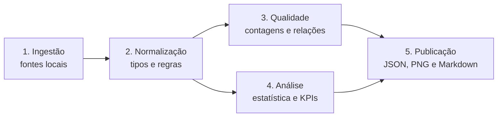

# ADR-001: Pipeline Reproduzível para a Análise Quantitativa

| Campo | Valor |
| :--- | :--- |
| Status | Aceito e implementado no contrato v2.0 |
| Data | 2026-08-13 |
| Responsáveis | Equipe G02 — Artefato 3 |
| Especificação | `spec-analise-quantitativa-dados.md` |

## Contexto

O Artefato 3 exige cálculos auditáveis sobre seis CSVs do Sindusfarma antes da construção de dashboards ou modelos de dados. As fontes incluem diferenças de granularidade, percentuais e datas armazenados como texto, ausências condicionais, colunas estruturalmente vazias e relações órfãs.

Os dados brutos não podem ser publicados no Git. Ao mesmo tempo, os números do relatório precisam ser reproduzíveis e verificáveis por testes. Também não existe uma chave que permita ligar `respostas.respondent_id` diretamente a `respondentes`.

A auditoria da primeira versão revelou três decisões que precisavam ser incorporadas à arquitetura: valores textuais não vazios estavam sujeitos à conversão automática em nulo; os campos de `respostas` são polimórficos e só podem ser avaliados em conjunto com o tipo da questão; e os resumos por pesquisa omitiam silenciosamente as pesquisas sem participação. Além disso, CSV e XLSX divergem em parte da remessa e o parceiro ainda não confirmou qual formato é autoritativo.

## Decisão

Adotar um pipeline Python modular, executado por linha de comando, com diretório de entrada configurável e cinco etapas explícitas, e versionar os contratos de saída como **v2.0**:

### Componentes

| Componente | Responsabilidade | Saída |
| :--- | :--- | :--- |
| `scripts/data_quality/` | schema, completude, duplicidade, chaves, relações e erros de parsing | estruturas Python serializáveis |
| `scripts/metrics/` | estatística descritiva, outliers e indicadores | estruturas Python serializáveis |
| `scripts/runners/` | configuração de caminhos, orquestração e escrita atômica | JSON e imagens agregadas |
| `tests/` | fixtures sintéticas e regressão dos contratos | resultado automatizado |
| `docs/data/` | resultados agregados versionáveis | `quality_report.json`, `kpis_summary.json` |
| `docs/images/` | gráficos sem microdados identificáveis | PNG |

### Princípios obrigatórios

1. **Fonte imutável:** nenhuma transformação sobrescreve os CSVs recebidos.
2. **Configuração externa:** caminhos locais entram por argumento ou variável de ambiente; não ficam codificados no repositório.
3. **Separação de responsabilidades:** cálculo não depende de renderização de gráfico ou MkDocs.
4. **Falha explícita:** fonte ou coluna obrigatória ausente interrompe a execução; valores pontuais inválidos são contabilizados conforme a SPEC.
5. **Determinismo:** a mesma remessa e a mesma versão de código produzem os mesmos valores, exceto metadados temporais declarados.
6. **Privacidade por camadas:** os contratos internos podem manter identificadores técnicos pseudonimizados para auditoria, mas não publicam e-mails nem respostas individuais. O site é construído por allowlist e exclui os JSONs, as amostras de órfãos e os mapas por entidade.
7. **Sem junções inferidas:** relações não demonstradas, especialmente a de `respondent_id`, não são usadas.
8. **Ausência física estrita:** somente campos fisicamente vazios são nulos; sentinelas textuais não vazias são preservadas.
9. **Representação por tipo:** uma resposta é válida conforme a combinação permitida para o tipo da questão, não pela completude isolada de uma coluna.
10. **População explícita:** indicadores por pesquisa materializam todas as pesquisas cadastradas; zero é incluído quando representa ausência observada de participação.
11. **Fonte rastreável e provisória:** cada execução publica manifesto e SHA-256 da remessa; os CSVs permanecem provisórios até o parceiro resolver a precedência diante dos XLSX.
12. **Semântica conservadora:** cobertura cadastral não é chamada de adesão oficial, e o prazo pré-calculado é publicado como proxy até haver definição operacional.

## Alternativas consideradas

### Notebook como única implementação

Rejeitado como mecanismo principal. É útil para exploração, mas aumenta o risco de células executadas fora de ordem e dificulta testes automatizados. Notebooks podem existir como apoio, sem serem a fonte autoritária dos cálculos.

### Script monolítico

Rejeitado. Misturar ingestão, regras, gráficos e escrita torna mais difícil testar fórmulas e identificar a origem de divergências.

### Carregar imediatamente em banco ou Data Warehouse

Adiado. O objetivo atual é compreender e validar a estrutura quantitativa das bases; a modelagem física pertence a etapas posteriores.

### Versionar os CSVs brutos

Rejeitado por governança, privacidade e tamanho. O repositório mantém código, documentação e resultados agregados.

## Consequências

### Positivas

- fórmulas e regras podem ser testadas com dados sintéticos;
- divergências entre relatório e fonte podem ser reproduzidas;
- o caminho dos dados varia entre ambientes sem alterar o código;
- contratos JSON desacoplam cálculo e documentação;
- o manifesto permite provar exatamente qual remessa gerou cada resultado;
- as 20.607 representações válidas são auditadas sem confundir campos complementares vazios com falha de coleta;
- KPI-03 e KPI-05 incluem as 366 pesquisas, inclusive os 40 zeros, evitando viés de seleção;
- a arquitetura pode evoluir para banco ou dbt sem reescrever as definições matemáticas.

### Custos e riscos

- contratos JSON precisam de versão e validação quando mudarem;
- a fonte CSV continua provisória enquanto as divergências com XLSX não forem resolvidas pelo parceiro;
- dependências Python devem ser declaradas e instaladas de forma reproduzível;
- resultados agregados precisam ser regenerados após mudança de fonte ou regra;
- uma média global de completude pode ocultar problemas de colunas críticas;
- a ausência de uma chave comum de respondente limita análises individuais.
- zeros materializados dependem do cadastro de pesquisas estar completo para o período analisado;
- o KPI de prazo permanece proxy e não pode ser promovido a SLA sem definição de campos, status e calendário.

## Validação da decisão

A arquitetura foi aceita para o Artefato 3 porque:

- os testes definidos na SPEC cobrem ingestão, regras de resposta, fórmulas, universos, rollback e snapshot do parceiro;
- o runner reproduz os volumes e relações registrados no inventário;
- o pipeline gera os dois contratos JSON v2.0 sem dados pessoais e com manifesto da fonte;
- os outputs registram 20.607 representações válidas, os 40 zeros dos KPIs 03/05, a sensibilidade do KPI-04 e os scorecards do KPI-06;
- a documentação é preparada para validação com `mkdocs build --strict`.

## Revisão futura

Reavaliar esta decisão se o parceiro fornecer uma chave de respondente compartilhada, regras formais de elegibilidade das empresas, definição oficial de prazo, confirmação da fonte canônica, uma nova remessa com schema diferente ou requisitos para execução em banco de dados.
