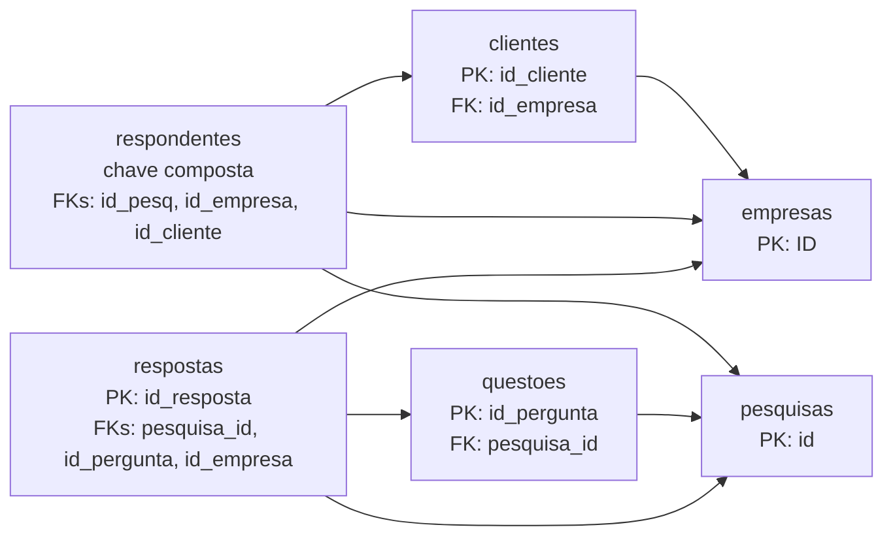

# SPEC-001: Análise Quantitativa e Qualidade dos Dados

| Campo | Valor |
| :--- | :--- |
| Versão | 2.0.0 |
| Status | Implementada |
| Escopo | Artefato 3 — Modelagem Quantitativa dos Dados do Parceiro |
| Referência dos dados | `docs/inventario_das_bases.md` |

## 1. Objetivo e limites

Esta especificação define como carregar, validar e analisar as seis bases históricas da Central de Pesquisas do Sindusfarma para produzir resultados agregados, reproduzíveis e compatíveis com o relatório `docs/modelagem_quantitativa_de_dados_do_parceiro.md`.

Estão incluídos:

- leitura de `clientes.csv`, `empresas.csv`, `pesquisas.csv`, `questoes.csv`, `respondentes.csv` e `respostas.csv`;
- normalização controlada de identificadores, percentuais e datas;
- auditoria de volumetria, ausências, completude, duplicidade, chaves e relações;
- estatística descritiva por tipo de variável;
- cálculo de pelo menos cinco indicadores matematicamente definidos;
- geração de JSON e gráficos agregados para apoiar o relatório.

Não estão incluídos:

- alteração das fontes recebidas do parceiro;
- carga em banco de produção ou construção do Data Warehouse;
- identificação de pessoas em relatórios ou gráficos;
- vínculo entre `respostas.respondent_id` e `respondentes`, pois não existe chave correspondente disponível;
- inferência ou imputação automática de valores sem regra validada pelo parceiro.

## 2. Contrato das fontes

Os dados brutos ficam em armazenamento local protegido e não são versionados. O diretório de entrada deve ser configurável por argumento de linha de comando ou variável de ambiente; o pipeline não pode depender de um caminho pessoal nem exigir uma pasta `DADOS/` no Git.

| Base | Grão | Chave lógica | Observação obrigatória |
| :--- | :--- | :--- | :--- |
| `clientes` | um contato cadastrado | `id_cliente` | contém o sentinela textual `s/i` |
| `empresas` | uma empresa | `ID` | `% de mercado` chega como texto percentual |
| `pesquisas` | uma pesquisa | `id` | 22 colunas são obrigatórias; 11 `Unnamed` vazias são opcionais e podem não existir em novas exportações |
| `questoes` | uma questão de pesquisa | `id_pergunta` | campos de alternativa e matriz são condicionais |
| `respondentes` | uma participação registrada | (`id_pesq`, `id_empresa`, `id_cliente`) | `id_cliente` pode estar ausente |
| `respostas` | um registro de resposta | `id_resposta` | campos de resposta são condicionais ao tipo da questão |

Regras de ingestão:

1. Ler os CSVs com separador `;` e codificação UTF-8 com BOM.
2. Falhar com mensagem clara se uma fonte obrigatória ou coluna contratada não existir.
3. Preservar os arquivos brutos em modo somente leitura.
4. Interpretar como ausente apenas campo fisicamente vazio; textos não vazios como `NA`, `N/A`, `null` e `s/i` devem ser preservados para auditoria.
5. Tratar `Unnamed: 22` a `Unnamed: 32` como resíduos opcionais: se presentes, entram na fotografia bruta; se ausentes, não provocam falha de schema.
6. Registrar data da execução, impressão digital SHA-256 e manifesto não sensível de cada arquivo, com tamanho, volumetria, codificação e delimitador.
7. Não registrar e-mails, respostas individuais ou outros valores pessoais em logs e artefatos.

Nesta versão, os CSVs têm autoridade **provisória** (`csv-provisional`). A promoção para fonte canônica depende de confirmação do Sindusfarma, porque a remessa possui divergências entre CSV e XLSX: uma linha-chave de clientes e 72 representações brutas de `respostas.valor`, 71 após normalização numérica. O pipeline deve preservar a divergência; não pode reconciliá-la silenciosamente.

## 3. Requisitos funcionais

| ID | Requisito | Critério de aceite |
| :--- | :--- | :--- |
| `RF-01` | Carregar as seis bases | Todas as fontes e colunas obrigatórias são validadas; ausência interrompe a execução com erro acionável. |
| `RF-02` | Normalizar tipos | Datas são convertidas com `dayfirst=True`; percentuais perdem `%`, usam vírgula decimal corretamente e são representados em pontos percentuais (`10,00%` → `10.0`); IDs permanecem identificadores. |
| `RF-03` | Auditar qualidade | Para cada base: registros, colunas, nulos por campo, completude, linhas duplicadas, unicidade das chaves e colunas constantes. |
| `RF-04` | Auditar relações | Para cada relação válida: quantidade de valores órfãos e quantidade de linhas afetadas, sem presumir a relação inexistente de respondentes. |
| `RF-05` | Calcular estatística descritiva | Categóricas: frequência, percentual e moda; numéricas: média, mediana, mínimo, máximo, amplitude, desvio-padrão e CV; temporais: contagem por período e intervalo observado. |
| `RF-06` | Calcular indicadores | Pelo menos cinco KPIs contêm nome, objetivo, fórmula, variáveis, grão, filtros, cobertura, valor, unidade e interpretação. |
| `RF-07` | Avaliar granularidade | Pelo menos dois indicadores são calculados ou comparados em mais de um grão, com alerta sobre diferenças de denominador e ponderação. |
| `RF-08` | Publicar resultados agregados | Gerar `quality_report.json`, `kpis_summary.json` e gráficos sem dados individualmente identificáveis. |
| `RF-09` | Validar representações de resposta | Cada linha de `respostas` é avaliada pela regra do tipo da questão; o output separa ausência física, representação inválida e linha não avaliável. |
| `RF-10` | Declarar universo e zeros | KPIs por pesquisa materializam todas as 366 pesquisas cadastradas; ausência de observação válida é zero quando o indicador mede contagem ou cobertura. |
| `RF-11` | Diagnosticar divergências cruzadas | Inconsistências entre tabelas são reportadas por contagem e severidade, sem expor identificadores individuais nem transformar ambiguidades em erros confirmados. |

## 4. Regras matemáticas

### 4.1 Qualidade

Para uma variável $x$ com $N$ registros e $A_x$ valores ausentes:

$$
C_x = \frac{N-A_x}{N} \times 100
$$

A completude global de uma base deve ser apresentada apenas como resumo secundário. Ela é a média simples das completudes das colunas incluídas e deve declarar se colunas estruturalmente vazias foram mantidas ou removidas do cálculo.

Para uma relação entre chave estrangeira $f$ e chave primária $p$:

- **valores órfãos:** quantidade de valores distintos de $f$, não nulos, ausentes em $p$;
- **linhas órfãs:** quantidade de linhas da base filha que contêm esses valores.

As relações auditáveis são:

1. `clientes.id_empresa → empresas.ID`;
2. `questoes.pesquisa_id → pesquisas.id`;
3. `respondentes.id_pesq → pesquisas.id`;
4. `respondentes.id_empresa → empresas.ID`;
5. `respondentes.id_cliente → clientes.id_cliente`;
6. `respostas.pesquisa_id → pesquisas.id`;
7. `respostas.id_pergunta → questoes.id_pergunta`;
8. `respostas.id_empresa → empresas.ID`.

### 4.2 Estatística descritiva

Para uma amostra numérica válida $x_1,\ldots,x_n$:

$$
\bar{x}=\frac{1}{n}\sum_{i=1}^{n}x_i
\qquad
s=\sqrt{\frac{\sum_{i=1}^{n}(x_i-\bar{x})^2}{n-1}}
\qquad
CV=\frac{s}{|\bar{x}|}\times100
$$

- O desvio-padrão adotado é amostral (`ddof=1`).
- O CV é indefinido quando a média é zero e deve ser representado como nulo, não como zero.
- A amplitude é $\max(x)-\min(x)$.
- Valores não convertíveis são contabilizados como falhas de parsing e excluídos apenas da estatística daquela variável.

Para detecção exploratória de outliers:

$$
IQR=Q_3-Q_1,\quad LI=Q_1-1{,}5IQR,\quad LS=Q_3+1{,}5IQR
$$

Outliers devem ser sinalizados, nunca removidos automaticamente.

### 4.3 Ausência condicional

Campos como `prorrogada_ate`, `alternativas`, `linhas_matriz`, `colunas_matriz` e os campos de conteúdo de `respostas` possuem aplicabilidade condicional. O relatório deve distinguir:

- ausência bruta: nulo sobre todas as linhas;
- ausência aplicável: nulo apenas entre linhas às quais o campo deveria se aplicar.

Nenhuma regra de aplicabilidade deve ser inventada; ela deve partir do tipo de questão ou de regra explicitada na base. Para `respostas`, o contrato v2 é:

| Tipo de questão | Combinação mínima aceita |
| :--- | :--- |
| `aberta` | `valor` |
| `numerica` | `valor` |
| `multipla_escolha` | `alternativa` **ou** `valor` |
| `caixas_de_selecao` | `alternativa` |
| `matriz_avaliacao` | (`linha_matriz` e `coluna_matriz`) **ou** (`alternativa` e `valor`) |

Uma linha é válida quando satisfaz ao menos uma combinação do seu tipo. As contagens por combinação são não aditivas, pois uma linha pode satisfazer mais de uma regra. Questão ausente, tipo não suportado ou chave de questão ambígua tornam a linha não avaliável e devem aparecer separadamente no contrato de qualidade.

## 5. Indicadores mínimos

| ID | Indicador | Fórmula inicial | Grão e ressalva |
| :--- | :--- | :--- | :--- |
| `KPI-01` | Volume de pesquisas por período | contagem de `pesquisas.id` agrupada pelo período de `data_solicitacao` | período; informar pesquisas sem data válida |
| `KPI-02` | Percentual de pesquisas por status | $n(status=s)/n(status\ preenchido)\times100$ | pesquisa; categorias não possuem ordem presumida |
| `KPI-03` | Cobertura de empresas cadastradas por pesquisa | empresas cadastradas distintas observadas na pesquisa / 779 empresas cadastradas | 366 pesquisas, inclusive 40 zeros; é cobertura provisória, não taxa oficial de adesão |
| `KPI-04` | Proxy de tempo médio de entrega | média de `dias_uteis_para_entrega` válido e não negativo | publicar $n$, cobertura e sensibilidade para pesquisas finalizadas; não tratar como SLA oficial |
| `KPI-05` | Participações registradas por pesquisa | contagem de linhas com pesquisa e empresa válidas por pesquisa cadastrada | 366 pesquisas, inclusive 40 zeros; não chamar de taxa sem denominador de convidados |
| `KPI-06` | Micro média de ausência em campos críticos | campos críticos ausentes / campos críticos esperados $\times100$ | célula; publicar também scorecards por campo e unidade de análise |

Para o `KPI-06`, os campos críticos são `pesquisas.id`, `pesquisas.status`,
`pesquisas.data_solicitacao`, `pesquisas.dias_uteis_para_entrega`, `empresas.ID`,
`respondentes.id_pesq` e `respondentes.id_empresa`. A lista cobre as chaves e
medidas mínimas usadas pelos seis indicadores e evita diluir a ausência com
campos que não participam dos cálculos.

Outros indicadores podem ser adicionados, mas não substituem a obrigação de definir denominadores, cobertura e limitações.

## 6. Contratos de saída

Os dois contratos têm `schema_version = "2.0"`, manifesto da fonte e impressão digital da remessa. Campos sem valor matemático definido usam `null`; zero só representa zero observado ou materializado conforme a população declarada.

### 6.1 `quality_report.json`

```json
{
  "schema_version": "2.0",
  "generated_at": "2026-08-13T00:00:00Z",
  "source_fingerprint_sha256": "...",
  "source_manifest": {
    "canonical_format": "csv-provisional",
    "authority_status": "pending_partner_confirmation"
  },
  "datasets": {
    "pesquisas": {
      "row_count": 0,
      "column_count": 0,
      "null_count_by_column": {},
      "completeness_pct_by_column": {},
      "duplicate_row_count": 0,
      "constant_columns": []
    }
  },
  "relationships": [
    {
      "child": "questoes.pesquisa_id",
      "parent": "pesquisas.id",
      "orphan_value_count": 0,
      "orphan_row_count": 0,
      "orphan_values_sample": []
    }
  ],
  "parsing_errors": [],
  "response_representations": {
    "total_row_count": 20607,
    "evaluable_row_count": 20607,
    "valid_representation_count": 20607,
    "missing_representation_count": 0,
    "not_evaluable_row_count": 0
  },
  "consistency_checks": []
}
```

### 6.2 `kpis_summary.json`

```json
{
  "schema_version": "2.0",
  "kpis": [
    {
      "id": "KPI-01",
      "name": "string",
      "objective": "string",
      "formula": "string",
      "variables": ["dataset.column"],
      "granularity": "string",
      "filters": [],
      "numerator": 0,
      "denominator": null,
      "value": 0,
      "unit": "count | percentage | days",
      "valid_observations": 0,
      "coverage_pct": 0,
      "definition_version": "2.0",
      "indicator_status": "descriptive | proxy | diagnostic",
      "population_definition": "string",
      "excluded_observations": 0,
      "zero_materialized_count": 0,
      "summary": {
        "observation_count": 0,
        "mean": null,
        "median": null,
        "minimum": null,
        "maximum": null
      },
      "interpretation": "string",
      "limitations": []
    }
  ],
  "granularity_analysis": [
    {
      "indicator_id": "KPI-03",
      "values_by_granularity": {
        "global": 0,
        "pesquisa": {}
      },
      "denominator_note": "string",
      "weighting_note": "string"
    }
  ]
}
```

No snapshot de 13/08/2026, o contrato deve reproduzir, no mínimo: 20.607 representações válidas; KPI-03 sobre 366 pesquisas, 40 zeros, média 6,5486%, 18.680 linhas válidas e 18.671 pares distintos; KPI-04 marcado como `proxy` e com sensibilidade das 329 pesquisas finalizadas; KPI-05 sobre 366 pesquisas e 40 zeros; KPI-06 com scorecards por campo e grão.

## 7. Modelo relacional observado



`respostas.respondent_id` permanece sem ligação demonstrável com `respondentes`; qualquer associação individual por aproximação é proibida.

## 8. Cenários de aceite

### Cenário A — fonte ausente

- **Dado** que uma das seis fontes obrigatórias não está no diretório configurado;
- **Quando** a ingestão é executada;
- **Então** a execução falha antes dos cálculos e identifica o arquivo ausente.

### Cenário B — completude e duplicidade

- **Dado** um conjunto controlado com 10 linhas, uma coluna com 2 nulos e uma linha duplicada;
- **Quando** a auditoria é executada;
- **Então** a completude da coluna é 80% e a duplicidade é 1.

### Cenário C — integridade referencial

- **Dado** uma base filha com os valores de FK `[1, 2, 9, 9]` e uma base pai com PK `[1, 2]`;
- **Quando** a relação é auditada;
- **Então** o resultado contém 1 valor órfão e 2 linhas órfãs.

### Cenário D — média zero

- **Dado** uma variável numérica cuja média é zero;
- **Quando** o CV é calculado;
- **Então** o CV retornado é nulo e a execução não falha.

### Cenário E — privacidade

- **Dado** que `clientes.e-mail` existe na fonte;
- **Quando** os JSON, logs e gráficos são gerados;
- **Então** nenhum endereço ou registro individual aparece nos artefatos publicados.

### Cenário F — sentinelas textuais

- **Dado** um campo não vazio com `NA`, `N/A`, `null` ou `s/i`;
- **Quando** a fonte é carregada;
- **Então** o texto é preservado e não aumenta a contagem de ausência física.

### Cenário G — representação polimórfica

- **Dado** uma resposta de múltipla escolha com `valor` preenchido e `alternativa` vazia;
- **Quando** a representação é auditada;
- **Então** a linha é válida, desde que sua questão tenha tipo inequívoco e suportado.

### Cenário H — pesquisas sem participação

- **Dado** o cadastro de 366 pesquisas e participações válidas em apenas 326 delas;
- **Quando** KPI-03 e KPI-05 são calculados;
- **Então** os resumos possuem 366 observações e 40 zeros materializados.

## 9. Definição de pronto

A especificação está atendida quando:

- testes automatizados cobrem fórmulas, contratos e casos de erro relevantes;
- a execução sobre a remessa local reproduz os valores do inventário;
- o build estrito do MkDocs é concluído;
- os resultados publicados são agregados e não contêm dados pessoais;
- o relatório identifica denominadores, cobertura e limitações dos indicadores.
- o manifesto identifica exatamente a remessa e mantém explícito o status provisório dos CSVs;
- o contrato de respostas distingue ausência física, validade e não avaliabilidade;
- KPI-03, KPI-04, KPI-05 e KPI-06 apresentam população, status analítico, exclusões, zeros e scorecards aplicáveis.
