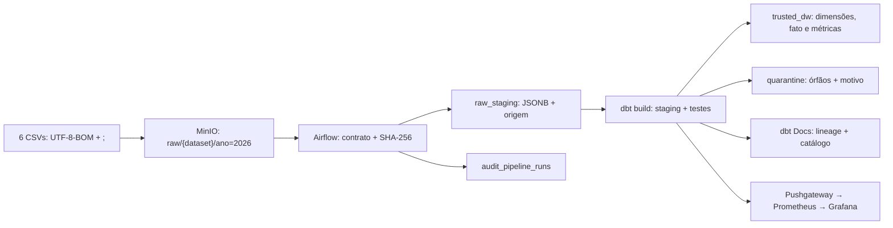
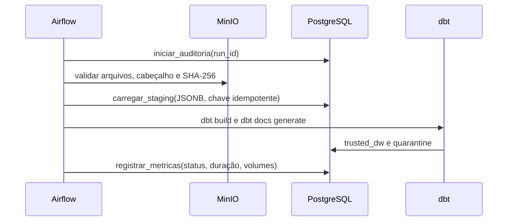

# Pipeline de ingestão raw — Airflow + dbt

> Documento único da entrega: arquitetura, execução, validação, qualidade, resultados e data mapping.

## Resultado da execução validada

| Indicador | Resultado |
|---|---:|
| Fontes / linhas lidas | 6 / 46.148 |
| Bytes de origem | 2.392.090 |
| Respostas trusted | 17.005 |
| Quarentena | 3.690 |
| Reexecução | 0 inserções; 46.148 reprocessadas |
| Testes | 14 Python/integrados e 30 checks dbt aprovados |
| E2E | 18,389 s |
| Smoke/load | 280/280 checks; 0% erro; p95 58,58 ms |

O pipeline lê seis CSVs Sindusfarma (`;`, `UTF-8-BOM`) do object storage, preserva raw, transforma com dbt e entrega dados confiáveis no DW. Órfãos são retidos em quarentena com o motivo, nunca descartados silenciosamente. A evidência persistente é `audit.audit_pipeline_runs`.

## Decisão arquitetural

| Componente | Responsabilidade e motivo |
|---|---|
| MinIO | Object storage local reproduzível, com objetos por dataset/ano. |
| Airflow | Agenda, dependências, retries, logs e auditoria; não contém regra analítica. |
| PostgreSQL | Raw JSONB auditável e schemas separados para staging, trusted, quarentena e auditoria. |
| dbt | SQL versionado, testes, catálogo e lineage; `dbt build` é gate da DAG. |
| Quarentena | Retém inconsistências sem contaminar fatos/dimensões confiáveis. |

Airflow decide **quando** e **em que ordem**; dbt define **como** transformar. O dbt Docs é a referência principal de catálogo, testes e linhagem.

## Arquitetura e fluxo





| Task | Responsabilidade |
|---|---|
| `iniciar_auditoria` | Abre `run_id` e registro operacional. |
| `validar_arquivos` | Valida presença, BOM, delimitador, cabeçalho e checksum. |
| `carregar_staging` | Copia raw JSONB com arquivo, checksum, linha e timestamp. |
| `dbt_build_e_docs` | Executa modelos, testes e gera dbt Docs. |
| `registrar_metricas` | Fecha auditoria e publica métricas. |

Agenda padrão: a cada seis horas; `max_active_runs=1` evita sobreposição local.

## Subir e validar

Pré-requisitos: Docker Desktop (4 GB+) e seis CSVs em `data/`.

```bash
cd pipeline_ingestao_raw
cp .env.example .env
docker compose up --build -d
docker compose exec airflow-scheduler airflow dags trigger ingestao_raw_sindusfarma
```

| Verificação | Onde | Resultado esperado |
|---|---|---|
| Orquestração | `http://localhost:18080`, `airflow` / `airflow`; **DAGs → ingestao_raw_sindusfarma → Grid** | Cinco tasks verdes. |
| Raw | `http://localhost:19001`, `minioadmin` / `minioadmin`; **Object Browser → raw → fonte → ano=2026** | Um objeto por fonte/ano. |
| Lineage | `http://localhost:18081`; pesquise `fato_resposta` e abra **Lineage Graph** | Raw → staging → dimensões → fato, colunas, testes e SQL. |
| Dashboard | `http://localhost:13000`; **Dashboards → Sindusfarma** | Status, duração, quarentena, volume e reprocessamento. |
| Métricas | `http://localhost:19090`; **Graph** ou **Alerts** | Pushgateway ativo e regras de alerta. |

```bash
docker compose exec postgres psql -U warehouse -d warehouse -c "select run_id, status, finished_at-started_at as duracao, metrics from audit.audit_pipeline_runs order by started_at desc;"
docker compose exec -e RUN_PIPELINE_INTEGRATION=1 airflow-scheduler pytest /opt/airflow/tests -q
docker compose exec airflow-scheduler dbt build --project-dir /opt/airflow/dbt
docker compose --profile performance run --rm k6
```

## Dados, modelagem e data mapping

| Camada | Conteúdo e grão |
|---|---|
| `raw_staging` | Linha JSONB; chave `(dataset_name, source_checksum, source_row_number)`. |
| `staging` | Campos padronizados por dbt. |
| `trusted_dw` | Dimensões; `fato_resposta` no grão de uma resposta; métricas no grão de pesquisa. |
| `quarantine` | Órfãos com `rejection_reason`. |
| `audit` | Status, duração, volumes e erro por `run_id`. |

| Fonte | Campos materializados e destino | Retidos somente no raw JSONB |
|---|---|---|
| `clientes.csv` | `id_cliente→cliente_id`, `id_empresa`, `cargo`, `departamento`, `e-mail→email` em `dim_cliente`. | — |
| `empresas.csv` | `ID→empresa_id`, nome, mercado, nacionalidade, associação, cidade, estado e `País→pais` em `dim_empresa`. | — |
| `pesquisas.csv` | `id→pesquisa_id`, título, status, tipo, área, participantes e datas em `dim_pesquisa`; participantes vazio→`NULL`, demais→inteiro. | Mercado, datas auxiliares, complexidade, objetivos, tipo/tempo e indicadores de prazo. |
| `questoes.csv` | `id_pergunta→pergunta_id`, pesquisa, enunciado, tipo e alternativas em `dim_questao`. | Título da pesquisa, matrizes, confiança, formato, origem e observações. |
| `respondentes.csv` | `id_pesq→pesquisa_id`, empresa, cliente e horários em staging; alimenta participação. | `market_share`. |
| `respostas.csv` | `id_resposta→resposta_id`, pesquisa, `id_pergunta→pergunta_id`, empresa, valor e alternativa em `fato_resposta`. | `respondent_id`, matriz linha/coluna. |

Métricas: respostas distintas, respondentes distintos e taxa de participação. Cada cabeçalho é materializado ou explicitamente retido no raw por teste de contrato.

## Qualidade, falhas e reprocessamento

| Evento/gate | Comportamento |
|---|---|
| CSV ausente, BOM/delimitador/cabeçalho inválido | Falha antes da carga, duas tentativas e motivo auditado. |
| Mesmo arquivo novamente | Chave idempotente e `ON CONFLICT DO NOTHING`; nenhuma duplicação. |
| Arquivo corrigido | SHA-256 novo cria versão raw nova e mantém o histórico. |
| Relação obrigatória ausente | Vai para quarentena; dados válidos não sofrem hard fail. |
| Falha de teste/modelo | `dbt build` falha e a DAG não conclui como sucesso. |
| Monitoramento indisponível | Auditoria PostgreSQL segue como evidência primária. |

O padrão aplicado combina contratos, unidade, integração real, `dbt build`, idempotência, reconciliação, falhas e observabilidade. Produção exigiria SLO, volume sintético, RPO/RTO, TLS, cofre de segredos, backup e ambiente distribuído.

## Rastreabilidade da ponderada

> “Cada aluno deverá pensar no módulo de ingestão de forma individual, mas para o projeto, e criar um MR no repositório do seu projeto.”

> “uma arquitetura de ingestão raw não pode ser igual à do colega do mesmo grupo.”

| Critério | Situação | Evidência |
|---|---|---|
| Object storage, CSV `;`/UTF-8-BOM e camadas | Atendido | Arquitetura, parser e dbt Docs. |
| Métricas, volume, tempo, falha, duplicidade, nulos e schema | Atendido | Auditoria, testes dbt, Prometheus e Grafana. |
| ELT idempotente, erros e reprocessamento | Atendido localmente | SHA-256, chave por linha, retries e quarentena. |
| Design, dependências, trigger e subida em um comando | Atendido | Diagramas e `docker compose up --build -d`. |
| Desempenho, volumetria, gargalo e órfãos | Atendido | Resultado, auditoria, smoke/load e quarentena. |
| Artefato 1: auditoria/rastreabilidade e qualidade técnica | Atendido no fluxo; controles corporativos são externos. | `audit`, contratos, testes e monitoramento. |
| Artefato 2: grão, origem→DW, transformação, joins e deduplicação | Atendido | Seção de dados/modelagem e modelos dbt. |

Branch individual: `feature/ingestao-raw-airflow-dbt`, destinada a `develop`.

## Operação local

```bash
# Regenerar dbt Docs
docker compose exec airflow-scheduler dbt docs generate --project-dir /opt/airflow/dbt

# Apagar bancos/buckets desta demonstração local
docker compose down --volumes
```

O último comando não apaga CSVs de referência, mas não deve ser usado em ambiente compartilhado.
